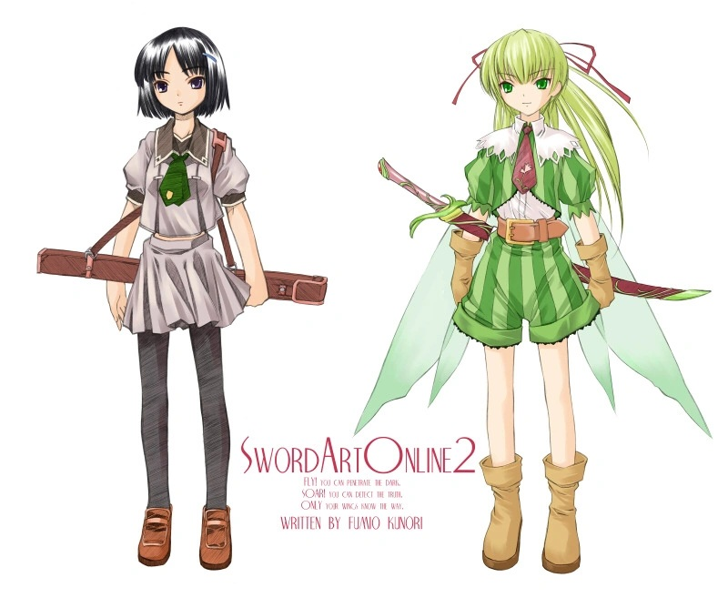

# Sword Art Online 2: 妖精之舞

## 序章　2014年·秋

&emsp;

　　三颗深蓝色的亮点，像一个小小的星座般排列着。

　　直叶【Suguha】轻轻伸出右手的手指，试着触碰那光芒。

　　那是显示NerveGear运转状态的LED指示灯。安放在头盔前缘部的设备，从右开始依次监视主电源、WAN连接、大脑连接的状态。左端的光点若是变成红色的话——那就意味着该使用者的大脑已被破坏。

　　头戴这设备的人，就躺在灰白色病房中央宽大的凝胶床上，陷入无法苏醒的沉睡。不，这种说法并不准确。实际上，他的灵魂正在遥远的异世界里日夜奋战——为了解放自己。

　　「哥哥……」

　　直叶轻声呼唤着沉睡的哥哥和人。

　　「已经两年了……我马上要上高中了哦……如果你还不回来的话，我可要超过你了哟……」

　　再次伸出手指，描摹哥哥脸部的轮廓。长时间昏睡让他消瘦了许多，那削薄的脸部线条，让原本就给人中性印象的和人侧脸更添了几分少女般的阴影。母亲甚至开玩笑地叫他「我们家的睡美人」。

　　消瘦的不只是脸颊，全身都是如此，和从小就练习剑道的直叶相比，现在体重明显轻了许多。会不会就这样消失不见……最近，直叶的心中出现了这种恐怖的念头。

　　但，直叶从一年前开始就一直忍耐着，忍耐着哭泣。那时，总务省「SAO救援对策本部」的组员告诉了她这件事——在那个游戏内，哥哥和人的「等级」处于仅占全体玩家数百分之几的顶尖位置，是个经常奋战在危险的最前线的少有的攻略玩家之一。

　　哥哥现在肯定也还在与死亡相邻的战场上战斗吧。正因为如此，直叶才不能哭。她握住哥哥的手，想要支援他。

　　「加油……加油，哥哥。」

　　和以往一样，她用自己双手包裹住和人骨瘦如柴的右手，并很努力地祈祷着，此时身后传来了声音。

　　「啊，你来了啊，直叶。」

　　直叶慌忙转身过去。

　　「啊，妈妈……」

　　站在那里的正是直叶与和人的妈妈翠【Midori】。病房的推拉门由于采用电动驱动，开合的声音极其的安静，以至于让直叶都没有听到。

　　翠把手中的大波斯菊插在床头的花瓶里，坐到直叶旁边的椅子上。她大概是刚从公司回来，身穿棉质衬衫和修身牛仔裤，外面套着一件皮革短夹克。淡妆，头发随意地在脑后束起，这种样子一点也不像明年就要四十岁的女性。大概是因为工作性质是电脑信息杂志的主编吧，她本人似乎暂时没有要收敛成符合年龄的稳重样子的打算，在直叶看来，翠与其说是母亲，不如说更像姐姐。

　　「妈妈才是，怎么来这里了。还在校对前吧？」

　　直叶说完，翠笑了。

　　「我把工作放在一边就出来了。以前很少来这里，今天想来看看。」

　　「这样啊……今天是哥哥的……生日啊。」

　　一时间两人停止了言语，同时望向病床上躺着的和人。夕阳下，风吹进病房，吹起窗帘，带着些许大波斯菊的香气。

　　「和人……已经十六岁了啊……」

　　翠低声自语。

　　「……是个好机会，我有话要对你说，直叶。」

　　翠一改往日的语气，这让直叶歪起了头，望向身旁。

　　「……什么？」

　　「和人啊……不是我亲生的孩子。」

　　「诶……？」

　　母亲究竟在说些什么啊，直叶一时间没有反应过来。

　　「那，那个……是什么意思……？」

　　「你也知道我有个姐姐吧……？」

　　「嗯……好像是在车祸中……去世了吧……」

　　「和人啊，是我姐姐的孩子。奇迹的是……只有他一人活了下来。那时他的父母……还有直叶的爷爷，奶奶也都过世了……我和研介【Kensuke】商量过后，就收养了他……因此，和人应该是直叶你的表哥……」

　　「……怎……怎么可能……」

　　直叶呆呆的看着翠的脸。思绪如同漩涡一般，什么也无法思考。

　　「……哥哥知道吗……？」

　　好不容易才问出这一句，翠缓缓地摇了摇头。

　　「我本想在和人上高中后，再对你们说出这件事的……可没想到会发生这样的事……抱歉，直叶……」

　　一向坚强的翠少见地垂下眼帘，站了起来。

　　「……那，我就回公司了……不要太晚才回来哟。」

　　用手摸了摸直叶的头，翠离开了病房。随着一声轻微的马达声，门关上了，房间再次被寂静所笼罩。

　　直叶摆在双膝上的手紧握起来，睁大眼睛看着和人的脸。全身像发烧般轻飘飘的，没有着落，但只有那心脏的跳动声变得越发的响亮。

　　白色窗帘彼端摇曳的金色光芒，不久变成深红，又转为紫色，直到病房被薄暗笼罩时，直叶仍留在那里。她一动不动，一直倾听着和人细微的呼吸。

&emsp;

[Main](../index.md) [Next](sao2-01.md)
