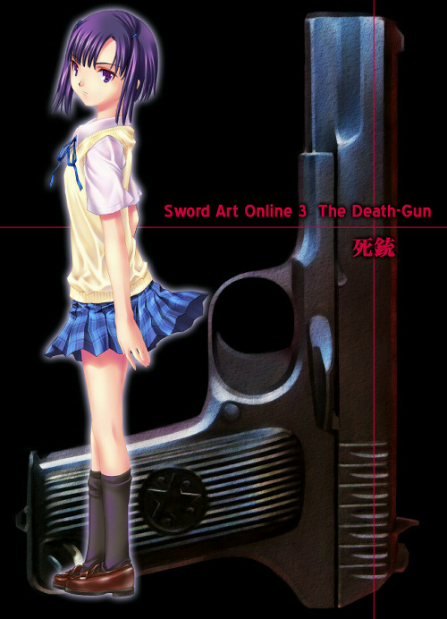

# Sword Art Online 3: 死枪

## 序章　2015年・冬

&emsp;

　　『所以说啊，所谓的AGI万能论，归根到底，只是幻想的东西罢了。』

　　高亢的男声在宽阔的酒馆里回荡。

　　『的确，AGI是很重要的属性。速射与回避，只要这两项能力突出，就足以成为强者。至少在过去是这样。』

　　得意洋洋地说着话的那人，就是投影在昏暗的店内的正中央高高悬挂着的四面屏幕里的那个选手。

　　网络电台《MMO Flash》的人气环节——《人生赢家请进》。在现实的世界里，也能通过电脑访问流媒体网站观看，在无数个VRMMO世界内的旅馆和酒吧也是现场直播的，但玩家们还是喜欢在游戏中观看。

　　更何况，做客嘉宾本身就是「那个世界」的居民，就更不用说了。

　　『但是，那已经是过去的事情啦！对那些花了八个月把AGI猛堆上去的废柴们，我只能说一句——节哀顺变。』

　　那损人的口气，让店内处处都涌起了不满的声音，好几个酒瓶和玻璃杯被摔在地上，碎片四散后随即消失。

　　但是，「他」完全没有理会那个骚动，只是在店内最里面的沙发上，把自己卷成一团。

　　他从深戴的迷彩斗篷兜帽与遮住下半张脸的厚布缝隙间，用冰冷的视线扫视店内。

　　虽然很讨厌电视画面里的那个洋洋得意的男人，但那些一脸蠢相盯着电视的玩家，也让他感到不快。在场的所有人，发出的忿忿不平的声音，仿佛他们是在祭典般享乐一样。

　　为什么会那么轻浮呢？「他」完全不能了解。电视里的男人，只是很靠运气得到了世界最强的地位，同时也成为了最大的榨取者。把大部分玩家支付的连接费捞进自己口袋，摆出一副专业玩家的样子。

　　所有玩家应该都和「他」一样，心里非常嫉妒和憎恨那名男子。如果说那种感情是丑陋的，那么把这种感情隐藏起来，用表面的笑容掩饰，不是又丑陋又滑稽吗。

　　「他」的斗篷下面，全身僵硬，咬得紧紧的牙关间，微微地吐着气。现在还不是时候。等一下才是扣扳机的最佳时间。

　　视线回归到全息屏幕上，镜头拉远，把坐在男人右边的主持人和左边另一位嘉宾收进画面。

　　作为主持人的那个少女，以一身电子音乐人般的衣服，用如同动画中的甜美的声音说着。

　　『不愧是号称全VRMMO中最硬核的《Gun Gale Online》顶尖玩家，说话真够刺激呢。』

　　『哎呀，被《MMO Flash》叫来可能一生只有一次，所以想把想说的话一次说个够。』

　　『你真会开玩笑，你不是瞄准了这次的《Bullet of Bullets》的冠军了吗？』

　　『那当然啦，出场当然是以冠军为目标啦。』

　　男人撩起华丽的银色长发，无畏地对着镜头说着。再次让店内掀起暴风雨般的骚动。

　　《MMO Flash》虽然不是《Gun Gale Online》——通称GGO——的内部内容，但出演者不管是主持还是嘉宾，都不是真身，而是虚拟身体。《人生赢家请进》每周从各种VRMMO邀请顶尖玩家来做访谈，这一星期的嘉宾就是GGO在上个月举行的最强者决定大逃杀，通称《Bullet of Bullets》的冠军和亚军。

　　『但是呢，泽克西特【XeXeeD】先生。』

　　听着银色长发的男人傲慢的言语的亚军，再也忍不住开口了。

　　『BoB是单人遭遇战吧。再打一次也不能保证同样结果。把它说成是属性类型的胜利，这样不太好吧？』

　　『不是这样的，这次的结果可以说是整个GGO的倾向的表现。暗风【Yamikaze】先生是AGI型的玩家，所以我也明白你想要反对的心情。』

　　被称为泽克西特的那位冠军立刻回复道：

　　『……到目前为止确实如此，AGI不断提高，快速发出强大的实弹武器这种能力是称得上最强的类型。同时它的回避的能力也在增强，持久力不稳定这个缺点也等到了补充。但是MMO和单机游戏不同，它能不断改变其平衡走向。尤其是等级型，无法重新分配属性点，所以必须时刻预测未来，谨慎分配点数。在这个等级区间里最强的风格，未必在下一个区间也最强，这一点你想想就知道。以后出现的武器，装备要求的STR，命中精度也会不断提升。靠不停闪避就想毫发无伤地撑过去，这种天真想法不可能一直行得通。我和暗风先生的战斗就是那个象征。你的枪被我的防护力场大幅削弱了威力，相反地，我射击的命中率达到七成。坦白说，今后将是STR-VIT型的时代了。』

　　被连珠炮般反驳后，那个叫暗风的粗犷男人不甘地扭曲了脸。

　　『……但是，那是泽克西特在BoB前弄到刚好满足STR要求的稀有枪的结果吧，究竟花了多少钱啊，那个东西？』

　　『真是令人讨厌啊，当然是靠自己刷出来的，也就是说，最重要因素或许就是现实世界中的幸运值吧，哈哈哈哈。』

　　「他」一边用怨恨的眼光盯着在全息屏幕里笑着的那个银发男人，一边在斗篷下动了动手。摸到了插在腰间的枪套处的握把，紧紧握住。快了——快了，时机要来到了。用余光确认了下时间。还有一分二十秒。

　　坐在「他」的旁边桌子的那两个人，一边大口大口地喝着啤酒，一边发着牢骚。

　　「哼，净说些废话，以前说AGI是最强的型号的那人不就是泽克西特那家伙自己吗？」

　　「现在看来，那简直就是误导潮流的阴谋啊……。真的是被骗得很惨啊……」

　　「话说回来，说那个STR-VIT是最强的那话也是假的吗？」

　　「那真正最强的会是什么啊？难道是提升LUK吗？」

　　「你去做啊。」

　　「我才不要。」

　　两人呵呵地笑了。那笑声让「他」的怒火更加强烈起来。既然知道被骗了，为什么还可以那样地笑出来啊，真的难以理解。

　　——不过，那愚蠢的笑声很快就会凝固。只要亲眼看到真正的力量、真正的最强者。

　　是时候了。

　　「他」无声地站了起来，一步一步穿过桌子间的走道。谁也没有留意他。

　　愚蠢的人们啊……，你们应该要感到害怕。

　　「他」自言自语，站立在酒吧的中间，屏幕的正下方。他甩开斗篷，同时从枪套里拔出一把大型手枪。

　　枪身涂成哑光漆黑，仿佛凝聚了黑暗本身；略粗的枪管上有一道深红色纹路。外表看来，像是没什么威力，随处可见的定制枪而已。但是，这把枪拥有「真正的力量」。「他」慢慢地把枪口转向天空，对准那巨大的屏幕。瞄准在那里面笑着，最强玩家泽克西特的额头。

　　「他」保持着那个姿势片刻，不一会儿，周围就涌起了奇怪的骚动。虽然GGO不限制PK，但在城区中还是不能互相厮杀。即使可以发射弹药，别说对玩家造成伤害了，连物品都无法破坏。

　　「他」那毫无意义的动作，让好几个人失笑。但「他」纹丝不动，继续举着黑色的枪。

　　屏幕里的泽克西特还在继续进行着那令人不快的发言。因为泽克西特的真实躯体躺在现实世界里的某个地方，并从那里连接到《MMO Flash》虚拟演播室。而且这里是在《Gun Gale Online》世界首都格洛肯【Glocken】的中央街的一个酒吧内，所以泽克西特根本不可能知道在电视上的自己已经被人用枪指着了。

　　但是，「他」开口了，用他所能的最大的声音吼了出来。

　　「泽克西特！你这个虚伪的胜利者。现在就是你接受真正的力量的制裁的时候了！！——去死吧！！」

　　在惊呆的玩家们注视下，「他」扣下了扳机。

　　瞬间，枪身的轮廓闪现出深红的光泽，同时绯红色的光弹被发射了出去。咻砰！发出沉闷的炸裂声。 深红色的光束在昏暗的酒吧中径直飞过——击中了屏幕的表面，散发出点点光影特效。

　　但也只是这样。画面和原先一样，泽克西特仍然在那里口若悬河地说着。

　　这一次，店内真的涌起了嘲笑的声音。「哎哟哟」「搞砸了」之类的声音传了出来。但泽克西特的声音最后还是掩盖了店内的嘲笑声，流淌出来。

　　『……所以说呢，数值以及技能的选择也包括在内，但最终来说玩家的强大，资质……』

　　他的声音突然间中断了。

　　店内客人的视线也回到了屏幕上。

　　只见泽克西特嘴大张着，眼睁得圆圆的，整个人僵硬了。他的手缓慢地抬起来，抓住自己的胸口。

　　很快，他的身影就消失了。主持人这时候才开始慌慌张张地说：

　　『啊，信号好像断了。不过这个应该很快就可以恢复的，大家不要走开喔……』

　　但是，店里面谁也没有留心主持人的话。死寂中，大家的视线再次聚集到「他」的身上。

　　「他」把对着屏幕的枪收了回来，放回水平位置。然后慢慢转过身，用如同射线般的视线扫了下店内的玩家。

　　转过身后，「他」再次把黑色的枪高高地举起来，吼叫道：

　　「……这才是真正的力量，真正的强大！愚蠢的家伙，把这个名字和恐怖连在一起，刻在脑海里吧——」

　　『我，和这把枪的名字就是《死枪》……《Death-Gun》！！』

　　「他」把枪收到枪套里，摆动左手调出菜单。

　　按下登出按钮的「他」品味着胜利感，以及比之更强烈的灼热饥渴。

&emsp;

[Main](../index.md) [Next](sao3-01.md)
