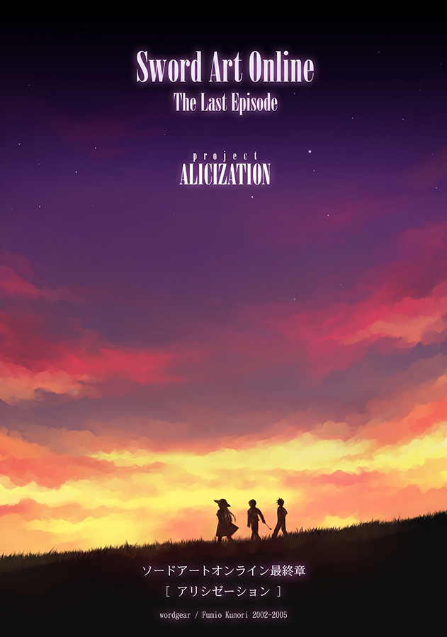

# Sword Art Online 4: Alicization

## 第一章

### 1

&emsp;

　　用力握紧。

　　扬起。

　　砸下。

　　明明只是这样简单的动作，但只要稍一分神，斧头就会砍偏，坚硬的木质震得两条胳膊生疼。呼吸、时机、速度、身体重心的移动，只有完美控制这些，藏在沉重斧刃中的力量才能全部传到树上，发出响亮清澈的美妙声音。

　　可是，即使脑袋里理解了，也无法完全实践出来。优吉欧【Eugeo】在十岁的春天得到这份工作后已经迎来了第二个夏天，可是那种会心的一挥，十次里也不知能不能有一回。教他挥斧方法的前任加里塔【Garitta】爷爷可以百发百中，巨大的伐木斧无论挥多少次也没有疲惫的样子。可优吉欧不过挥五十次就会两手发麻，肩膀酸痛，抬不起胳膊。

　　「四十……三！四十……四！」

　　像鞭策自己似的，一边尽力大声数着数，一边用斧头砍着树干。可是流出的汗模糊了眼睛、让手心打滑，命中率眼看着下降。带着几分自暴自弃，抡起握紧的伐木斧，连人带斧一起甩。

　　「四十……九！五……十……！！」

　　最后那一击准头大乱，远远偏离刻在树干上的斧痕砸在树皮上，发出刺耳的金属声。那股震得他眼冒金星的反弹力让他吃不消，优吉欧失手丢下斧子，晃晃悠悠地退了几步，一头倒在厚苔上。

　　在他呼哧呼哧喘着粗气的时候，在旁边一段距离同样躺着的少年转过脸来，嘿嘿笑了。

　　「发出好声音的在五十次里有三次。全部加起来，那个，四十一次吗。看来今天的希拉尔【Siral】水该你请客啦，优吉欧。」

　　优吉欧就那样躺着，摸索着抓起水壶，把已经变温的水咕噜咕噜地倒入口中后，才终于缓过气来。然后他哼了一声回答：

　　「哼，你不也只有四十三次吗。还说不准呢。喏，该你了……桐人。」

　　「是是。」

　　优吉欧的童年玩伴、同时也是最好的朋友，从一年前开始跟他一起干这份忧郁的工作的桐人，在把被汗浸透的黑发从额前甩开后，一下举起双脚，嘿咻一下坐起身来。但他并没有马上去捡起斧头，而是把手叉在腰间仰起了头。被他的视线所牵引，优吉欧也跟着把视线投往空中。

　　七月才刚过一半的夏空蓝得令人瞠目，而正中间的太阳神索尔斯【Solus】毫不留情地发出刺眼的光芒。但是，向四面八方伸展的大树枝条上密密麻麻的树叶贪婪地遮蔽了阳光，几乎没有多少光线能射到优吉欧他们所处的树根位置。

　　就在他们这么躺着的时间里，大树依然以树叶如饥似渴地吸收着太阳神的恩惠，同时一刻不停地以根部吸收着地神泰拉里亚【Terraria】的恩宠，应该正一点点把优吉欧和桐人刻上的斧伤复原吧。就算他们两人在白天怎么努力，休息一晚，第二天早上再来这里的时候，大树受的伤都能恢复个七成。

　　优吉欧呼地叹息了一声，把视线从天空转回到树上。

　　大树——村民之间称呼为《巨人之树》，也叫《基加斯西达【Gigas Cedar】》。树干直径有四Mel，到顶端枝头足有七十Mel高，是名副其实的怪物。村里最高的教堂钟楼也只有它的四分之一左右；对今年才终于长到超过一点五Mel的优吉欧和桐人来说，它简直如同古代巨神般的对手。

　　说到底，以人类的力量想砍倒这东西，真不是痴人说梦吗——每当看向树干上的斧痕，优吉欧总会这么想。楔形缺口虽然勉强达到一Mel深，树干仍有它三倍的厚度，完好如初。

　　去年春天，跟桐人一起被带到村长家，被分配了《巨树的刻痕手》这个职责时，优吉欧听到了一番让他几乎发晕的话。大树基加斯西达在两人生活的露莉德【Rulid】村开辟之前很久就已扎根于此，从最早的移民时代起，村人就一直不停地用斧头砍它。从初代刻痕手数下来，前任加里塔爷爷是第五代，优吉欧和桐人是第六代；到如今，已经耗费了三百多年。

　　三百年！这是刚迎来十岁生日的优吉欧根本无法想象的时间。理所当然地，到十一岁的现在也依然无法想象。想破脑袋之后能理解到的是，从优吉欧父母的时代，往上到祖父母的时代，往上、再往上的那个时代开始，刻痕手们就挥动了可以说是无数次的斧头，而得到的成果，就是这不到一Mel的刻痕。他理解到的就只有这点。

　　为什么付出如此无谓的努力也非要砍倒这棵树呢——村长也曾一本正经地讲过其中的理由。

　　基加斯西达由于那巨大的身体和过于旺盛的生命力，从周围极其广阔的范围内夺去了太阳神和地神的恩惠。在被大树影子笼罩的土地里，不管种下什么都不会有所收成。

　　这片位于神圣帝国北方边境、三面被险峻山脊环绕的露莉德村，想扩展田地或牧场，就只能开拓南边的森林；可入口处却被基加斯西达挡住了。不先想办法对付这个麻烦的家伙，村子就不可能继续发展。大树的皮如钢铁，木质甚至有红铜般的硬度，用火烧连烟都不会冒，想连根挖起，根又会深到与树梢同高。因此，我们必须用开村先祖留下的、连铁都能斩断的龙骨之斧在树干上刻削，再把这份职责传给下一代——

　　在村长用那或许因为使命感太强而发颤的声音说完这些话后，首先战战兢兢地发问的是优吉欧。那索性放着基加斯西达不管，去开拓更南边的森林不就好了吗，他如此问道。村长用可怕的语气回答说，砍倒这棵树是先祖代代传下来的夙愿，将这重任交托给两名刻痕手是村子的惯例。然后桐人歪着头问，说起来先祖们为什么要在这种地方开拓出村子呢？村长先是一时语塞，然后爆发出了火一般的怒气，用杖头在桐人连带着优吉欧的头上咚地敲了一下。

　　在那之后的一年又三个月，两个人就这样轮流握着龙骨之斧，向基加斯西达发起挑战。但是，也许是因为挥动斧头的手法还不熟练吧，大树树干上的刻痕再怎么看也不觉得有加深多少。到此为止的刻痕可是花了三百年添上的，两个孩子花上仅仅一年的时间也不会有多少变化，这要说的话也是理所当然的，但作为工作还是相当没有成就感。

　　不——只要想的话，他完全可以不只凭外观判断，而是用更准确的方法去确认那令人沮丧的事实。

　　站在优吉欧旁边，一言不发地瞪着基加斯西达的桐人似乎也在想着同一件事。他快速地走到树干前边，直直地伸出左手。

　　「喂，住手吧桐人。不要胡乱窥探大树的《天命》，村长不是这么说过吗？」

　　但桐人稍微回过头来，露出一如往常的恶作剧般的笑脸，若无其事地回答道：

　　「上次看已经是两个月前了吧。这不是『胡乱』而是『偶尔』啊。」

　　「真是的，说不过你啊。……喂，等等，我也要看。」

　　优吉欧像桐人那样高举双脚，靠反作用力把疲劳终于退去的身体撑起来，跑到伙伴身边去。

　　「那么，我要打开咯。」

　　桐人压低声音说着，伸出左手的食指和中指，其余手指握起，在空中画出如爬行之蛇的轨迹。那是献给生命神的最初级的咒印。

　　画好咒印之后，桐人立刻敲向基加斯西达的树干。接着响起的不是本应发出的干哑敲击音，而是轻弹银制品时会响起的清澈声音。然后，像是从树干内部浮起来一样，一个小小的矩形发光窗口出现了。

　　存在于这片天地的所有事物，无论能动与否，都拥有司掌生命的原初之神丝提西亚【Stacia】赐予的《天命》。虫和花草只有一点点，猫和马则多得多，人类又拥有比它们更多的天命。森林里的树、覆满青苔的岩石，又有着比人多好几倍的天命。所有天命都遵循同一规律：从诞生起持续增加，到某一时刻达到顶点，再慢慢减少。天命耗尽时，无论野兽还是人类都会停止呼吸，草木枯萎，岩石粉碎。

　　用古代神圣文字记载天命的，正是这《丝提西亚之窗》。拥有相应魔力的人完成咒印并敲击对象，就能唤出它。石头、草这类东西的《窗口》几乎任何人都能看见；野兽则稍难；至于人的《窗口》，若没有足以修习初等魔术的力量，就无法唤出。一般来说，树木的窗口比人的容易看见，但被称为古代树的基加斯西达难度果然很高，优吉欧和桐人也是到半年前左右才能唤出窗口。

　　虽然只是传闻，过去央都的帝立魔导院有一个得到大导师地位的术师，经过长达七天七夜的仪式之后，成功唤出了大地——也就是地神泰拉里亚本体的《窗口》。但是，在看了一眼大地的天命之后术师陷入了恐慌，随后失去理智，不知消失到何处去了。

　　在听说了这故事之后，优吉欧在看包括基加斯西达在内的巨大物体的窗时都多少有些恐惧，但桐人则完全不在意。现在也是如此，兴冲冲地把脸靠近浮上来的光窗。就算是童年玩伴兼挚友，有时也真跟不上他；虽然优吉欧这么想着，但最后还是败给了好奇心，也在一旁看向光窗。

　　发出淡淡紫色的矩形窗口上，有着直线跟曲线组合而成的奇妙的数字。对于上边记载的古代神圣文字，优吉欧只能认出数字的部分，而书写这种文字则被严格禁止。

　　「我看看……」

　　优吉欧用手指一个个点着，把数字读了出来。

　　「二十三万……五千五百四十二。」

　　「嗯——……上上个月是多少来着？」

　　「我记得是……二十三万五千五百九十左右吧。」

　　「……」

　　听到优吉欧的话，桐人夸张地举起双手作投降状，马上又颓然跪在树根上。然后他用手抓着自己的黑发说：

　　「只有五十！花了两个月才这么点，二十三万有余只减了五十！这不是花上一辈子也砍不倒吗！」

　　「这个嘛，早跟你说过那不可能啦。」

　　优吉欧也只能苦笑以对了。

　　「我们之前的五代刻痕手花了三百年的努力，才仅仅去到四分之一左右啊……。这么算的话，嗯，再过十五代、九百年左右才能砍下来吧。」

　　「你—这—人—啊～」

　　抱着头蹲坐在地上的桐人狠狠地瞪了一下优吉欧，然后突然紧紧缠抱住他的双腿。被袭击的优吉欧马上就失去了平衡，后背重重摔在青苔上。

　　「干嘛像个优等生那样说话啊！再为这无理之极的任务想想办法、烦恼下啊！」

　　虽然嘴上说些像是在生气的话，但桐人本人却是满面笑嘻嘻地骑在优吉欧身上，伸手在他头上胡乱揉着。

　　「喂，你在干什么啊！」

　　优吉欧也用上双手抓住桐人的手腕，使劲往回拉。然后借桐人绷紧身体抵抗的力量，优吉欧猛地垂直翻转半圈，这次自己到了上面。

　　「看我的，报复来啦！」

　　他带着笑喊道，用脏手去扯桐人的头发。但比起亚麻色平顺头发的优吉欧来说，这种攻击对桐人那黑色竖立着的头发没多大意义。没办法之下优吉欧只好把目标换成腰间，改用胳肢攻击。

　　「呜哈……你……这、这太卑鄙……」

　　优吉欧按住因为呼吸困难而挣扎的桐人，正继续挠他时，背后冷不防袭来一声尖锐的高喊。

　　「喂！又在偷懒了吧！！」

　　听到这叫声的瞬间，优吉欧跟桐人马上停止了动作。

　　「呜……」

　　「糟了……」

　　两人都缩了缩脖子，畏畏缩缩地把头转了过去。认出稍远岩石上那个双手叉在白围裙腰间、挺胸看着这边的人影后，优吉欧露出抽搐一样的笑容回话说：

　　「哟……哟，爱丽丝【Alice】。今天还真早呢。」

　　「一点也不早了，一直以来都是这个时间吧。」

　　冷淡地把脸一扬的时候，在头两侧扎起的微卷发散出了耀眼的金色光泽。用灵敏的动作翻下岩石的，是个穿着青色连衣裙和白色围裙的少女。她的右手提着一个大大的篮子。

　　少女的名字是爱丽丝。露莉德村村长的女儿，年龄和优吉欧、桐人一样是十一岁。

> rkl：此处原文作「村长的孙女」，下文又作「村长的女儿」，按「村长的女儿」统一。

　　露莉德——不，是北部边境地区生活的所有孩子，在十岁那年的春天都会被授予《天职》，开始从事见习工作，但爱丽丝是少数例外，继续在教会学校就读。为了培养她那被视为全村孩子中最出众的神圣魔法才能，她正接受阿扎莉娅【Azalia】修女的个人指导。

　　说是这么说，就算拥有天赋之才，又是村长的女儿，但要让一个十一岁的女孩一天到晚只学习不干活——露莉德村还没富裕到这程度。能工作的人都得工作。干旱、连绵阴雨、虫害——也就是暗之神贝库塔【Vecta】的恶作剧——不断夺走作物与家畜的天命，若不想办法抵挡，很难让所有村民都平安度过严冬。

　　优吉欧家在南边开垦地有一片颇大的麦田。身为次子的优吉欧被选为基加斯西达的刻痕手，身为地道农夫的双亲嘴上虽为此高兴，心里却似乎有些遗憾。刻痕手的报酬会由村金库支付给家里，但下田干活的人终究少了一个。

　　按照习俗，各家的长子必定会被赋予与父亲相同的天职；农家的话，女儿、次子、三子也以此为准。道具店的孩子继承道具店，卫士的孩子当卫士，而村长一职由村长的孩子继承。露莉德村遵从这一习俗，自开拓以来数百年几乎维持原状。大人们说，能维持现状正是丝提西亚护佑的恩赐，但优吉欧对此有时会感到一种难以言说的、极轻微的违和感。

　　到底大人们是不是真心想让村子发展起来呢，还是说他们只希望维持现状一点都不加以改变呢？就是这一点让他想不通。真的想扩展田地的话，那就应该放着这麻烦的树不管，就算绕点远路也应该往再南一点的森林开垦，这样就可以了。但是，就连村子里最聪明的村长，也是从来没想过去改变代代传下来的各种惯例。

> rkl：这本质上就是11区千年来社会形态的具象化了。

　　因此，露莉德村不管经过多少世代都依然被贫困所苦。身为村长女儿的爱丽丝能专心学习的只有上午时段，下午也必须忙着照顾家畜跟打扫家里卫生。而她首先要做的工作，就是为优吉欧跟桐人送来午饭。

　　爱丽丝用碧玉般的眼眸狠狠瞪向青苔上停下扭打的那两人，然后右臂仍挂着篮子，双手叉腰，挺起胸膛。在她那张小嘴哈地吸了口气、眼看一声响雷就要从那小嘴里炸响之际，优吉欧用最快的速度撑起身子，摇起头来。

　　「没在偷懒没在偷懒！规定要在上午做好的分量都好好地完成了！」

　　他快速地辩解着，身后的桐人也「对对」地圆滑附和着。

　　爱丽丝又用锐利的眼神瞪了两人一眼，然后才露出没办法的样子放松表情说道：

　　「既然你们在完成任务之后还有气力来打架，那我是不是跟加里塔爷爷建议说增加挥斧次数比较好呢？」

　　「别、别这样啊！只有这个千万不要！」

　　「开玩笑的啦。——好了，快点吃午饭吧。今天天气很热，得快点在变质之前吃掉。」

　　爱丽丝把篮子放到地上，然后从里边拿出一块大大的白布，啪地一下扬了开来。她刚在选好的平地铺好白布，桐人就像是等不及一样脱下鞋子扑了上去。接着优吉欧坐下后，她才在两位饥肠辘辘的劳动者面前一一摆好食物。

　　今天的菜单是腌肉和炖豆做馅的派、用薄黑面包夹着芝士和酸黄瓜的三明治、几种干果，还有早上刚挤出来的牛奶。虽然除了牛奶都是能够存放挺长时间的食物，但在挥洒而下的七月阳光面前，食物的《天命》恐怕也被毫不留情地夺去了不少。

　　像是制止小狗那样，爱丽丝把手伸在打算抓向食物的桐人和优吉欧面前。她快速地在空中划出咒印，先确认装着牛奶的陶壶的《窗口》，然后一个个地确认其他食物的《窗口》。

　　「呃，牛奶只剩十分钟，派也只能坚持十五分钟了。明明都跑着来了啊。——就是这样，抓紧时间吃掉它们吧。不过也别忘了好好咀嚼哦。」

　　天命耗尽的料理会变成《变质的料理》，只要吃上一口，除非有副相当强健的胃，否则立刻就会腹痛或出现其他症状。优吉欧和桐人连「我开动了」都等不及，就拿起大块的派咬了下去。

　　接下来的一段时间，三个人默默地嚼了一阵子。饥肠辘辘的两个少年自然不用说，就连爱丽丝也发挥了让人纳闷那么纤细的肚子怎么装得下的惊人食量，食物一样样被解决掉。最先被吃光的是六块派，九个三明治也随着一壶牛奶进入腹中，然后三人都心满意足地舒了一口气。

　　「——味道怎么样呢？」

　　爱丽丝斜眼瞥着这边，低声这么说。优吉欧忍着笑出来的冲动回答说：

　　「嗯，今天的派很好吃。爱丽丝的厨艺也进步了很多呢。」

　　「是、是这样吗。我总觉得还差一味啦……」

　　趁着爱丽丝因害羞转过头去的空档，优吉欧和桐人对了个眼神，确认了彼此眼中的笑意。从上个月开始，爱丽丝便负责两人的便当。虽然对外这么宣称，但实际上有她母亲萨蒂娜【Sadina】帮忙时和没帮忙时的差别实在太明显了。不管怎么说，技术这种东西不经过长年锻炼是学不会的——事实虽然如此，但现在的优吉欧和桐人总算学会了识趣地不把这话说出口。

　　「不过啊——」

　　桐人从装着干果的篮子里拿起一个黄色的马利哥【marigo】果实，说：

　　「难得准备了这么好吃的便当，还是想慢慢地享受啊。为什么一热起来便当就变质得这么快呢……」

　　「你说为什么……」

　　这次优吉欧并没藏起自己的苦笑，而是夸张地耸了耸肩。

　　「你还真是会说些怪话啊。夏天时什么东西的天命都会减得很快吧。肉也好，鱼也好，蔬菜和果实也是，只要就那么搁着，很快就会坏掉啊。」

　　「所以我想说的就是，为什么会这么样啊。冬天的话，就算把生火腿扔到外边，都还能坚持好几天不是吗。」

　　「这个嘛……是因为冬天很冷啊。」

　　听见优吉欧的回答之后，桐人像是不懂事的孩子一样歪起嘴来。他那在北部边境很罕见的黑眼睛里，似乎闪过一丝挑战般的光芒。

　　「对啊，就像优吉欧说的，食物能放得久是因为冷，不是因为冬天。那么……只要弄出冷的环境，就算是这个时期便当也能放很久吧。」

　　优吉欧这次是真的无话可说了，于是他用脚尖向桐人的小腿踢了一下。

　　「说得倒是简单。弄出冷的环境什么的，夏天就是因为热才叫夏天的啊。你是打算用被禁止了的古老术式降下雪来吗？第二天就会有央都的整合骑士来抓你去处刑了吧。」

　　「嗯、嗯……就没什么办法吗……什么好的办法……」

　　桐人皱起眉头低声嘟囔着时——直到刚才都只是听着两人对话的爱丽丝，用手指绕着长辫子的辫梢，插了进来：

　　「听起来挺有趣嘛。」

　　「说、说什么傻话啊，连爱丽丝也这样……」

　　「我又没有打算去用禁术什么的。用不着夸张到把整个村子都变冷吧，比如说，只把这个装便当的篮子里边变冷不就好了？」

　　听到这番仿佛理所当然的话后，优吉欧跟桐人才对上双眼，然后同时点了点头。爱丽丝露出一个胸有成竹的笑脸，继续开口说：

　　「夏天也有冰凉的，有那么几种。比如深井里的水，还有希尔贝【silve】的叶子。把那些一起放进篮子里，里面不就会变冷了吗？」

　　「哦……这样啊……」

　　优吉欧双手抱胸，开始思考。

　　教会前广场的正中央，有一口露莉德村建立时挖的深得可怕的井，从那里提上来的水即使夏天也冷得刺痛。北方山谷只长着几棵希尔贝树，叶子摘下后会一边散发刺鼻的香气，一边变凉，对治疗跌打肿痛很有用。这么说来，把深井水装进壶里，或用希尔贝叶把派包起来，送便当的路上应该就能保住凉意吧。

　　但是，同样想了一会的桐人却摇了摇头，然后开口否决。

　　「只是这样的话还是不成。井水提上来一分钟左右就会变温了，希尔贝的叶片也只是让人凉一下的程度而已。不管哪个，都不可能在从爱丽丝家到基加斯西达的这段路上让篮子保持冰凉。」

　　「那么，还有别的什么办法吗？」

　　见自己难得想出来的好办法被反驳了，爱丽丝嘟起嘴来反问。桐人先是胡乱抓着一头黑发沉默了一会儿，才小声说：

　　「冰。要是有很多冰，就足够把便当冰镇了。」

　　「我说你啊……」

　　爱丽丝像是彻底无语了一般摇了摇头。

　　「现在是夏天啊。冰什么的，要从哪里拿来啊。央都的大市场根本没有吧！」

　　她用母亲斥喝不懂事的孩子一般的口吻回话。

　　但优吉欧强烈地感到一种不祥的预感。他闭着嘴，望着桐人的脸。每当这个童年玩伴露出这种眼神、用这种口吻说话，基本上都是在想些不得了的东西——长年的经验让他能如此判断。优吉欧脑海里接连浮现又消失的，是这些回忆：去东边的山脉取皇帝蜂的蜜浆啦，去教会地下室打破封印黑妖精的壶啦……

　　「嘛、嘛，这样也不错啊，只要快点吃完就没问题了吧。比起这个，差不多该去准备下午的活儿了，不然回去又要晚了。」

　　优吉欧边麻利地把空的器皿放回篮子里，边试图用这话来结束这个令人不安的话题。但桐人眼中却闪过一道仿佛想到什么的光，这让优吉欧无奈地意识到自己的担忧正在变成现实。

　　「……怎么啦，这次你又想到什么了？」

　　优吉欧抱着一半放弃的心态问了句，然后桐人咧嘴一笑回答了。

　　「我说……很——久以前，优吉欧的爷爷跟我们说过的故事，还记得吗？」

　　「咦……？」

　　「哪个故事……？」

　　二年前完成天职、耗尽天命而蒙受丝提西亚召唤的优吉欧的祖父，他的白胡子里藏着各种各样的古老故事。他总是坐在庭院的摇椅上，抽着烟斗，向蹲在脚边的三个孩子说出那些故事。不可思议的故事、令人兴奋的故事、恐怖万分的故事，数量多达数百个。因此优吉欧也搞不懂桐人说的到底是哪个故事，跟爱丽丝同时歪着头反问。

　　「说到夏天的冰，就只有那个了吧。《贝尔库利与北方的白……》」

　　「喂，别开这种玩笑啦！」

　　优吉欧连听到最后都不愿意，又是摇头又是摆手大叫着打断了桐人。

　　贝尔库利【Bercouli】。那个名字属于建立露莉德村的移民者中最强的剑士，也是据说曾担任初代卫士长的人物。毕竟是三百年前的事了，留下的只有口口相传的神话般英勇事迹，而其中最异想天开的，就是桐人正要说出口的那个故事。

　　某个盛夏之日，贝尔库利注意到流经村子东边的河里漂下一块巨大的透明石头。捞起一看竟是冰块；觉得不可思议的贝尔库利便沿着河向上游走。他一路走到被视为大地尽头的北方山脉脚下，仍循着细流沿山谷向上，最后发现一个巨大的洞窟。贝尔库利迎着洞中吹出的刺骨寒风走进去，越过重重危险，终于抵达洞窟最深处的大厅。在那里等着他的是……大致的故事便是如此，标题则叫做《贝尔库利与北方的白龙》。

　　就算是喜欢恶作剧的桐人，也不可能想去触犯禁忌、越过北边的山口，找一条真正的龙吧——半是怀着祈祷的心情，优吉欧畏畏缩缩地问桐人：

　　「你的意思是，我们盯着鲁尔【Rul】河，等上游流下冰块来……对吧？」

　　但桐人像是嘲笑般哼了一声，干脆地说。

　　「等那东西来，夏天都要结束了！我又没说要像贝尔库利那样跟龙战斗。按那个故事，进洞窟之后马上就能看到许多大冰柱吧？折两三根带回来，应该就够用了。」

　　「就算你这么说……」

　　优吉欧呆了几秒钟，什么都说不出来，只好转头看向身旁，指望爱丽丝能替他好好劝住这个莽撞的小子。但他注意到的却是碧蓝的眼眸里闪耀着平时没有的某种光辉，于是他只能失落地垂下肩膀了。

　　虽然优吉欧绝对不希望如此，但他跟桐人作为村里最会闹的捣蛋鬼组合，被村里那些严肃的老人们又是叹气、又是数落斥责，都是家常便饭。但是，很少有人知道，两人无数恶行的背后，都有村里头号优等生爱丽丝暗中的煽动。

　　而现在，爱丽丝把食指抵在嘴唇上，像是在犹豫般地歪了歪头，眨了一下眼，然后用明快的声音说：

　　「——这主意不坏呢。」

　　「我、我说啊爱丽丝……」

　　「确实，村规禁止我们去北边的山口。但那是因为越过山口那头的《边境山脉》，会触犯神圣教会的《禁忌目录》吧？我们又不是要爬到边境山脉的山顶，只是要在山脚某处找洞窟而已。再说，我们不走山口那条路，而是沿河边前进，所以也不会违反村规。」

　　她说的话如流水般滔滔不绝，连给优吉欧像之前那样提出异议的空隙都没有。再者，听了爱丽丝的话之后，不知不觉也开始觉得她说得没错了。

　　所谓《禁忌目录》，是远在央都、建有直贯天际巨塔的世界中央神圣教会发行的一本厚厚黑皮装书籍。不只是优吉欧他们所在的诺兰高尔斯【Norlangarth】神圣帝国，东方、南方、西方的所有异国城镇村庄，每一地之长的家中都必定备有一册。里面密密麻麻列着教会规定的「不可做之事」，从第一条「反叛教会」到最后一条「给山羊喂晒干的奥利修【orish】麦」，禁忌数量轻易超过一千条；把它们全部背下来，是学校里最重要的科目。

　　《禁忌目录》的威能唯一无法触及的，只有据说位于包围世界的边境山脉另一侧的暗之王国。因此，越过山脉这项禁忌也记载在相当靠前的位置。若严格解释，在山脚附近游荡大概不会触犯禁忌——不过，优吉欧还是隐隐感到不安，不由自主地咽了口唾沫。

　　但是，就在他正要再次劝阻爱丽丝的时候，桐人大声说：

　　「你看，村里把《禁忌目录》背得最熟的爱丽丝都这么说，绝对错不了啦！就这么决定了，下次的休息日我们就去找龙……不对，找冰之洞窟！」

　　「便当得用耐放的食材来做才行呢～」

　　优吉欧交互看了看满面喜色的两位好友，只能在心里深深叹了口气，然后勉强笑着应了声「是啊」。

***

### 2

　　七月的第三个休息日，看来会是个好天气。

　　就连已经被授予天职的十岁以上的孩子们，也唯独在这一天能像以前那样，被允许一直玩到晚饭时间。优吉欧和桐人平时都是跟其他男孩子一起钓鱼或者模仿剑术练习什么的度过这一天，但今天却在晨雾消散之前就溜出了家门，到村头的古树下会合，等着爱丽丝的到来。

　　「……太慢了！」

　　撇开自己也让优吉欧等了好几分钟的事实，桐人嘟嘟哝哝地发着牢骚。

　　「真是的，所以说女孩子啊，居然比起约好的时间更重视准备跟打扮！再过两年的话，估计就会跟你家姐姐一样，说什么森林那种地方会弄脏衣服、不能去之类的了。」

　　「没办法的啦，因为是女孩子嘛。」

　　混着苦笑这么回了一句之后，优吉欧稍微想了一下桐人说的两年后的事情。

　　到现在为止，爱丽丝还可以归类到没有被授予天职的孩子里边，周围的人也默认她凭喜好跟优吉欧他们一起行动的事。但本来她就是村长的女儿，半已注定要成为村子里所有女性的模范一般的存在。在不久的将来，她一定会被禁止跟男孩子一起游玩，而毫无疑问地，除了神圣魔法外也得开始接受行为礼仪的课程了吧。

　　然后……之后会怎样呢？她会像大姐塞莉妮亚【Celinia】那样，嫁到某个人家去吗？说不定对象会是优吉欧或桐人中的一个，这有可能吗？对这方面的事，身边这个伙伴又是怎么想的呢……？

　　「喂，你在发什么呆啊。昨晚有好好睡吗？」

　　忽然桐人带着纳闷的表情凑近端详他的脸，于是优吉欧连忙点头回应。

　　「呃、嗯，没问题。……啊，她好像来了。」

　　刚好耳边听到了哒哒哒的脚步声，优吉欧向村子的方向指去。

　　像是把晨雾分开一样现身的爱丽丝，就跟桐人说的一样，她用绸带绑着梳理整齐的金发，穿着洁净的连身围裙。优吉欧和桐人对视一眼，强忍住笑，然后转过身一起大喊：

　　「太慢了！」

　　「是你们两个太早了。真是的，都这年纪了还是像个孩子一样。」

　　一脸理所当然地说完，爱丽丝把右手的篮子递向优吉欧、左手的水袋递向桐人。

　　看见两人下意识接过东西，爱丽丝便转身面向出村的小路，弯腰从脚边摘下一根草穗。她用带着圆球的一端笔直指向远处的岩山，神采奕奕地喊道：

　　「那么……出发，去找夏天的冰了！」

　　为什么一直以来都会变成这种『公主跟两位随从』的模式呢，优吉欧抱着这种念头跟桐人交换了下视线，然后追上已经迈步的爱丽丝。

　　贯穿村子的这条主路，南侧因为人来车往而被踩得十分坚实，但北侧这边却因为几乎没人使用而有着许多树根碎石，走起来很麻烦。但爱丽丝却迈着完全感觉不出路面恶劣的轻快脚步，哼着小曲走在优吉欧身前。

　　该怎么说呢，动作很优美——优吉欧这么想着。直到几年前，爱丽丝偶尔还会和村里那些顽皮家伙一起玩剑术游戏；那时她总是拿着一根柔韧的细枝，优吉欧也好桐人也好，不知被她啪地抽中过多少回。可他们两人的木棒却总是像在跟风之精灵搏斗一样，笨拙地挥空。若一直那样练下去，爱丽丝说不定会成为村里第一个女剑士。

　　「剑士啊……」

　　优吉欧在嘴里低声嘟囔道。

　　那是他被授予《巨树的刻痕手》这个天职之前，曾模糊地想着『说不定』的、荒唐无稽的梦想。村子里的男孩子都会梦想着被选拔为卫士，不是用削去树皮制成的木剑，而是被赐予虽属旧式却是真正的钢剑，每天练习真正的剑术。

　　不止如此。北方村落的卫士们每年秋天都能前往南方，参加在扎卡利亚【Zakkaria】镇举办的剑术大会。若能在那里名列前茅，有时便会被拔擢为镇上的卫兵——那意味着被承认为名副其实的真正剑士，并获配央都锻造工房打造的制式剑。梦想还不止于此。若在卫兵队里出人头地，还能前往央都，参加在皇帝御前举办的武术大会（很久以前，贝尔库利正是在这个大会上打进了八强）。

　　然后就是终极的、真正的英雄们齐聚一堂的，由神圣教会亲自举办的《四帝国统一大会》。只有在这场连众神都注目的战斗中胜出的人，才会被任命为居于所有剑士顶点、身负守护世界秩序之神命、有时甚至与暗之王国恶魔战斗的、驾驭飞龙的整合骑士——

　　至于成为整合骑士那一步，优吉欧连想都不敢想。不过，他也曾想过：说不定爱丽丝会不是作为剑士，而是作为见习神圣术士离开村子，前往扎卡利亚镇的学校，甚至能去央都的魔术院。到那时，在她身边的，是作为护卫、穿着绿色与浅茶色卫兵队制服、佩着闪亮制式剑的自己……

　　「那个梦想，还没到真正结束的时候啊。」

　　走在一旁的桐人忽然小声说了句，把优吉欧吓了一跳，猛地抬起头来。桐人似乎是从那声小小的叹息里猜出了他在妄想些什么。优吉欧对这依旧敏锐的直觉报以苦笑，然后低声回了一句：

　　「不，已经结束了。」

　　是啊，已经过了能做梦的时期。被授予村卫士天职的，是现任卫士长的儿子金科【Zink】和他的两个跟班（明明这三个家伙的剑术完全比不上优吉欧和桐人，更别提爱丽丝了！）。他带着一丝烦躁与加倍的死心，吐出一口气。

　　「一旦被授予了天职，就算是村长也改变不了了。」

　　「但有唯一的一种例外情况呢。」

　　「例外……？」

　　「是把工作做完的时候。」

　　优吉欧再次为桐人的顽固吃惊，然后苦笑。这个伙伴还没放弃那个夸张得过头的野心——要在自己这一代砍倒比铁还硬的基加斯西达。

　　「只要把那棵混蛋树砍掉的话，我们的天职就完美地完成啦。然后我们就可以自己选择下一个工作了。是吧？」

　　「说是这么说的啦……」

　　「我啊，很庆幸我们的天职不是喂羊或种麦之类的。那些活儿没有做完的一天，可我们的不一样。一定有什么办法。再花三……不，两年把那棵树砍倒，然后……」

　　「然后去报考镇上的近卫兵录用考试。」

　　「什么啊，你也有这个意思嘛？优吉欧。」

　　「总不能只让桐人一个人出风头吧。」

　　开了几句玩笑之后，不可思议地，优吉欧开始觉得这并不是那么离谱的梦想。想象着他们带着被授予的制式剑回到村子时，金科他们睁圆眼睛的样子——当两人这么笑着走着的时候，走在前边的爱丽丝忽然狠狠瞪了过来。

　　「喂，你们两个在说什么悄悄话啊？」

　　「没、没啦，没说什么。是在说什么时候吃午饭呢～对吧？」

　　「嗯，嗯。」

　　「真服了你们。我们才刚出发没多久吧？比起那个，你们看，可以看到河了。」

　　顺着爱丽丝草穗所指的方向看去，路的尽头出现了一座较大的木桥。那是横跨鲁尔河的北露莉德桥。渡过桥再往前走，不久就会到达北边的山口。但三人此行的目标不是山口，而是河的源头。

　　从桥头有一条小径通往河边的草丛。因为经常来这里钓鱼，他们轻车熟路地走了下去。

　　优吉欧在河边跪了下来，把右手哗啦一下插进潺潺流动的清水里。毕竟都到夏天了，初春时还是冰冷的河水现在已经相当温暖了。虽然一下子脱光衣服跳进河里应该会很舒服，但在爱丽丝面前可干不出这种事。

　　「完全不像是会有冰块流下来的水温哦。」

　　回头去说了这么一句，桐人就嘟起嘴来反驳了。

　　「不是早说了要去源头的洞窟里才行的嘛。」

　　「要去也无所谓啦，但到傍晚的钟响起时还没回去的话会挨一顿狠骂的吧。嗯……索尔斯到天空正中的时候，我们就该开始回程了。」

　　「只有这样了呢。既然这样的话，我们就走快点吧！」

　　爱丽丝沙沙地踏着杂草快步走了起来，而两人也连忙跟了上去。

　　左侧有像伞一样伸展的树枝遮阳，右侧有河面透上来的凉意，所以三人在索尔斯升高后仍走得很轻松。约一Mel宽的河岸覆盖着短短一层软草，几乎没有会绊脚的石头或坑洼。

　　明明是这么方便的路，仔细想来，自己竟从未踏足过北露莉德桥以北——优吉欧有些不可思议地想。对村规和教会《禁忌目录》的恐惧，也许已在不知不觉间渗入心底。平时他和桐人总抱怨大人只知道守老规矩，可回想起来，两人自己却从未真正违反过村规或禁忌。毫无疑问，今天这场小小的冒险，比以往任何一次都更接近禁忌的底线。

　　事到如今不安才开始涌上心头，但看向前边走着的桐人跟爱丽丝，两人居然在漫不经心地合唱着牧羊歌。真是的，这两个家伙，该不会从来没为什么而担心过吧？让人忍不住想叹气。

　　「喂，等等啦。」

　　听见他的叫声，两个人依然没停下脚步，只是把头转过来看向优吉欧。

　　「什——么？」

　　他试着对侧过头来的爱丽丝板起脸，怀着吓吓她的想法问：

　　「已经离开村子一段距离了吧……这附近会不会出现些危险的野兽啊？」

　　「咦——？我是没听说过啦。」

　　爱丽丝把视线投到桐人那边，而桐人也歪了歪头。

　　「嗯……多内提【Donetti】家的老爷子说见过好大一只长爪熊，那是在哪里来着？」

　　「东边大苹果树那一带吧。再说，那都是十年前的事了。」

　　「这一带的话，最多也就是有红毛狐跑出来而已吧。真是的，优吉欧你太胆小啦。」

　　两人一起啊哈哈地嘲笑着，这让优吉欧开始郁闷起来。

　　「话……话虽这么说，你们两个不也是第一次来到村北这带嘛。我是在说再小心点会比较好而已啦！」

　　他如此反驳，但出乎意料地桐人反倒是露出了恶作剧的神色。

　　「嗯，这么说起来的话。你们知道吗？听说这个村刚建立的时候，偶尔会有暗之国的哥布林【goblin】或兽人【orc】越过山来，把孩子抓走呢。」

　　「什么啊，你们两个居然合伙来吓我。我也知道啊，最后是央都来了一个整合骑士，把哥布林的老大消灭了吧？」

　　「——『从那天开始，天气晴朗的时候，都能看到在《边境山脉》的高空上有一位白银的龙骑士在飞翔』。」

　　桐人说出村里孩子都知道的童话最后一段，然后猛地转过身去。优吉欧和爱丽丝的视线也被引向不知不觉已逼近眼前、占去大半视野的巨大岩山，朝上方的晴空望了好一会儿。

　　说不定能在云彩之间看到那条闪闪发光的飞龙——虽然一瞬间有了这种想法，但不管再怎么看，天上连一丝云影都没有。三人看了一下彼此，然后笑了出来。

　　「——终究是童话呢。我想啊，洞窟里边的冰龙肯定也是贝尔库利本人后来编出来的故事。」

　　「喂喂，在村子里说这种话的话村长的拳头可是会打下来的哦。毕竟贝尔库利是村子的英雄吧。」

　　又被优吉欧的话逗笑了一次，爱丽丝加快了脚步。

　　「去看看的话不就知道啦。喏，再磨蹭的话，中午之前可就到不了洞窟了！」

&emsp;

　　——话又说回来，实际上优吉欧并不认为只是半天就能走到《边境山脉》。《边境山脉》可是真真正正的世界的尽头，也就是这个由神圣教会跟四帝国组成的人类国度的终点。就算露莉德是边境上最北的一个村子，尽头这种地方怎么可能会是几个孩子徒步能走过去的呢。

　　所以，在太阳到达中天之前一点点的时候，看到已经变得相当窄的鲁尔河消失在山崖边一个开口甚大的洞窟里时，优吉欧着实吃了一惊。

　　到刚刚为止都在左右两边茂密展开的森林忽然间截断，眼前只能看见灰色的岩石凹凸不平地往上延伸。抬头往上看去，虽然离那条切裂天空的棱线还差很远，但这座岩山毫无疑问是那片层层叠叠的山脉的一端。

　　「这就是……《边境山脉》吗？」

　　桐人似乎也无法相信眼前所看到的东西，张着嘴低声嘟囔了这么一句。同样地，爱丽丝也把湛蓝的瞳孔睁得大大的，然后微微动了动嘴唇。

　　「真的……山顶那边就是暗之王国吗？可是……我们才走了五个小时左右吧。这点时间连去扎卡利亚镇都不够啊。露莉德……原来真的在世界的边缘呢……」

　　实际上，让优吉欧最为惊讶的是，为什么这件事我们居然不知道呢？不——该不会村子里的大人们谁都不知道《边境山脉》原来就在这么近的地方吧？难道说三百年的历史里，穿过村子北部那片广阔森林的，除了贝尔库利以外就只有我们了吗……？

　　总觉得很奇怪。这种感觉忽然袭上优吉欧的心头。但是，到底是哪里很奇怪呢——他也搞不清楚。

　　大人们总是日复一日地，在固定的时段起床、吃着同样的早餐、同样地前往田地、牧场、铁匠铺和纺线场。虽然刚才爱丽丝说，五个小时连扎卡利亚镇都到不了，但实际上爱丽丝也好桐人也好优吉欧也好，当然都是从来没去过那个城镇的。只是从大人那里听说，沿着南方的街道骑马从早上跑到傍晚，才能到达那个名为扎卡利亚的镇子。但是，说着这些话的大人们里边，真正到过那个城镇的人，到底存不存在呢……？

　　在优吉欧心中那团盘旋的思绪理出头绪之前，就被爱丽丝一声「总而言之」吹散了。

　　「——总而言之，都来到这里了，怎么也得进去里边看看呢。在那之前，我们先来吃便当吧。」

　　说完之后，她从优吉欧手中接过篮子，在紧挨着矮草地与灰沙地边界的地方坐了下来。等了很久啦、肚子饿死了，被桐人的欢呼催促着，优吉欧也坐到了草地上。派的香气把胸中疑问一口气扫光，而胃这才像想起什么似的闹起饿来。

　　爱丽丝先是啪啪地挡开优吉欧和桐人争先恐后伸来的手，然后逐一点开食物的《窗口》。确认所有食物都还充足后，才把鱼豆派、苹果核桃派和李子干分给两人。接着她又把袋里的希拉尔水倒进木杯，开始确认水有没有变质。

　　终于得到进食的许可之后，桐人连『我开动了』都等不及说就大口啃起来，然后才用含糊不清的声音说话。

　　「要是在那边的洞里……找到冰柱的话，明天的午饭就不用这么慌慌张张地吃了呢。」

　　把嘴里的东西咽下去之后，优吉欧歪着头回答了。

　　「不过啊，认真想想的话，就算我们真的拿到冰了，但冰本身的《天命》又要怎么保持呢？要是明天中午之前就融了的话那不就毫无意义了吗？」

　　「呜……」

　　那还真是没想到啊，桐人用皱起的眉头传达出这句话，但爱丽丝却是一本正经地回答说：

　　「用最快的速度赶回去，然后放到我家的地下室的话，一晚还是没问题的。真是的，你们两个啊，这种事一开始就要想好的吧？」

　　见自己的马虎又像以往一样被指责了，为了掩饰窘态，优吉欧和桐人狼吞虎咽地大口吃了起来。虽然她大概也不是在配合他们两人的速度，但爱丽丝也用比平时快得多的速度吃光了派，喝完了希拉尔水。

　　在把包着食物的餐巾叠好放回空荡荡的篮子里之后，爱丽丝站了起来，拿着三个杯子走到身旁的河面，用河水快速地冲了一下。

　　「呜哇！」

　　发出一声怪叫之后，冲洗完毕、回到这边来的爱丽丝，把在围裙上擦干的手向优吉欧摊开。

　　「河里的水好冰啊！就像隆冬的井水一样。」

　　顺着她的话一看，她那小小的手掌都变得通红了。优吉欧下意识地伸出双手包着爱丽丝的手，确实传来一阵凉丝丝、很舒服的冷意。

　　「等……别这样啦。」

　　脸上也变得跟手掌一样红的爱丽丝迅速抽回了双手。然后优吉欧才终于发觉自己做了平时绝对不可能做出来的事，一下子慌了神。

　　「啊……不，那个……」

　　「好啦，我们也差不多该出发了吧，两位。」

　　不知是不是想替他解围，优吉欧轻轻踢了踢那样嬉皮笑脸说着这话的桐人的脚，优吉欧像是要掩饰自己的窘迫一样用粗暴的动作捡起水袋担到肩上。然后他就这样头也不回地往洞窟入口走去。

　　三人一路追随而来的透明溪流，此刻已细弱到让人怀疑这真的是那条鲁尔河的源头。河面只有大约一Mel半宽。从高崖上开凿出的洞窟里涌出的水流的左侧，有跟河面差不多宽的岩路，似乎能走着进去洞窟里边。

　　把右脚踩上那块灰色的岩石——三百年前卫士长贝尔库利可能也踩过——优吉欧迟疑了好一阵，然后才下决心踏进了洞窟内部。周围的气温忽然下降了，让他不由自主地搓了搓裸露的胳膊。

　　确认后边两人的脚步声跟了上来之后，他又往前走了十来步。

　　然后优吉欧才发现自己又忘了了一件重要的事，于是他垂头丧气地转过了头。

　　「糟糕了……我根本没带灯来啊。桐人呢？」

　　明明只是从入口前进了五Mel左右，周围已经暗到连两人的表情都判断不清了。洞窟里本就一片漆黑，自己却连这种理所当然的事都忘了。在对自己感到失望的同时，他把希望寄托在伙伴的机灵上。但回答的却是「你没注意到的事我怎么可能注意到啊！」这种没出息的话。

　　「我……我说啊，你们两个……」

　　到底这是今天第几次听到爱丽丝无奈的声音呢，边这么想着，他望向那头连微光也映得发亮的金发。爱丽丝摇了好几次头，然后把手伸入围裙的口袋里，拿出了一根细长的什么东西。仔细一看，才发现那是冒险出发时她摘下来的草穗。

　　爱丽丝右手拿着草穗，把草穗尖端抵在左手掌心，随即闭上了眼睛。接着她小小的嘴唇轻轻翕动，唱起语调与唤出《窗口》时的圣句相似，却长上很多的，由不可思议的音节组成的句子。

　　最后她用左手迅速完成了一个复杂的印记，草穗头上的圆球随即发出蓝白色的光辉。光辉转眼增强，在洞窟里照亮了一长段距离。

　　「哇！」

　　「哦哦……！」

　　桐人跟优吉欧不由得异口同声地发出了感叹。

　　虽然两人都知道爱丽丝在学神圣术，但像这样实际看到她施展，几乎可以说是头一回。按照阿扎莉娅修女的教导，一切魔术——也就是向生命神丝提西亚祈祷的圣术，以及以七元素神之力为源的精术；皈依暗之神贝库塔的魔物所用的暗术则属例外——都只应为守护世界的平稳与安息而存在，绝不可随意使用。

　　优吉欧一直以为，修女和她的弟子爱丽丝只有在村里出现药物治不好的病人或伤者时，才会使用神圣术。因此，他不禁向让草穗发出魔法光辉的爱丽丝问道：

　　「爱、爱丽丝……为了这种事而使用魔法，没问题吗？不会遭到天罚什么的……」

　　「哼，这种程度就要受天罚的话，我早就被雷劈过十次左右了吧。」

　　「……」

　　那是什么意思……在他想这么问出来之前，爱丽丝把那根发光的草猛地伸到优吉欧面前。反射性地接过草穗之后，才在心里「哇」地一惊。

　　「让、让我来拿吗！？」

　　「当然了。你打算让柔弱的女孩子走在最前边吗？优吉欧在我前边，桐人到我后边。时间宝贵，加快脚步往前走吧！」

　　「好、好的。」

　　被她的气势所压，优吉欧只好转身高举草灯，战战兢兢地往洞窟深处走去。

　　内部虽然弯弯绕绕，道路却始终保持一定宽度向内延伸。带青的灰色岩壁像覆了一层水似地反光；偶尔会从灯光照不到的暗处传来窸窣声响，像是有什么小东西在四处爬动。天花板上垂着形状奇异的尖岩，地面上也有对应的石笋向上生长。

　　然而，不管再怎么仔细寻找，还是完全看不见像是冰的东西。

　　再往前走了五分钟左右，优吉欧回头开口说：

　　「我说……桐人你不是说过，进到洞窟之后马上就能看到冰柱的吧？」

　　「我有说过那种话吗？」

　　「说过了！」

　　优吉欧想向那个装傻般移开视线的伙伴逼近，但爱丽丝马上抬起右手阻止了他。

　　「喂，把灯凑近一点。」

　　「……？」

　　按爱丽丝说的，优吉欧把右手的魔法光芒靠近了她的脸。然后她把嘴唇拢成圆形，向着灯光哈地吐了一口气。

　　「啊！」

　　「看到了吧？像冬天一样，吐出来的气都变白了呢。」

　　「呜哇，真的假的。难怪从刚才开始就觉得冷了……」

　　无视任性地抱怨着的桐人，优吉欧跟爱丽丝相互点了点头。

　　「这个洞窟里边的气候就跟冬天一样啊。那里面一定也会有冰的。」

　　「嗯。那我们再往前走走看吧。」

　　优吉欧转过身，把魔法灯伸向似乎越来越宽的洞窟深处，谨慎地继续前进。

　　除了三人皮鞋摩擦岩石的细微声响，就只有地下水潺潺流淌的声音。明明已经这么接近源头了，但水势却完全没有和缓的迹象。

　　「……如果有条船的话，回去会轻松很多吧。」

　　听见队伍最后的桐人毫无紧张感地开口了，优吉欧只能以严厉的口气让他安静下来。现在他们已经深入洞窟，远远超出了预定范围。虽然想着不太可能吧——

　　「——我说，如果真的碰上龙了，怎么办？」

　　像是看穿了优吉欧的想法一样，爱丽丝低声说。

　　「那当然是……只能逃了吧……」

　　优吉欧同样小声地回答，但桐人那悠哉的话又像盖过它似的响起回音。

　　「没——问题啦。贝尔库利之所以被龙追杀，是因为他想偷龙的宝剑吧？不管怎么说，只是拿几根冰凌，龙应该不会对我们怎么样。——嗯，不过呢，如果可以的话，真想拿一片掉下来的龙鳞啊……」

　　「喂，你在想什么啊桐人。」

　　「你想想看，如果我们带着真的见到龙的证据回去，金科他们一定会羡慕死的吧？」

　　「这可不是开玩笑的！先说好了啊，如果你被龙追杀的话，我们可是会马上扔下你逃跑的啊。」

　　「喂，你太大声啦优吉欧。」

　　「我说啊，还不是你说了些奇怪的事……」

　　忽然脚下传来个奇怪的声音，优吉欧顿时闭上嘴。「咔嚓」一声，像是踩碎了什么。他慌慌张张地把右手的光源靠了上去，确认了右脚下方的情况后，便不由自主地叫了起来。

　　「啊，看这个！」

　　爱丽丝和桐人都弯下腰，朝优吉欧脚边看去。在灰色光滑的岩面上有一摊积水，水面结着一层薄薄的冰。优吉欧挪开脚尖，伸出手指拈起一片透明的薄冰。

　　放到掌心后，薄冰几秒内就化成了一小滴水，但三人相互看了一眼，都忍不住笑了起来。

　　「不会有错的，是冰。在这前边应该有更多吧。」

　　边说着，优吉欧把灯向四周照去，同样结冰的水洼也有好几处反射出青蓝的光芒。还有，在那沉入漆黑黑暗的洞窟最深处——

　　「啊……好像有好多东西在发光——」

　　正如爱丽丝所说，优吉欧一动右手，随着动作就有无数的小光点闪动起来。三人都把龙的事完全抛到脑后，小跑着前往那个方向。

　　感觉又向前走了约一百Mel时——忽然，左右两侧的岩壁消失了。

　　同时，一幅令人屏息的梦幻光景出现在三人面前。

　　好广阔。这是一个让人无法想象是地下洞窟的、巨大的圆形穹顶空间。这绝对是村里教会前广场的五倍大还不止。

　　四周的岩壁围成近乎圆形，已不再是之前那种带湿气的灰色，而是密密地覆盖着淡蓝透明的结晶。而地面则成了让人一眼就明白这里是鲁尔河源头的巨大水池——不，该说是湖。水面没有一丝波纹，因为从岸边到中央都结着厚厚的冰。

　　带着白色雾气的冰湖上，到处矗立着远高于优吉欧他们三人个头、形状怪异的柱子。那些上方尖尖、棱角分明的冰柱。看起来简直像以前加里塔爷爷给我看过的水晶原石——优吉欧这么想着，不过这些更大、更美。无数深邃透明的青色冰柱吸收着优吉欧手中草穗的魔法光辉，又把光向六个方向放射——光随后继续反射，让这广阔的穹顶空间整体透出朦胧的光辉。越靠近湖心，冰柱越密集，正中有什么则完全看不穿。

　　是冰。所有的都是冰。仔细一看，四周的墙本身就是厚厚的冰板；冰层向上延伸，在遥远的高处合拢成天花板，把这个空间封闭起来。

　　三人连刺骨的寒意都忘了，只是边吐着白气，边呆呆地站在那里，好几分钟都没动。终于，爱丽丝用微微颤抖的声音开口：

　　「……有这么多的冰，都够把村里所有食物冷藏起来了吧。」

　　「还不止呢，还能让整个村子暂时过上一阵隆冬。——我说，再往里边走走吧？」

　　在话还没说完之前，桐人就前进几步踏上了冰面。冰面似乎结得很厚，完全听不见有吱嘎的声音。

　　要是平时的话，优吉欧在这种情况下都会扮演劝诫的角色，但这次真是完全被好奇心压倒了。说不定，那深处真的有龙……？只要想到这里，他就怎么也按捺不住，想偷偷进去看一眼。

　　优吉欧高高举起魔法灯，和爱丽丝并肩追向桐人。两人小心翼翼地不发出脚步声，从一根根冰柱的阴影间穿行，朝湖心靠近。

　　太厉害了，要是真能看到龙的话——优吉欧开始想着。如果真看到了的话，这次我们的经历，搞不好会变成流传几百年的故事吧？如果，仅仅是如果，我们能做到贝尔库利都没做到的……哪怕只带回一小片龙的宝物，村长会不会重新考虑我们的天职呢……？

　　「呃。」

　　优吉欧边走边不知不觉地编织着梦想，鼻子撞上了突然停步的桐人的后脑勺，不由得皱起眉头。

　　「喂，干嘛忽然停下来啊桐人。」

　　但是，他的伙伴并没有回答。正在优吉欧觉得奇怪的时候，桐人的喉咙里漏出像是低沉呻吟的声音。

　　「……这是什么啊……」

　　「咦……？」

　　「到底是怎么回事啊，这玩意！」

　　和身旁的爱丽丝同时歪了歪头，优吉欧从桐人身边探身望向前方。

　　「到底是怎么了呀——」

　　看到和优吉欧相同景象的爱丽丝，把话尾咽了回去。

　　在视线前方的是一座骨山。

　　淡蓝的、冰质的骨。与其说是冰，不如说是水晶雕刻。一块块巨大、形状各异的骨头层层堆叠，堆成一座比他们三个都高的山。山的中央，有一块巨大的骨庄严地宣告着这是何种生物的骨。

　　那是头骨——优吉欧一眼就看了出来。有着空洞的眼窝和鼻孔。后侧伸出长长的角状突起，前伸的颚骨上排列着无数剑一般的牙齿。

　　「龙的……骨头？」

　　爱丽丝低声说道。

　　「死了吗……？」

　　「啊……不过，它不是单纯死掉的。」

　　桐人回答的声音已经恢复平静，但优吉欧感觉其中带着某种平时很少从伙伴身上见到的情感。

　　桐人往前走了几步，捡起了脚边那应该是龙的前脚的巨大钩爪。

　　「看……伤痕累累，而且爪尖也齐整整地缺了一截。」

　　「跟什么战斗过吗……？但是，能杀掉龙的生物什么的……」

　　优吉欧心里也浮现出和爱丽丝相同的疑问。说到龙，那不是栖息在包围世界的边境山脉各地、从暗之势力手中守护人类国度、世上最强的善良守护者吗？究竟有谁能杀死它……？

　　「这不是跟野兽、或者其他龙战斗留下来的伤口。」

　　桐人用指尖抚摸着青色的钩爪，低声说道。

　　「咦？」

　　「这是剑伤。杀死这头龙的是人类。」

　　「咦……咦？可是……就连在央都御前大会上屡屡夺冠的英雄贝尔库利，也只能逃啊。普通的剑士，怎么可能做出这么胆大包天的事……」

　　忽然间，爱丽丝像是想到什么似的沉默下来。短暂的寂静，降临在如今已成巨大陵墓的冰湖表面。

　　「……整合骑士……？杀掉这头龙的，是教会的整合骑士……？」

　　过了一会儿，爱丽丝终于开口说出了那句话。

&emsp;

[Main](../index.md) [Next](sao4-1-02.md)
