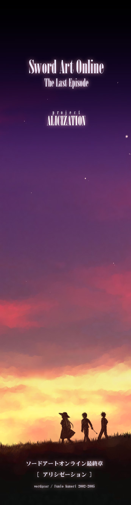

# Sword Art Online 4: Alicization

## 第三章

### 1

　　空气中有着某种气味。

　　将醒未醒之际，在断断续续的思绪中，我忽然意识到了这点。

　　流入鼻腔的空气含着大量的信息。花朵的甜香。青翠的草味。仿佛能洗净肺腑的清爽树木气息。还有刺激着干渴喉咙的水的气味。

　　注意力一转到听觉，声音便如洪水般涌来。无数树叶相互摩擦的声响层层叠叠。小鸟在欢快地啼叫。这些声音底下，还衬着轻轻的虫翅振动声。再远一些，隐约传来潺潺的流水声。

　　这里究竟是哪里？至少不是我的房间。我这才想到这点。平日醒来时总能闻到干爽的床单上那股晒过太阳的气味，听到空调除湿时的低鸣，还能闻到从楼下飘来的味噌汤香味，可这些全都没有。而且，从刚才起就不规则地拂过我紧闭眼睑的绿光，恐怕是从树叶间漏下来的阳光，而不是忘了关的灯吧。

　　我压下了在酣睡的余韵里再多停留片刻的念头，终于睁开双眼。

　　无数摇曳的光芒直射进来，让我连眨了好几下眼。我抬起右手，用手背擦去沁出的泪水，慢慢撑起上半身。

　　「……这里是哪……？」

　　我不禁脱口而出。

　　率先映入眼帘的是淡绿色的草丛。白色和黄色的小花这儿一簇、那儿一簇，泛着光泽的淡蓝色蝴蝶在花丛间来回飞舞。草地如绒毯般铺开，却在不过五米远的地方戛然而止。再往前，仿佛是一片由不知活了几百年的虬曲巨木连成的森林。我凝视树干间的昏暗处，目光所及，树木似乎一直延伸到光线能抵达的尽头。粗糙起伏的树皮和地面都覆着厚软的苔藓，在漏下的阳光中泛出金绿色的光泽。

　　我把头转向右边，又转身环顾一圈，四面迎接我的都是古树的树干。看来我刚才就躺在森林中一小片圆形草地的正中央。最后抬起头，从四面伸来的虬曲树梢之间，可以看见飘着几缕碎云的蓝天。

　　「这里是……哪里？」

　　我又低声问了一遍，却没人回应。

　　我怎么翻找记忆，都不记得来过这种地方睡午觉。梦游？失忆？这些让人不安的字眼掠过脑海。怎么可能，我慌忙打消了这些念头。

　　我是——我的名字是，桐之谷和人。十七岁八个月。和母亲、妹妹三人一起住在埼玉县川越市。

　　能顺利想起自己的情况，我稍稍松了口气，继续往下回想。

　　高中二年级。不过到明年第一学期，我就能修满毕业所需的学分，所以打算秋天升学。对了，我应该找人商量过这件事。那是六月的最后一个星期一，正在下雨。放学后，我去了御徒町的『Dicey Cafe』，和游戏伙伴诗浓商量大会的事。

　　之后又和亚丝娜——对，和结城明日奈会合，聊了一会儿才离开店里。

　　「亚丝娜……」

　　我不由得喊出了那个少女的名字。她是我的恋人，也是我完全信任、可以把背后托付给她的搭档。我渐渐习惯了她在我身边，便一次次环顾四周，寻找她的身影。可是无论在这片小草地上，还是在那深邃的森林里，都找不到她。

　　心里一下没了着落，我还是接着往下回想。

　　离开咖啡店后，我和亚丝娜向诗浓道了别，坐上电车。我们搭JR从南边绕到涩谷，再换乘东横线，前往亚丝娜家所在的世田谷。出站时雨已经停了。我们并肩走在湿漉漉的砖铺人行道上，谈起升学的事。我坦白说自己想去美国读大学，还提出了一个任性的请求，希望亚丝娜也和我一起去。她露出一如往常、宛如和煦阳光的笑容，然后——

　　记忆到此就中断了。

　　想不起来了。亚丝娜是怎么回答的，我们是怎么分别的，我又是怎么回到车站、几点到家、几时入睡，全都记不起来。

　　我有些愕然，拼命想把记忆拉出来。

　　然而，亚丝娜的笑容只是像在水中洇开似的模糊下去，渐渐消失，无论怎么使劲，接下来的画面都不肯浮现。我闭紧双眼，皱起眉头，拼命发掘那片灰色的空白。

　　红色的——闪烁的光。

　　让人快要发疯的窒息感。

　　像小气泡一样浮上来的，只有这两个片段。我不禁深深吸了一口带着甜香的空气，一直忘在脑后的干渴突然变得格外强烈。

　　没错，昨天我应该在世田谷区宫坂。可为什么会独自一人躺在这片不知名的森林里？

　　等等，那真的是昨天吗？从刚才起拂过肌肤的风凉爽宜人，丝毫没有六月末的闷热。直到这时，一阵真切的战栗才掠过我的背脊。

　　我正死死抓住这份『昨天的记忆』，像在风浪滔天的海上抓着一只小小的救生圈。可那些事真的发生过吗……？我，真的是我吗……？

　　我反复摸了摸脸，又扯了扯头发，然后放下双手仔细端详。和记忆中一样，右手拇指根部有颗小小的黑痣，左手中指背面也有一道小时候留下的伤疤。我这才稍稍松了口气。

　　此时，我终于意识到自己穿得有多奇怪。

　　这不是我平时睡觉时穿的T恤和平角内裤，也不是学校制服，甚至不是我现有的任何一套衣服。不仅如此，怎么看都不像市面上卖的成衣。

　　上身是一件染成浅蓝色的短袖衫，料子像是粗棉布，也可能是麻布。布纹不规则，摸起来很粗糙。袖口的锁边看着也不像机器缝的，而是手工缝的。衣服没有领子，V形开口处穿着一根棕色的细绳。我用指尖捏了捏，感觉不是用纤维编的，而是切成细条的皮革。

　　裤子和上衣是同一种料子，颜色乳白，看着像没染过，裤腿只到小腿中段。裤子一个口袋都没有，腰间的皮带不用金属搭扣，而是用一枚细长的木扣扣住。皮鞋也是手工缝的，鞋底是一整片厚皮，上面钉着好几颗防滑钉。

　　这样的衣服和鞋子，我从未见过。——在现实世界里确实是这样。

　　「什么嘛。」

　　我轻轻叹了口气，小声说道。

　　这身衣服虽然异样至极，却也是我看惯了的装束。中世纪欧洲风格，换句话说就是奇幻风格：束腰外衣、及膝短裤和皮鞋。这里并非现实，而是奇幻世界，也就是我熟悉的虚拟世界。

　　「什么嘛……」

　　我又嘀咕了一遍，却还是有些纳闷。

　　看来我是在潜行中睡着了。可我是什么时候登录了哪个游戏，怎么一点都不记得？

　　不管怎样，试着登出就明白了。我这么想着，挥了挥右手。

　　等了几秒也没见窗口打开，我又挥了挥左手。

　　听着没完没了的树叶摩擦声和鸟鸣，我拼命想摆脱那股从腰间往上爬的异样感。

　　这里是虚拟世界。应该是这样的。不过，至少这里不是我熟悉的《Alfheim Online》。不，甚至不是由AmuSphere生成的、遵循《The SEED》规格的VR世界。

　　毕竟，我刚才在手上看到了和现实中一模一样的黑痣和伤疤。据我所知，没有哪款AmuSphere游戏能把这些也再现出来。

　　「Command……Logout.」

　　我抱着一丝希望这么说道，却没有任何反应。我盘腿坐着，再次打量自己的手。

　　指尖上打着旋的指纹。关节处的皱褶。稀疏的汗毛。还有从刚才起就不断沁出的一颗颗冷汗珠。

　　我用上衣擦去冷汗，顺便再次仔细查看布料。那是用粗线按原始的方法织成的，连表面翘起的极细纤维都看得一清二楚。

　　如果这里是虚拟世界，生成它的机器性能就高得惊人。我盯着前方，右手飞快地从身旁扯下一片草叶，拿到眼前。

　　若用以往VR世界的细节聚焦技术，就跟不上我这么快的动作，草叶细部的纹理理应稍迟才会显现。但我一凝神细看，细细的叶脉、锯齿状的边缘，乃至断口垂下的水滴，一切微小的细节都已清晰呈现。

　　也就是说，这个世界能以微米为单位，实时生成视野中的所有物体。按数据量算，光这一片草叶就得占几十MB吧。这种事真的做得到吗？

　　我压下心里那个不愿再追究下去的声音，拨开两脚之间的草，把右手当铲子，试着挖了挖土。

　　湿润的黑土意外地松软，没挖几下，细细的草根就显露出来，彼此缠成一张网。我发现根须织成的网眼里有东西在蠕动，便用指尖轻轻捏了出来。

　　那是一条不过三厘米长的小蚯蚓。它被拖出安身的泥土，拼命扭动着，通体泛着绿色的光泽，竟然还发出了吱吱的细叫声。我一阵眩晕，把它放回原处，又盖上挖开的土。低头一看，右手掌已经沾得乌黑，指甲缝里也嵌着细细的土粒。

　　我愣了足足几十秒，才很不情愿地勉强想出三种能解释眼下状况的可能性。

　　首先，这里可能是由既有的NERDLES技术发展而来的VR世界。但在我的记忆中，没有哪台超级计算机能生成如此精细的3D世界。也就是说，在我失去记忆的这段时间里，现实世界已经过了几年，甚至几十年。

　　其次，这里可能是现实世界的某个地方。也就是说，我成了某起犯罪、非法实验或恶劣恶作剧的受害者，被人套上这身衣服，丢进了地球上某处的森林。按气候来猜，大概是北海道，说不定甚至在南半球。可我不认为日本有会吱吱叫的金属绿色蚯蚓，也不记得世界上哪个国家有这种生物。

　　最后，这里可能是真正的异次元、异世界，甚至可能是死后的世界。这在漫画、小说和动画里屡见不鲜。照那套情节，我大概会救下被怪物袭击的女孩、答应村长的请求，或是以救世勇者的身份和魔王交战吧。可我的腰间却连一把《铜剑》都没有。

　　我突然很想抱着肚子大笑一场，好不容易忍住，便决定彻底排除第三种可能。因为我觉得，一旦分不清现实和非现实，恐怕连神志也会一并丢掉。

　　也就是说——这里要么是虚拟世界，要么是现实世界。

　　如果是前者，无论这虚拟世界逼真到什么地步，辨别真伪都不算难。只要爬到附近一棵树的顶端，再头朝下摔下去就知道了。如果就此登出，或者在某座寺院或某个存档点复活，那这里就是虚拟世界。

　　但如果这里是现实世界，这个实验就会招来最坏的结果。我很久以前读过一本悬疑小说，里面有个犯罪组织为了拍摄真正的死亡游戏，绑了十来个人，把他们扔进无人的荒野，让他们相互残杀。虽然很难想象现实中会发生这种事，可真要这么说，SAO事件也同样离奇。假如这真是一场以现实世界为舞台的游戏，一开局就自杀可不是什么好选择。

　　「……这么说来，那次还算好一点吗……」

　　我无意识地说出了这句话。至少茅场晶彦在游戏开始时，尽到了把各项细节说清楚的最低限度的义务。

　　我抬头望向树梢缝隙间的天空，再次开口：

　　「喂，GM！听见了就回话！！」

　　可是等了半天，既没见一张巨大的脸浮现，也没见有戴兜帽的人影出现在身旁。我抱着一丝希望，又仔细翻查了附近的草丛，把衣服各处都摸了一遍，却没找到规则手册之类的东西。

　　看来把我丢到这里的人压根没打算理会我的求助。当然，前提是眼下这一切并非某种意外事故所致。

　　听着鸟儿不紧不慢的歌声，我拼命思考接下来该怎么办。

　　如果是现实中出了事故，贸然四处走动恐怕不是个好主意。说不定已经有人在赶来救我了。

　　可是，究竟什么样的事故才会弄成眼下这种让人摸不着头脑的局面？硬要找个解释的话，也许我在旅行途中搭乘的飞机或汽车出了故障，我掉进这片森林摔昏了，受冲击丢了前后的记忆。但这样既解释不了这身古怪的衣服，也解释不了我身上为何看起来连一道擦伤都没有。

　　也可能是我在虚拟世界里潜行时出了事故。比如通信线路出了故障，让我登录到了本不该连上的世界。可这么一来，周围物体精细到吓人的细节还是说不通。

　　想来想去，还是有人蓄意设计了眼下的局面更说得通。如果真是这样，只要我不主动做点什么，情况就不会有任何改变。

　　「不管怎么说……」

　　这里究竟是现实，还是VR世界，至少这一点得想办法弄清楚——我自言自语着。

　　应该有办法的。人们常说，虚拟世界一旦接近完美，就会让人分不清它和现实。但是，我不觉得能把现实中的万事万物都百分之百模拟出来。

　　我就那么蹲着，反复琢磨了将近五分钟，还是没想出眼下可行的办法。要是有显微镜，就能查查土里有没有微生物；要是有飞机，也可以试着飞到世界的尽头。可惜我只有一双手一双脚，顶多也就挖挖土了。

　　这种时候，换作亚丝娜，肯定能用我怎么也想不到的办法辨明这个世界的真面目吧。我想着，轻轻叹了口气。又或者，她根本不会一直坐在这里发愁，早就行动起来了。

　　那股没着没落的感觉又涌了上来，我轻轻咬住嘴唇。

　　光是联系不上亚丝娜，我就已经这么不知所措，连自己都有些吃惊。可仔细一想，又觉得理所当然。这两年来，几乎每一个决定都是和她商量后才做的。如今少了亚丝娜的思考回路，我的大脑就像一颗有一个核心停转的双核CPU一样。

　　按照我的主观时间，就在昨天，我还在艾基尔的店里聊了好几个小时，现在想来却仿佛没发生过一样。早知如此，当时就不聊什么STL了，该好好讨论一下怎么区分现实和超精细的虚拟世界才对……

　　「啊……」

　　我不由得欠了欠身，险些站起来。四周的声音迅速远去。

　　怎么回事，居然到现在才想起来，真是昏了头。

　　我不是早就知道吗？那项远超NERDLES机器、能生成堪称超现实的VR世界的技术。那也就是说，这里是——

　　「Soul Translator里面……？这里是Underworld吗……？」

　　没人回应我的低语，我却几乎没注意到，只是愣愣地环顾四周。

　　那片虬曲的古树林，怎么看都像是真的。摇曳的草丛。飞舞的蝴蝶。

　　「这是梦……？是用我意识深处的意象加工出来的……？」

　　到初创企业《拉斯》打工的第一天，我就听他们讲过STL的大致原理，以及它生成的世界有多逼真。但因为不允许把亲眼见到虚拟世界的记忆带出来，此前我一直只能模模糊糊地想象。『拼装起来的梦』这个说法，让我想到的是一出混乱不堪、前后毫无连贯性的舞台剧。

　　可眼前又是怎样？映入眼帘的一切，根本不是『逼真』——也就是『像现实』——这种程度的东西。某种意义上，它们甚至比现实还真实。空气的气味、风拂过皮肤的感觉，还有眼前色彩鲜明的景物，全都以远超初代NerveGear的清晰度刺激着我的五感。

　　如果这里是用STL造出来的世界，那无论采取什么行动，都几乎不可能验证它是不是虚拟的。因为周围的物体并不是经过数字处理的多边形。就算我扯下一片草叶端详，我的大脑——也就是fluctlight——接收到的信息，也会和在现实中做同一件事时完全相同。原则上，我不可能据此分辨它究竟属于哪个世界。

　　等STL投入实际应用，一定得加上能让人认出这是虚拟世界的标记啊……我这么想着，呼出一口气，放松双肩，站了起来。

　　虽然还没有十足的把握，但这里就是Underworld，这应该是最说得通的解释。也就是说，我现在正在打那份时薪三千五百日元的工。

　　「不，可是……这也太奇怪了吧……？」

　　才松了口气，我又犯起了嘀咕。

　　负责的工程师确实说过，为避免污染实验数据，现实世界的记忆不能带进Underworld。可现在的情况离这差得远。我的记忆只缺了从送亚丝娜回家的路上到接上机器之间的一小段。再说，期末考试就在眼前，为了复习，我本来已经打算暂时不去《拉斯》打工了。

　　即便我正在做STL的测试潜行，也肯定出了严重的岔子。我努力回想之前拿到的工程师名片，再次仰头望向天空。

　　「平木先生！如果你在看，就请断开连接！好像出问题了！」

　　我就这样等了足足十多秒。

　　然而，和煦的阳光下，绿色的树梢依旧摇摆，蝴蝶依旧懒洋洋地拍着翅膀，眼前没有丝毫变化。

　　「……难道说……」

　　我叹了口气，低声嘀咕。

　　说不定眼下的状况本身，就是一项连我也同意了的实验。如果真是这样，他们可能是为了收集数据，看看无法确定自己是否身处STL内部的用户会采取什么行动，才屏蔽我潜行开始前的那段记忆，把我孤身丢进虚拟世界。

　　如果真是这样，我真想狠狠敲一下自己的脑袋，居然这么轻率地答应做这种恶劣的实验。要是我当时还以为自己一定能迅速采取正确的行动，轻轻松松地脱身，那可真是笑死人了。

　　我屈着右手的手指，一条条数出能解释眼下状况的几种可能，并随手给每一种估了个概率。

　　「呃……这里是现实世界的可能性，3%。是传统VR世界的可能性，7%。是经我同意的STL测试潜行的可能性，20%。是在STL潜行中出了意外的可能性，69.9999%……差不多就这样吧……」

　　还有0.0001%的可能性，是真的误入了异世界。我在心里补上这一条，把右手按在腰上。再绞尽脑汁恐怕也没用。要想再多几分把握，就只能冒险去接触其他人，或者玩家，或者潜行测试者。

　　到了应该行动的时候了。

　　先得弄点水润润快要渴得受不了的喉咙。我的背上别说剑了，连根棍子都没带，空落落的。我离开那片小草地，朝隐约传来水声的方向走去。看太阳的位置，那里大概是东边。我从两株犹如天然巨型门柱的古树之间穿了过去。

　　林地上铺着天鹅绒般的苔藓，长着大得惊人的蕨类，与身后那片圆形草地迥然不同，俨然是个神秘的世界。高处繁密的枝叶几乎遮尽了阳光，落到地面的光只剩一道道浅金色的细带。一只钴蓝色的小蜥蜴趴在绿色的圆石上晒太阳，仿佛生怕错过那一点暖意。

　　方才在我身边飞舞的小蝴蝶换成了似蜻蜓又似蛾子的怪虫，无声地滑过半空。不知何处还时而传来一声高亢的兽鸣，听不出是什么野兽。

　　拜托了，可别在这时候冒出什么危险的野兽或怪物。我这样想着，在厚软的苔藓上走了大约十五分钟。前方终于又出现一片明亮的阳光，我这才大大松了口气。

　　水声已经相当清楚了。几十米开外准有一条南北走向的河。我像被干渴喉咙的哀鸣拉着一样，不由得加快脚步。

　　冲出茂密的森林，隔着一片约三米宽的草地，我看见了在阳光下闪闪发亮的水面。

　　「水、水啊……」

　　我狼狈地呻吟着，踉踉跄跄地迈过最后几步，一头扑倒在草花丛生的河边。

　　「哇……」

　　我趴在地上，不由得发出一声惊叹。

　　多美的一条河啊。河面不算宽，缓缓蜿蜒的流水却清澈得惊人，仿佛在纯净无色的水里只滴了一滴蓝颜料。透过清澈的河水，河底随流摇曳的水草看得一清二楚。

　　老实说，就在几秒钟前，我还想着，只要这里有一丝可能是现实世界，喝生水就有风险。可眼前的流水像融化的水晶，我再也抵不住诱惑，一下把右手伸进河里。河水冷得像要割破皮肤，我忍不住怪叫一声，把捧起的水送进嘴里。

　　这就是甘露吧。喝不出一丝杂质，却微甜清爽，好喝得让我再也不想花钱买便利店里的矿泉水了。我忍不住用双手一捧接一捧地喝，到最后干脆把脸埋进河里，喝了个痛快。

　　我沉醉在这名副其实的生命之水里，同时在心底彻底排除了这里是由传统NERDLES机器生成的虚拟世界的可能。

　　因为光靠多边形，不可能让人完整体验液体环境。

　　多边形原本就最适合表现固体，本质上是三维空间中数量有限的坐标，不擅长再现流动液体那样不断随机分离和变形的东西。就算能用分形光照技术做出相似的画面，要完整再现到能转化为触觉信号的程度，也不是件容易的事。别说AmuSphere这样的消费级设备，就连最新的工作站也很难做到。

　　比方说，在旧艾恩葛朗特，即使泡进盛满热水的浴缸，能感到的也只有温度和压力，能看到的则只有水面的反光。现在的ALO也一样。也就是说，此刻我的双手和脸所感受到的那种『完美的液体感觉』，要么来自现实，要么是由STL唤起的拟似现实。

　　我仿佛灌了一肚子昂贵的灵药，心满意足，浑身又有了力气，便撑起上半身。

　　我甚至想把这里是现实世界的可能性也一并抛开。这么美的河流、在对岸向深处延伸的梦幻森林，还有那些色彩鲜艳的奇异小动物，实在不像是地球上哪个地方会有的东西。再说，大自然不是越没人插手，对人就越严酷吗？我穿得这么单薄，在这里转了这么久，怎么身上连一个虫咬的印子都没有？

　　——再想下去，没准STL真会从原始记忆层里招来一大群毒虫。我甩开这个念头，再次站了起来，把这里是现实世界的可能性下调到1%，然后左右张望。

　　河流似乎划出一道平缓的弧线，自北向南流去。无论往哪一头看，前方都没入巨木林中，望不到更远处。

　　不过，从河水的清澈和冰凉程度，还有河面的宽度来看，这里似乎离水源很近。如果真有人家或城镇，往下游找应该更有希望。

　　要是有条船就好了，既省力又好玩。我这么想着，正要朝下游迈步——

　　就在这时。

　　微风稍稍转了向，把一种奇怪的声音送到我耳边。

　　像是有什么坚硬的东西敲在一个同样坚硬而巨大的物体上。不止一声，约莫每隔三秒就有一下，节奏十分规律。

　　这不像是鸟兽或自然物发出的声音，几乎可以肯定是人弄出来的。我一瞬间还在想，靠过去会不会有危险，随即轻轻苦笑起来。这里又不是鼓励相互抢夺、相互杀戮的MMORPG世界。眼下最要紧的是与别人接触，弄到情报。

　　我转过半圈，面朝隐约传来声响的河流上游。

　　忽然，我仿佛看见了一幕不可思议的景象。

　　右侧是微微荡漾的河面，左边是幽深茂密的森林，正面是一条仿佛没有尽头的绿径。

　　三名孩子并肩走在那条路上。一个男孩长着一头黑色卷发，另一个留着亚麻色的娃娃头。走在他们中间的是个戴草帽的女孩，长长的金发摇曳得令人目眩，沐浴着盛夏的阳光，毫不吝惜地洒下金色的光辉。

　　这是——记忆……？那遥远、遥远，再也回不去的那一天——我曾相信那样的日子会永远继续，曾发誓只要能守住那样的日子，什么都愿意做，可那一切却像阳光下的冰，转眼就消融了的——

　　那段令人怀念的岁月。

***

### 2

　　眨眼之间，幻象就消失得无影无踪。

　　我惊得呆立了好一会儿。

　　刚才那究竟是什么？那股突如其来的、压倒性的乡愁，让我的胸口正中到现在还像被揪紧一样疼。

　　那是幼时的记忆——看见沿河岸走着的孩子们的背影时，我强烈地感觉到这一点。走在最右边的那个黑发少年，就是我自己。

　　但那是不可能的。从我刚懂事起就一直住着的川越市，并没有这么深的森林，也没有这么美的小河，我也从没和金发女孩交过朋友。再说，那三个孩子都穿着跟我身上这套相似的异国服装。

　　如果这里是STL内部，刚才看到的会不会是上周末连续潜行试验中残留的记忆？我也这么想过，但就算把STL的时间加速功能算进去，我在里面待的时间也最多只有十天。那份如此深切的眷恋，实在难以想象会在这么短的时间里产生。

　　事态似乎越发朝着不可理解的方向发展了。我真的是我吗？这个疑问再次缠上了我。我战战兢兢地俯身望向身旁的河面，但湍动的水流映出的脸不断扭曲，根本无法辨认。

　　我决定先不去管那阵还没消退的刺痛，凝神听那依旧响着的神秘声响。也许正是这个声音搅乱了我的记忆，但看来无从验证。我摇摇头，再次朝声音的源头走去。

　　我只管迈步向前，等终于又有心情欣赏沿途的风景，才留意到声音渐渐偏向了左边。看来声源并不在河边，而是在左侧森林里稍深一点的地方。

　　屈指数了数，我发现那奇特的硬物敲击声并不是连续不断的。每次不多不少响五十下，就中断约三分钟，再响起来时又是五十下。我越发觉得这只能是人弄出来的声音。

　　我就这样一路走走停停，不时停下三分钟。走到合适的地方，我离开河岸，踏进森林。奇妙的蜻蜓、金龟子和蘑菇再次迎了上来，我只管从它们当中穿过去。

　　「……四十九，……五十。」

　　不知不觉间，我已在小声数着那声响。声音一停，我也停下了脚步。明明一点也不累，却这么频繁地停下来，实在让人心急。不过我告诉自己，这总比没头没脑地乱走、最后迷路要好，便在脚边一块长满青苔的岩石上坐了下来。

　　旁边的树根上，一只背着蓝紫色壳的大蜗牛正在爬行。我出神地看着它慢吞吞地往前爬，等着声音再次响起。

　　可是，直到蜗牛爬过树根搭成的桥，抵达树干，开始挑战那道无尽的绝壁，森林里依然一片寂静。虽然没有计时，但三分钟早已过去了。我皱起眉头，站起身来，集中精神仔细倾听。

　　我又这样等了几分钟，声音还是没有再响起来的迹象。这下可麻烦了……我一边想着，一边四下张望。来时的方向和刚才声音传来的方向，似乎还能分辨得出来。再不济，能退回河边就行。我这么说服自己，决定朝那已经消失的声音的源头走走看。

　　唔，那声音该不会是魔女为了引诱误入森林的傻瓜而设下的陷阱吧？我心里直打鼓，却还是沿着刚才辨出的方向径直往前走。可惜没带面包可以撒在路上当记号，不过就算撒了，也准会被鸟吃个精光。

　　不知何时，前方树木间的缝隙渐渐亮了起来。那会是森林的出口吗？说不定还会有个村子。我加快脚步，朝透进光来的地方走去。

　　我攀上如台阶般隆起的树根，从古树的树干后探出头来，看到的是——

　　一个庞然大物。

　　森林并没有到头，也没有什么村子。不过我连失望都顾不上，只是张着嘴，呆呆地望着眼前的景象。

　　森林中豁开了一片圆形空地，比我先前醒来的那片草地宽阔得多，直径大概有三十米。地面同样覆盖着金绿色的苔藓，但和之前走过的林地不同，这里完全没有蕨类、藤蔓或低矮的灌木。

　　而在空地正中央，那个牢牢吸引住我视线的东西巍然耸立。

　　这是何等巨大的一棵树啊！树干直径光凭目测就不下四米。此前在这片森林里见到的全是树干粗糙起伏的阔叶树，眼前这棵巨树却是笔直向上生长的针叶树。树皮颜色深得近乎漆黑，抬头望去，层层枝条在极高处向四面伸展。屋久岛的绳文杉和美国红杉也很巨大，但眼前这棵树有着压倒性的存在感，简直不像自然界的树木，仿佛连王者的傲慢都散发了出来。

　　我把视线从根本看不见树梢的高处移回树根。那些像大蛇一样蜿蜒的根朝四面八方铺展开来，交织如网，一直伸到我所站的空地边缘。说不定正是这棵树夺走了土里的养分，让苔藓以外的植物都无法生长，森林里才空出了这么大一片地方。

　　我有些犹豫是否要踏进这位王者的庭院，却还是抵不住想摸一摸巨树树干的诱惑，迈开了脚步。我几次被苔藓下蜿蜒的树根绊到，却仍忍不住抬头仰望，就这样缓缓前进。

　　我不知第几次轻声感叹，走到离树干只剩几步的地方，早已把对周围的警戒忘得一干二净。也因此，我迟了许久才察觉到。

　　「！？」

　　我忽然把视线转回正前方，正好和从树干后探出来的一双眼睛对上，不禁屏住了呼吸。我浑身猛地一震，后退半步，压低身子，差点伸右手去摸背上根本不存在的剑。

　　所幸，我在这个世界遇到的第一个人只是好奇地歪着头，仿佛不但没有敌意，连戒心也没有。

　　那是个看起来和我差不多大的少年。一头看上去很柔软的深棕色头发留得稍长，垂了下来；身上穿着和我相似的本色短衣和裤子。他坐在巨树脚下，背靠着树干。

　　让人觉得不可思议的是他的长相。皮肤虽是奶油色，却说不准是西方人，也不像东方人。眉眼鼻梁的线条纤细柔和，瞳孔看起来是深绿色。

　　我张开嘴，想说点什么，好让他知道我也没有敌意，却完全想不出该说什么。我傻愣愣地张合了几下嘴，倒是少年先开了口。

　　「你是谁？从哪里来的？」

　　那是日语，语调无可挑剔。

　　我受到的冲击不亚于刚才看见那棵漆黑的巨树，一时愣在原地。倒不是白人说日语有什么稀奇，而是我没想到，在这个怎么看都不是日本的世界，居然能听见如此地道的日语。熟悉的母语从这个穿着中世纪西欧风格服装、相貌带着异域感的少年口中说出来，让我有种不真实感，仿佛在看一部配了日语的西方电影。

　　现在可不是发呆的时候，得赶紧动脑。我拼命让近来都有点生锈的脑子转动起来。

　　假定这里是STL创造的Underworld，那么眼前的少年大概有三种可能：一，他是正在潜行的测试玩家，和我一样保留着现实世界的记忆；二，他是测试玩家，但记忆受到了限制，完全以这个世界的居民自居；三，他是由电脑控制的NPC。

　　如果是第一种，那就好办了。只要说明我遇到的异常状况，再请他告诉我该怎么登出就行。

　　但如果是第二种或第三种，就没那么简单了。对一个只以Underworld居民的身份行动的人或NPC，冷不防说什么Soul Translator出了异常、怎么登出之类他听不懂的话，很可能会引起他的强烈戒心，妨碍之后收集情报。

　　所以，我得只挑些稳妥的词和他交谈，弄清他究竟是哪一种。我悄悄把掌心的冷汗擦在裤子上，勉强挤出一个笑容，开口说道：

　　「我……我叫……」

　　说到这儿，我顿了一下。这个世界里，到底是日式名字常见，还是西式名字常见？我一边祈祷这个名字听来两边都说得通，一边报上名字。

　　「——桐人。我是从那边来的，有点迷路了……」

　　我指着身后大概是南边的方向这么说道。少年惊讶地睁圆了眼睛，轻巧地站起身，也指向我来时的方向。

　　「那边……森林南边？你是从扎卡利亚镇来的？」

　　「不、不是，不是那里。」

　　这么快就陷入了窘境，我好不容易才没让脸僵住。

　　「那个，怎么说呢……我也不太清楚自己是从哪里来的……回过神来，就发现自己倒在这片森林里了……」

　　咦，是STL出了异常吗？稍等，我这就联系观察员。——我打心底盼着他这么回答，可少年只是再次露出惊愕的表情，盯着我的脸看。

　　「诶……不知道自己从哪里来……连以前住的镇子也……？」

　　「啊、嗯……记不起来了。只知道自己的名字……」

　　「……真让人吃惊……《贝库塔的迷路人》啊，我倒是听说过……亲眼见到还是头一回。」

　　「贝、贝库塔的迷路人……？」

　　「咦，你们镇上不这么说吗？有一天突然不见了的人，或是反过来，突然出现在森林或原野上的人，我们这儿都这么叫。暗之神贝库塔会为了恶作剧把人掳走，抹去他们关于自己出身的记忆，再扔到很远的地方。听说很久很久以前，我们村也有个老婆婆就这么不见了。」

　　「是、是吗……那我说不定也是这样……」

　　我点点头，心想这下有点不妙。我越来越觉得，眼前这个少年恐怕不是在扮演角色的测试玩家。我抱着最后一丝希望，斟酌着开了口。

　　「所以……我实在有些为难，眼下想先离开这里。可我不知道该怎么出去……」

　　我拼命祈祷他能明白我的处境，少年的棕色眼睛里却泛起同情的神色。他点了点头，说道：

> rkl：原文如此。前文眼睛的颜色写为「看起来是深绿色」。

　　「嗯，这片森林很深，不认路的话很难走出去。不过没关系，从这棵树往北有条路。」

　　「不、不是，那个……」

　　算了，豁出去了。我试着抛出了一个有点冒险的词。

　　「……我想登出。」

　　听了这句寄托着我一线希望的话，少年把头大大地往一边一歪，反问道：

　　「登……什么？你刚才说什么？」

　　这下大概可以确定了。不管眼前的少年是测试玩家还是NPC，他完全就是这里的居民，根本没有『虚拟世界』这个概念。我尽量不让失望显在脸上，赶紧补了几句，想蒙混过去。

　　「啊，抱、抱歉，刚才好像顺口用了个地方说法。呃……我是想找个村子或镇子，看看有没有地方可以借宿。」

　　我自己都觉得这话太牵强了，少年却只是一副长了见识的样子，点了点头。

　　「这样啊……这个词我还是头一次听说。黑头发在这一带也少见……说不定你是南方人呢。」

　　「可、可能吧。」

　　我勉强笑了笑，少年也回了一个天真的笑容，随后又像是替我发愁似的皱起眉头。

　　「嗯，能借宿的地方啊。我住的村子就在这北边不远处，不过从来没有旅人来，所以也没有旅店什么的。但……要是把事情说清楚，教会的阿扎莉娅修女说不定能帮你。」

　　「这……这样啊，太好了。」

　　这话是发自内心的。既然有村子，说不定就有《拉斯》的观察员常驻在那里，也可能有人从外部监看村里的情况。

　　「那我就去村里看看吧。从这里一直往北走就行吗？」

　　我转过视线，果然看到一条窄道，朝着和我来时几乎相反的方向延伸出去。

　　可还没等我迈步，少年就抬起左手拦住了我。

　　「啊，等等。村里有卫士，你突然进去，可能很难向他们解释清楚。我跟你一起去，替你说明情况吧。」

　　「那可帮大忙了，谢谢。」

　　我笑着道谢，同时在心里嘀咕：看来你不是NPC啊。

　　对于只能作出预设反应的模拟人格程序来说，他的应答未免太自然了。而且，他还主动跟我打交道，这也不像NPC会做的事。

　　让眼前这个少年行动起来的，是某个人的fluctlight。我不知道那人是在六本木的《拉斯》开发支部潜行，还是在据说位于湾区某处的《拉斯》总部潜行。不过，那人的性格想必相当热心。要是能平安离开这里，或许该好好向那人道谢。

　　我正这么想着，少年的脸色又黯淡下来。

　　「啊……不过，现在恐怕还不行……我还有工作……」

　　「工作？」

　　「嗯，现在是午休时间。」

　　我顺着他瞥去的方向看，只见他脚边的布包里露出两个圆圆的、像面包一样的东西。除此之外就只有一个皮制水壶，要是这就是午饭，那还真够简单的。

　　「啊，原来我打扰你吃饭了。」

　　我缩了缩脖子，说完这句话，少年便腼腆地笑了。

　　「要是你能等我做完工作，我就能陪你去教会，拜托阿扎莉娅修女让你借宿……不过，还得大约四个小时。」

　　我巴不得立刻跑到那个村子，找个能听我说明眼下情况的人，可又实在不想再来一轮刚才那种如履薄冰的对话。四个小时不算短，不过考虑到STL的时间加速功能，现实中应该只会过去一个多小时。

　　而且也不知为什么，我还想和这个亲切的少年再聊一会儿。我点点头，说道：

　　「没关系，我等你。不好意思，那就拜托了。」

　　少年顿时笑开了，也朝我点了点头。

　　「好，那你就在这附近找个地方坐着看吧。啊……我还没告诉你我的名字呢。」

　　少年把右手伸到我面前，接着说道：

　　「我叫优吉欧。请多关照，桐人君。」

　　我回握住他那看似纤细、实则结实而有力的手，同时把少年的名字在口中反复念了几遍。那发音并不耳熟，却总觉得念起来很顺口。

　　自称优吉欧的少年松开手，又一次坐到巨树的根部，从布包里取出一个圆面包，把其中一半递给我。

　　「不、不用了，这怎么好意思。」

　　我慌忙摆手，他却丝毫没有收回的意思。

　　「桐人君不也饿了吗？你什么都没吃吧。」

　　被他这么一说，我才意识到强烈的饥饿感，不由得苦笑起来。河水虽然好喝，但实在说不上能填饱肚子。

　　「不，可是……」

　　我还在推辞，面包却被硬塞进手里，我只好收下了。

　　「没关系。我其实不太喜欢这个。」

　　「……那我就恭敬不如从命了。说实话，我饿得都快倒下了。」

　　我在笑出声的优吉欧面前坐到树根上，又补了一句。

　　「还有，叫我桐人就好。」

　　「是吗？那你也可以叫我优吉欧……啊，等一下。」

　　优吉欧抬起左手，制止了正准备把圆面包送到嘴边的我。

　　「……？」

　　「不，这面包除了耐放也没别的长处，不过姑且还是……」

　　说着，优吉欧动了动左手，把手掌悬在右手拿着的面包上方。他只把食指和中指并拢伸直，其余手指握起，指尖随即在空中划出一道像是把字母S和C组合起来的轨迹。

　　我目瞪口呆地看着，只见那两根手指轻轻敲了敲面包，随着一声仿佛金属震颤般的奇异声响，从面包中浮现出一块泛着淡紫色光芒的半透明矩形板。宽约二十厘米，高约八厘米。即使从远处也能看清，那表面用简洁的字体显示着我早已熟悉的字母和阿拉伯数字。毫无疑问，那是物品的状态窗口。

　　我张大嘴巴，一时愣住了。

　　——这下确定了。这里既不是现实，也不是真正的异世界，而是虚拟世界。

　　这个认识沉入心底的同时，我也意识到，安心之余身体一下子轻了起来。虽说此前已有百分之九十九的确信，但果然还是有一层不安像薄皮一样缠在身上——毕竟没有确凿的证据。

　　来历依旧不明，但总之，只要想到自己身处熟悉的虚拟世界，我似乎终于有了余力去享受眼前的状况。我先学着优吉欧的样子，试着自己唤出窗口，把左手的两根手指伸直。

　　我照着所见的样子描出S和C的形状，提心吊胆地敲了敲面包，果然响起效果音，浮现出一扇泛着紫光的窗。我把脸凑近，目不转睛地盯着看。

　　显示出来的文字非常简洁，只有「Durability Point: 7」这一行。我很容易就想到，这大概就是这块面包被设定的耐久值。我一边盯着数字，一边想着这数字变成零时面包究竟会怎样，身旁传来了优吉欧疑惑的声音。

　　「我说，桐人。你该不会连看《丝提西亚之窗》都是第一次吧？」

　　我抬起头，优吉欧手里那块面包的窗口已经消失，他一手拿着面包歪着头。我慌忙摆出「怎么可能」的笑脸。我随手用左手碰了碰窗口表面，它便无影无踪地消失了，我心里稍稍松了口气。

　　优吉欧并没有特别怀疑的样子，点了点头说道：

　　「《天命》还有很多，不用急着吃。要是夏天，可不会剩下这么多。」

　　所谓《天命》，大概就是用数值表示的耐久力，而显示它的状态窗口就是《丝提西亚之窗》。从他的口气听来，优吉欧似乎把刚才看到的东西当成了某种宗教或魔术现象，而不是系统上的功能。

　　该思考的事情还有很多，但我暂且把它们搁到一边，先满足眼前的食欲。

　　「那我开动了。」

　　说着，我张大嘴咬下去，面包的硬度让我不由得瞪圆了眼。但总不能把它吐出来，只好用力咬断。那「牙齿都要松动」的感觉逼真得不像虚拟世界，令我出乎意料地感叹。

　　这面包似乎是用类似全麦粉的粗磨小麦做的，口感硬得有些过头，但嚼起来也有一种朴素的滋味。饿着肚子的我拼命动着下巴咀嚼，然后咽了下去。要是涂上黄油、夹上奶酪，应该会更好吃吧——我正想着这种不知感恩的事，同样皱着眉啃面包的优吉欧带着笑意说道。

　　「不好吃吧，这个。」

　　我慌忙摇头。

　　「没、没有那种事。」

　　「不用勉强。这面包是在村里的面包店买的，因为早上要很早出门，只能买到前一天卖剩的。中午也没时间从这儿回村里去……」

　　「咦……那从家里带便当来不就好了……」

　　说到这里，我看见优吉欧忽然垂下视线，便缩了缩脖子，心想自己是不是说了太欠考虑的话。但优吉欧很快抬起头，轻轻笑了笑。

　　「很久很久以前……午休时，是有人给我送便当来的。可现在，已经……」

　　那双棕色眼眸里，闪着深深失落的光。那一瞬间，我忘了这个世界是人造的，不由自主地向前探出身子。

　　「那个人，后来怎么了……？」

　　我这么一问，优吉欧抬头望着遥远上方的树梢，沉默了一会儿，才慢慢开口。

　　「……是我的青梅竹马。和我同岁，是个女孩……每天从早到晚都一起玩。我被赋予天职之后，她也每天给我送便当……可是，六年前……我十一岁那年的夏天，整合骑士来到村里……把她带去了央都……」

　　整合骑士。央都。这两个词我都不明其意，但我推测前者大概是某种秩序维护者，后者则是这个世界的首都，于是沉默着示意他继续说下去。

　　「都是我的错。休息日那天，我们两个人去北边的洞窟找龙……回来的路上走错了，结果穿过《边境山脉》，到了暗之王国那一侧。你知道吧？就是《禁忌目录》里写着绝不可踏入的那个暗之国。我没有走出洞窟，可她却只迈了一步，踩到了暗之国的土地上……就因为这么一点事，整合骑士就在大家面前用锁链把她捆了起来……」

　　优吉欧右手里的、吃到一半的面包被捏扁了。

　　「……我想救她。就算和她一起被抓也无所谓，我甚至想用斧头去砍那个骑士……可是，手和脚都动不了。我只能默默看着那孩子被带走……」

　　优吉欧失去表情，久久望着天空，最后唇边浮起一丝淡淡的自嘲。他把压扁的面包塞进嘴里，低下头继续嚼着。

　　我不知道该说什么，也照样咬下一块面包，费力地咽下去之后，才终于开口。

　　「……你知道那孩子后来怎么样了吗……？」

　　优吉欧垂着眼，慢慢摇了摇头。

　　「整合骑士说，审问之后就要处刑……可究竟受了什么刑，我完全不知道。我曾经问过她的父亲加斯福特村长……他让我就当她死了……——可是，桐人，我相信。她一定还活着。爱丽丝一定在央都的某个地方活着。」

　　我倒吸一口气。

　　亚丝娜说过，STL的开发企业《拉斯》，以及虚拟世界《Underworld》，这些名字也许都取自小说《爱丽丝梦游仙境》吧。那么，优吉欧刚才说出的爱丽丝这个名字，究竟是不是偶然呢？

　　不，不可能。现实世界姑且不论，在这个万物皆有意义的虚拟世界里，不会存在什么方便的巧合。也就是说，优吉欧的青梅竹马、六年前被带走的少女爱丽丝，恐怕是这个世界上一位重要的人物。

　　而且，还有一件令人惊讶的事。

　　刚才优吉欧说过，六年前他十一岁。也就是说他现在十七岁，而且从他的口气听来，他似乎完整保留着那段漫长时间的全部记忆。

　　但这不可能。就算考虑STRA功能带来的三倍加速，要在这个世界里模拟十七年的时间，现实世界也应该已经过去了六年。然而，STL的第一台机器出厂至今，应该才过了半年左右。

　　这究竟该怎么解释呢？

　　这里不是我已知的STL，而是一个未知的虚拟世界生成系统，而且它最长可能从十七年前就已经开始运转了。又或者，我听说的STRA功能三倍倍率有误，实际上实现了三十倍以上的加速。无论哪一种，都让人难以轻易相信。

　　不安与好奇在我心中迅速膨胀。我一方面想立刻登出，向外面的人打听情况，另一方面又想留在这里，尽可能继续追查这些疑问。

　　咽下最后一块面包，我提心吊胆地问优吉欧。

　　「那……你去一趟怎么样？那个，去央都。」

　　话一出口，我就觉得「糟了」。这句话似乎引出了优吉欧意想不到的反应。

　　那个栗色头发的少年盯着我的脸愣了好几秒，才像是难以置信似的摇了摇头。

　　「……这个露莉德村在帝国的北端。到南端的央都要骑马走一个月。走路的话，连最近的扎卡利亚镇都要两天。就算休息日天亮就出发，也赶不到。」

　　「那……只要做好充分的旅行准备再去……」

　　「我说桐人。你也和我差不多大，在原来住的村里应该也被赋予了天职吧？放下天职去旅行，这种事怎么可能做得到。」

　　「……也、也是啊。」

　　我挠着头点头，同时仔细观察优吉欧的样子。

　　这个少年显然不是单纯的NPC。丰富的表情、自然的应答，只能让人觉得他是真正的人类。

　　但与此同时，他的行动似乎被一种比现实世界法律更具效力的绝对规范束缚着。没错，就像VRMMO里的NPC绝对不会离开规定的移动范围一样。

　　优吉欧说，他之所以没被逮捕，是因为没有侵入被《禁忌目录》限制的区域。那个目录大概就是束缚他的绝对规范，恐怕是在直接限制fluctlight本身吧。我不知道优吉欧的天职，也就是他的工作究竟是什么，但很难想象会有什么工作比从小一起长大的女孩的生死更重要。

　　为了确认这一点，我斟酌着措辞，向正把水壶凑到嘴边的优吉欧问道。

　　「呃，优吉欧的村里，还有其他人因为违反禁忌……目录被带去央都吗？」

　　优吉欧又睁圆了眼睛，用力擦了擦嘴角，摇了摇头。

　　「怎么可能。爷爷说过，露莉德三百年的历史里，整合骑士只在六年前来过那一次。」

　　他话音一落，顺手把皮水壶扔了过来。我接住，拔掉塞子凑到嘴边倾斜，流进嘴里的液体虽然不凉，却带着像是柠檬和香草混合的清爽香气。我喝了三口左右，把水壶还给优吉欧。

　　我装作若无其事，也用手背擦了擦嘴，心里却已经刮起了不知第几次的惊愕风暴。

　　三百年！？

　　如果真的实际模拟了如此漫长的岁月，那STRA功能就实现了数百倍……甚至可能达到一千倍的加速。这样一来，上周末进行连续潜行测试时，我实际上究竟度过了多长时间呢？事到如今我才感到一阵毛骨悚然，同时上臂轻轻起了鸡皮疙瘩，但我几乎没有余裕去感叹这种生理反应有多真实。

　　得到的数据越多，谜团反而越深。优吉欧究竟是人类还是程序？这个世界又到底是为了什么目的而被创造出来的？

　　再往下的事，不去那个好像叫露莉德的村子接触其他人，恐怕就弄不明白了。我在心里想着，要是能遇到了解内情的《拉斯》成员就好了……同时勉强露出有些僵硬的笑容，对优吉欧说。

　　「多谢款待。抱歉，吃了你一半的午饭。」

　　「不，别在意。我早就吃腻那个面包了。」

　　他极其自然地笑着摇了摇头，利落地收拾起便当包。

　　「那，不好意思，你等我一会儿。我把下午的工作做完。」

　　优吉欧说着，轻快地站起身，我朝他问道。

　　「说起来，优吉欧的工作……那个叫天职的，是什么？」

　　「啊……从这里看不到呢。」

　　优吉欧又笑了，朝我招了招手。我歪着头站起身，跟着他绕到巨树的树干后面。

　　然后，我被另一种惊讶击中，张大了嘴。

　　巨大的杉树那如暗夜般漆黑的树干，已被砍入约四分之一，深达一米左右。内部的木质也像煤炭一样黑，沿着紧密排列的年轮，散发出金属般的光泽。

　　我移动视线，发现在切口正下方靠着一把斧头。那把形状简单的单刃斧大概不是用于战斗的斧头，稍大的斧刃和较长的斧柄都由同一种灰白色材料制成，这一点很有特点。它带着类似哑光处理钢材的奇异光泽，我仔细凝视，发现整体似乎是由一整块材料削成的一体结构。

　　优吉欧右手轻松地提起那把只有握柄部分缠着被握得发亮的皮革的斧头，扛到肩上。他走到树干上楔形切口的左端，沉下腰，分开双脚，双手紧紧握住斧头。

　　看起来纤细的身体猛地一弯，大幅向后引出的斧头在短暂蓄力后锐利地划破空气，精准地命中切口中央，发出「铛」的一声清亮而响亮的金属音。毫无疑问，那和把我引到这片空地的奇异声音一模一样。

　　我感叹着那甚至可以说优美的身手，望着优吉欧以比机械还精准的节奏保持着节奏和轨迹，反复挥斧。后引一秒，蓄力一秒，挥下一秒。一连串动作流畅得让人不禁怀疑这个世界是否也有剑技。

　　优吉欧以每三秒一次的节奏准确挥了五十次，总共用一百五十秒把斧头砍进巨树，最后慢慢把砍进深切口的斧头拔出来，长长地呼了口气。他把工具靠在树干上，一屁股坐到旁边的树根上。额头的汗珠闪着光，他呼哧呼哧地喘着粗气，看样子这挥斧的活比我以为的要重得多。

　　我等着优吉欧呼吸平复，简短地搭话。

　　「优吉欧是樵夫吗？在这片森林里砍树？」

　　优吉欧用从短衣口袋里取出的毛巾擦着脸，轻轻歪了歪头，稍微想了想才回答。

　　「嗯，这么说也许可以吧。不过，我就任天职后的七年里，一棵树都没砍倒过。」

　　「咦？」

　　「这棵大树的名字叫基加斯西达。不过村里人都叫它《恶魔之树》。」

　　优吉欧对歪着头的我意味深长地笑了笑，然后仰望遥远上方的树梢。

　　「它会被这么叫，是因为这棵树会把周围土地里泰拉利亚的恩惠全都吸走。所以这棵树的叶子下面只长得出苔藓，阴影所及的范围内，树木也都长不高。」

　　我不知道泰拉利亚是什么，但我看到这棵巨树和这片空地时的第一印象，看来并没有错。我像是催促他继续说下去似的，连连点头。

　　「村里的大人们想开拓这片森林，扩展麦田。可只要这棵树还站在这里，就结不出好麦子。所以大家想把它砍倒，但它不愧是《恶魔之树》，硬得可怕。普通的铁斧砍一下就会崩刃，没法再用。于是就从央都订购了这把据说由龙骨削成的《龙骨之斧》，让专职的『刻痕手』每天来砍。那个人就是我。」

　　我半是发呆地来回看着若无其事说出这番话的优吉欧，以及巨树上被砍进约四分之一深的斧痕。

　　「……那么，优吉欧这七年每天都一直在砍这棵树？干了七年，才砍到这种程度？」

　　这次轮到优吉欧睁圆眼睛，无可奈何地摇头了。

　　「怎么可能。要是七年就能砍这么多，我也多少有点成就感了。听好了，我是第六代刻痕手。露莉德村在这片土地上建立三百年，历代刻痕手每天砍，才砍到这里。大概等我变成老爷爷，把斧头传给第七代时，能砍到的也只有……」

　　优吉欧用双手比出大约二十厘米的缝隙。

　　「大概这么多吧。」

　　我只能慢慢摇头。

　　在奇幻类MMO里，樵夫和矿工这类生产职业通常就是忍受枯燥单调的劳作，但花上一辈子连一棵树都砍不倒，实在超乎常理。既然这里是被人创造的世界，这棵树大概也是带着某种意图被放在这里的，但那究竟是什么，我完全摸不着头脑。

　　——不过，那另当别论，背上有股跃跃欲试的冲动。

　　大约三分钟的休息后，我站起身，对准备拿起斧头的优吉欧半是冲动地开口。

　　「喂……能不能也让我试试？」

　　「咦？」

　　「你看，我不是吃了你一半的便当吗。工作也帮你做一半，这才合情理吧？」

　　就好像第一次听人说想帮自己干活一样——实际上也许真是第一次——优吉欧愣愣地张着嘴，最后才犹犹豫豫地回答。

　　「嗯……不过，倒也没有规定说天职不能让别人帮忙……可是，这个比想象中难哦。我刚上手的时候，连好好砍中都做不到。」

　　「不试试怎么知道呢？」

　　我咧嘴一笑，伸出右手。优吉欧仍带着不安把《龙骨之斧》的斧柄递过来，我接过斧头后用力握住。

　　斧头外表看着轻，实际却沉甸甸地压在手腕上。我慌忙用双手握紧缠着皮革的握柄，小幅挥动确认重心。

　　在SAO以及ALO里，我从未把斧头当过武器，但打中不会动的目标应该很容易吧，我这样想着。我站到深深切口的左侧，模仿优吉欧的姿势分开双脚，微微沉腰。

　　确认依旧担心、同时又似乎觉得有趣的优吉欧已经离得足够远，我才把斧头举到肩膀的高度。咬紧牙关，双臂使出全力，狠狠砍下去。

　　「咔」的一声闷响，斧刃砍进了离目标将近五厘米的地方，猛烈的反震袭向双手。我忍不住松开斧头，把麻痹到骨髓的双腕夹在两腿之间，呻吟起来。

　　「疼、疼疼疼。」

　　看到这一击只能用一个「丢人」来形容，优吉欧「啊哈哈哈」地愉快笑了起来。我怨恨地看向他，他像是道歉一样竖起右手，却仍笑个不停。

　　「……不用笑成那样吧……」

　　「哈哈哈……不，抱歉，抱歉。你太用力了，桐人。手臂再放松一点……嗯，该怎么说呢……」

　　优吉欧有些着急地反复比划着双手挥斧的动作，我看着看着，终于后知后觉地意识到自己的错误。在这个世界里，当然并没有严密模拟物理法则和肉体动作。这是STL创造的逼真梦境，所以最重要的恐怕是想象力。

　　我用终于不再发麻的手从脚边拾起斧头。为了卸掉多余的力量，我摆好架势，意识着全身的动作，缓慢而大幅地后引。我一边回想在SAO里用过无数次的水平斩击系剑技《Vertical Square》的第一击，一边将重心转移所产生的能量顺势带入腰部与肩部的转动中，最终传递到斧头上，将其砸向大树——

　　这次我砍到了离切口很远的树皮，「哐」的一声，斧头又发出难听的声音弹了回来。手没有像刚才那样麻，但我的意识全放在自己的动作上，似乎忽略了瞄准。我一边想着优吉欧这下又要笑了，一边回头，没想到少年只是微微睁大了眼睛。

　　「哦……桐人，刚才那下还不错。不过，中途开始盯着斧头看就不好了。视线不要离开切口正中。趁还没忘，再来一次！」

　　「嗯、嗯。」

　　下一击也很糟糕。但之后我继续在优吉欧的指点下挥斧，不知挥到第几十次时，斧头终于伴着高而清亮的金属音命中切口正中，飞散出极细小的黑色碎片。

　　以此为契机，我和优吉欧交换，看他漂亮地砍了五十次。然后我又接过斧头，哼哧哼哧地也挥了五十次。

　　不知道重复了多少轮，回过神来太阳已经明显西斜，射进空地的光染上了淡淡的橙色。我从大水壶里喝下最后一口，同时优吉欧也挥完了斧，说道。

　　「好……这样就是一千次了。」

　　「咦，已经砍了这么多吗？」

　　「嗯。我五百次，桐人五百次。加上上午，一天要砍基加斯西达两千次，这就是我的天职。」

　　「两千次……」

　　我重新望向漆黑巨树上被砍出的巨大斧痕。怎么看都不觉得它比第一次看到时更深了。这是多么没有回报的工作啊，我正愕然着，身后传来优吉欧开朗的声音。

　　「呀，桐人挺有天赋的。最后那五十次里，有两三次声音不错。多亏你，我今天轻松多了。」

　　「不……不过，要是优吉欧一个人干，肯定进展更快吧。抱歉，拖你后腿了。」

　　我愧疚地道歉，优吉欧笑着摇了摇头。

　　「我说过这棵树就算花我一辈子也砍不倒吧。听好了……给你看个好东西。其实，这本来不太该给人看的。」

　　说着，他走近巨树，抬起左手。用两根手指比出那个手势，轻轻敲了敲黑色树皮。

　　原来这棵树本身也设定了耐久值吗——我一边这样想着，一边跑过去。伴随着铃声般的声响浮现出来的「窗」，我和优吉欧一起探头看去。

　　「呜呃……」

　　我不由得呻吟出声。因为那里显示的数字是二十三万二千多，庞大得离谱。

　　「嗯，从上个月看的时候起只减少了五十左右。」

　　优吉欧也用实在厌烦了的声音说道。

　　「也就是说……我挥一年斧头，也只能让基加斯西达的《天命》减少六百。到我退休时，剩下的二十万能不能跌破都难说。懂了吧。只是半天工作没什么进展，根本不算什么。」

　　之后，优吉欧扛着《龙骨之斧》、拎着空了的水壶回村，一路上又愉快地讲了许多事。比如他的前任、一位叫加里塔的老人是多么厉害的使斧名手，比如村里同龄的少年们觉得优吉欧的天职很轻松，这让他有些不满。我一边随声附和，一边仍然全力思考着一件事。

　　那就是，这个世界究竟是为了什么目的而运作的。

　　如果是为了检验STL的虚拟环境生成技术，那已经以完美的形式达成了。这个世界绝不会轻易与现实区分开来，这一点我已经体会得够多了。

　　可即便如此，这个世界在内部时间上至少已经模拟了三百年，更可怕的是，从巨树基加斯西达的耐久值和优吉欧的工作量来看，它似乎还计划继续运转将近一千年。

　　主观时间加速功能STRA的倍率究竟达到了多少，我不知道，但被封印记忆、潜行到这里的人，搞不好会在这里度过整整一生。确实，现实世界的肉体不会受到任何危险，如果潜行结束时记忆会被消除，对本人来说或许只是一场朦胧的「漫长的梦」——可是，灵魂、fluctlight又怎么样呢？构成人类意识的那种不确定的光的集合体，难道没有寿命吗？

　　无论怎么想，这个世界里进行的事情都既乱来又鲁莽了。

　　也就是说，即使冒着这么大的危险，也有必须达成的目的。就像诗浓在艾基尔的店里说的那样，这恐怕不是单纯生成逼真的虚拟空间这种用AmuSphere也能做到的事。在这个与现实完全无法区分的环境里，耗费几乎可以说是无限的时间，才能抵达的「某种东西」——

　　回过神来，不知何时，前方狭窄小道的尽头森林断开，橙色的光铺展开来。

　　出口近处孤零零地立着一间小杂物房，优吉欧走过去随手打开门。我探头一看，里面杂乱地堆着几把普通铁斧、类似柴刀的小刃物、绳子和水桶之类的工具，还有一个不知是什么的细长皮革包裹。

　　优吉欧把《龙骨之斧》靠在那些东西之间，砰地关上门。他就这样转过身准备回到路上，我惊讶地说。

　　「咦，不用上锁吗？那可是很重要的斧头吧？」

　　优吉欧也惊讶地睁圆了眼睛。

　　「锁？为什么？」

　　「为什么……会被偷之类的……」

　　话说到一半，我终于明白了。这里没有小偷。因为《禁忌目录》里大概写着「不得偷盗」之类的条文吧。

　　优吉欧笑了，一边走一边给出了预想中的回答。

　　「没事的，没有人会去偷。」

　　听到这话，我忽然冒出一个疑问。

　　「咦，可是……优吉欧说过村里有卫士吧？如果没有盗贼会来，为什么会有那种职业呢？」

　　「那还用说。是为了从暗之军团手中保卫村子啊。」

　　「暗之……军团……」

　　「你看，能看见吧，那边。」

　　这时，我们正好穿过了最后一片树林。

　　眼前是一整片麦田。尚未饱满的青麦穗在风中摇曳。开始西斜的阳光倾泻而下，简直像大海一样。道路在田地之间蜿蜒延伸，前方很远的地方可以看到一座略高的小山丘。仔细看那座被树木环绕的丘陵，能发现许多沙粒般小的建筑密集在一起，中央还有一座格外高的塔。看来那里就是优吉欧居住的露莉德村。

　　而优吉欧手指所指的，是村子更远处、极其遥远的地方隐约延伸的白色山脉。锯子般尖锐险峻的山脊，在视线所及的范围内从左向右连绵不断。

　　「那就是《边境山脉》。在那一边，有索尔斯之光也照不到的暗之王国。天空即使白天也被黑云覆盖，天光红得像血。地面、树木都像炭一样黑……」

　　大概是在回忆遥远的过去吧，优吉欧的声音微微颤抖。

　　「……暗之王国里住着哥布林、兽人之类被诅咒的生物，还有各种可怕的怪物……以及骑着黑龙的骑士。当然，守护山脉的整合骑士会阻止他们入侵，但根据神圣教会的传说……每一千年一次，当索尔斯之光变弱时，暗黑骑士就会率领暗之军团越过山脉一齐攻来。到那时，连整合骑士都不知能不能挡住，所以为了防备那一刻，村里有卫士，稍大的城镇则有卫兵队。」

　　说到这里，他有些疑惑地瞥了我一眼，继续说道。

　　「……这是连小孩都知道的事。桐人连这种事都忘了吗？」

　　「嗯……嗯，我好像听过……」

　　我提心吊胆地这样搪塞过去，优吉欧像是不知怀疑为何物似的笑着轻轻点头。

　　「嗯……说不定桐人不是这个诺兰高尔斯神圣帝国的人，而是来自东方或南方的国家呢。」

　　「也、也许吧。」

　　我点点头，为了转换话题，指了指已经相当近的山丘。

　　「那就是露莉德村？优吉欧的家在哪边？」

　　「正面看到的是南门，我家靠近北门，所以从这里看不到。」

　　「哦。顶端那座塔就是教会？」

　　「嗯，是啊。」

　　我凝目望去，只见细塔的尖端有一个十字与圆组合成的金属标志。

　　「总觉得……比想象中气派。真的会收留我这种人吗？」

　　「没事的。阿扎莉娅修女是个好人。」

　　我虽然不安，但对方大概和优吉欧不同，是真正的NPC，或者说自动应答程序——毕竟STL在世界上只有六台——只要进行常识性的应答应该就没问题吧，我这样想。只不过，所谓的常识，现在的我正好完全欠缺。

　　理想情况下，要是那位修女是《拉斯》的观察员，事情就好办了。但恐怕以观察世界为目的的人，不会担任村长或修女这类重要角色吧。潜入村子后，我必须设法找出应该接触的对象。

　　不过，这也得建立在这个小村里常驻着观察员的前提下……我带着些许担心，和优吉欧一起穿过了长满苔藓的石造拱门。

&emsp;

[Previous](sao4-2-02.md) [Main](../index.md) [Next](sao4-3-02.md)
