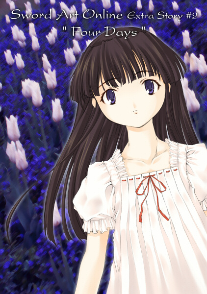

# Sword Art Online 外传2: 4 Days

&emsp;

### 第一天

　　亚丝娜将每天的起床闹铃设置在七点五十分。

　　若说为什么要设定这种不上不下的时间，那是因为桐人的起床时间是八点整。亚丝娜很喜欢早十分钟醒来，待在床上看着在身旁熟睡的他。

　　今天早上，亚丝娜也在木管乐器的柔和音效中醒来，之后轻轻地转身趴下，用双手托着脸颊，望着桐人的睡脸。

　　半年前相遇。两周前成为攻略搭档。结婚后，搬到位于第22层的森林则是在短短六天前。虽然是自己最心爱的人，但老实说，桐人还有太多自己不清楚的一面。真要说的话，睡脸也是其中之一。越是这样看着，就越是搞不清楚他的年龄。

　　因为桐人那有些冷静又飘忽不定的态度，让亚丝娜一直觉得他比自己稍微年长。但是陷入深沉睡眠时的桐人，天真无邪得甚至可以称为可爱，让人觉得他看来像是个比自己年幼许多的少年。

　　虽然觉得——不过是问问年龄应该无妨。就算触及现实世界的话题是种禁忌，但两人已经是夫妻，别说是年龄了，为了回到现实后还能再见，本名、住址跟电话都是要先交换的情报。

　　但是，亚丝娜却迟迟无法把话说出口。

　　因为她害怕，一旦提到现实世界的事情，这里的「婚姻生活」似乎就会变成虚拟而浅薄的东西。对亚丝娜来说，如今最重要，也是唯一的现实，就是在这森林中的家过着平稳的生活。就算现实的肉体在无法从这个世界脱离的情况下死去，只要能在这里生活直到最后一刻，她就不会有任何悔恨。

　　所以，过一段时间再从梦中醒来吧——这么想着的亚丝娜悄悄伸出手，抚摸桐人的脸颊。

　　还真是天真的睡脸啊。

　　虽然在醒着的时候，长长的黑色刘海和眼中射出的锐利眼神会给人非常强硬的印象，但如今的他看上去就像是个有着纤细面孔的少女。这时，亚丝娜的心头涌上一股不可思议的感触。

　　事到如今根本无须怀疑桐人的实力。从封闭测试开始累积的无数经验、不断进行攻略所获得数值上的等级，还有支持这些东西的判断力与意志力。即使输给了血盟骑士团团长希斯克利夫，桐人依然是亚丝娜所知的最强玩家。不论是多严峻的战场，只要有他在身旁就不会让人不安。

　　但是，这样看着躺在身旁的桐人，便感觉他是个纯真、容易受伤的弟弟。这股心情涌上胸口，完全控制不住，更觉得一定要保护他。

　　轻轻叹了口气，亚丝娜探出身子抱住桐人，非常小声地说着：

　　「桐人君……我最喜欢你了，我们要一直在一起喔。」

　　这个瞬间，桐人微微动了一下，缓缓张开了眼睛。两人的视线以非常近的距离相交。

　　「！！」

　　亚丝娜慌张地飞身后退，在床上正坐，并红着脸开口：

　　「早、早啊，桐人君……你有听见……刚刚的话吗……？」

　　「早。刚刚的话……你是指什么？」

　　面对坐起上半身努力忍住哈欠回问的桐人，亚丝娜用力挥动双手。

　　「没、没什么，我什么都没说！」

　　亚丝娜嘿嘿笑着，同时也在思考。虽然是因事出突然而惊慌失措地掩饰，但其实自己并没说什么难为情的话。于是，她将身体靠近桐人说道：

　　「其实不是什么都没说啦。」

　　「哈……？大清早的……」

　　亚丝娜一下子扑到还在发呆的桐人身上，在他的耳边小声说道：

　　「说了最喜欢你哦。」

　　「什……」

　　这下子轮到桐人脸红了。亚丝娜将自己的双唇，慢慢靠近桐人的脸颊。

> rkl：为什么我刚开始看这段就发现一个野生的闪光弹。

&emsp;

　　结束由荷包蛋、黑面包、沙拉与咖啡（和咖啡很像的饮品）组成的早餐，再花了两秒收拾桌面后，亚丝娜啪地双手一拍。

　　「那么！今天要去哪里玩呢？」

　　「我说你啊……」

　　桐人露出了苦笑。

　　「别说得那么直白嘛。」

　　「因为每天都很快乐嘛！」

　　这是亚丝娜发自内心的实话。

　　虽然是光回想就觉得痛苦的回忆，但在成为SAO的囚禁者到喜欢上桐人前的一年半当中，亚丝娜的内心总是结着一层坚硬的冰。

　　牺牲睡眠提升技能与等级，在受拔擢成为血盟骑士团的副团长后，有时更是以让成员们唉唉叫的高进击速度不断攻略迷宫。内心想着的，只有完成攻略脱离这里而已。并以毫无意义为由，拒绝参与一切无益于攻略的活动。

　　这么回想起来，亚丝娜就不禁为没能早点与桐人相遇感到后悔不已。自从与他邂逅的那天起，每一天都充满着比在现实世界更缤纷的色彩与惊艳。若是跟他在一起，就连在这里的时间也成为难得的经验。

　　所以对亚丝娜而言，现在这段好不容易才得到的，只属于两人的时间，每分每秒都能与贵重的宝石匹敌。她希望两个人能一起去更多不同的地方，聊更多各式各样的话题。

　　亚丝娜将双手叉在腰上，嘟起嘴唇说道：

　　「所以桐人君不想出去玩吗？」

　　桐人轻笑着挥动左手叫出地图，切换成可见模式给亚丝娜看。窗口中显示的是这层相连的森林与湖泊。

　　「差不多在这里。」

　　他所指的是距离两人的家稍远的森林一角。

　　第22层属于较低的楼层，面积因此相当宽广。以直径来说，应该有八公里多。中央有巨大的湖泊，南岸是主城区《科拉尔【Coral】》村，北岸则是迷宫区。除此之外的地方全是美丽的针叶树林。亚丝娜与桐人的小屋大约位在楼层的南端，接近外围的地方。桐人现在所指的，是在离家约两公里的东北方。

　　「这只是我昨天在村里听到的传闻……据说在这边的森林深处……会出现那个喔。」

　　「啊？」

　　桐人面对投来疑问的亚丝娜，露出意味深长的笑容：

　　「所以、会出来哦。」

　　「出来什么？」

　　「——幽灵。」

　　一段时间说不出话来的亚丝娜战战兢兢地确认：

　　「……那是，幽灵系的怪物？像鬼魂或暗影那种？」

　　「不是不是，是真的喔。玩家……人类的幽灵，而且是女孩子。」

　　「呜……」

　　亚丝娜的表情瞬间僵硬。关于这种话题，她有自信比常人更加害怕，而且严重到当初攻略以恐怖系楼层闻名的第65、66层古城迷宫时，她就找了各种理由跷掉攻略。

　　「我、我说啊，这里可是由数字档案所构成的游戏世界耶，怎么可能会出现——幽灵那种东西呢。」

　　亚丝娜硬是做出笑容，有点认真地反驳。

　　「这也很难说啊——」

　　不过知道幽灵是亚丝娜弱点的桐人，非常乐在其中地火上加油。

　　「例如啊……怀着怨恨死亡的玩家灵魂，依附在一直接着电源的NerveGear……每晚都在野外区域徘徊……」

　　「不要再说了——！」

　　「哇哈哈，抱歉抱歉，刚刚那个只是轻率的玩笑。虽然我也不觉得会出现真正的幽灵，不过反正要出门，去些好像会发生什么事的地方不是很好吗？」

　　「呜呜……」

　　亚丝娜嘟起嘴唇往窗外看去。

　　在接近冬天的季节里，今天算是好天气。暖洋洋的阳光照耀着庭院的草坪。总觉得这是个最不适合幽灵出没的时间。顺带一提，艾恩葛朗特由于构造的关系，除了早晨与傍晚外无法直接见到太阳，不过白天时会有足够的面光源照明，将整个野外区域照得十分明亮。

　　亚丝娜面向桐人，抬起下巴说道：

　　「好啊，走吧！去证明不可能有幽灵存在！」

　　「那就这么决定了——今天没碰到的话，下次就半夜去哦。」

　　「绝对不要！……我可不帮这么坏心眼的人做便当喔！」

　　「咳咳，没事没事，当我没说！」

> rkl：果然亚丝娜一拿吃的做威胁桐人就软了……想想UW里那半年，真是辛苦你了啊……

　　最后又瞪了桐人一眼，亚丝娜才露出笑容。

　　「那就赶快做准备吧。我负责烤鱼，桐人君你把面包切好。」

　　利落地做好鱼肉汉堡收进午餐盒，两人在早上九点时出门。

　　直到过上现在这样的生活，亚丝娜才注意到在攻略迷宫的日子里并未意识到的事情。那就是SAO内的一天实在太过漫长。理由也很简单，在现实世界的生活中不得不去应对的繁杂事务，在SAO内几乎都可以省略掉。

　　要举例子的话，比如像现在这样两人要出门，在现实世界里光是准备就要耗费相当长的时间。制作便当自不必说，收拾厨房、清理垃圾、将头发洗净吹干并整理好、试穿这件那件的衣服、加上在镜子前简单化个妆都要几十分钟。然后从家里出来，走到车站，乘坐电车到达会合地点——光是想想就感觉头晕。

　　然而现在只需几分钟就可以做好便当，不会产生任何垃圾，而且可以只在窗口中操作来选择衣服（还可以不必考虑收纳场所和零花钱地随便买），也不需要化妆。简单地说，就是可以将为了获得『快乐』而必不可少的『过程』一口气全部跳过。

　　亚丝娜以前也曾考虑过这样的情况对如今幸福的结婚生活造成消极影响的可能性。简单来说，本应付出的牺牲和努力（比如快迟到的时候跑向车站）不必付出，每天都过着这么开心的生活就会感觉很内疚——虽然说是这样，但最终还是得出了并没有什么不好的结论。这对她在一天24小时内和桐人对话、互相接触、确认彼此的爱意的时间能够增加，又有什么损害吗？

　　而当她询问桐人对此有何想法的时候，桐人则给出了这样的回答：

　　说不准我们正过着未来的生活呢。或许在遥远的未来，人类大概可以抛弃现实空间，将身体的管理交给机械，在虚拟世界成长、相遇、工作、衰老。在那里，不会存在现实生活中必然会发生的麻烦——比如摔倒受伤或是丢失物品。到那时候，人们能够露出笑脸的时间大概也会增加吧。

　　要是以前的亚丝娜，听到这些话的时候大概只会感觉厌恶吧。然而现在，她却想着说不准真的存在这样一个方向。也就是说——最重要的只有自己的心感觉到了什么而已。

> rkl：其实我觉得这段很有意思……2026补记，虽然这几年AI的发展势头出乎所有人的意料，但终究还是和理想存在一些差距，更别说大洋对岸的AI行业领导者们想的是完全不一样的方向了。

　　踏上庭院的草地后，亚丝娜转身对桐人说：

　　「让我坐到你肩膀上吧。」

　　「坐、坐肩膀？」

　　桐人以慌乱的声音回答。

　　「因为每次都看着同样高度的景色很无聊啊。这件事以桐人君的力量值来说很简单吧？」

　　「这、这应该是没错啦……可是、你都几岁了……」

　　「这跟年龄没关系！好啦，又没人在看！」

　　「是、是无所谓啦……」

　　桐人露出受不了的表情，边摇头边背对亚丝娜蹲了下去。亚丝娜撩起裙子，往他的肩膀跨坐上去。

　　「好啰——」

　　桐人像是一点也感觉不到沉重般以轻松的动作站了起来，亚丝娜的视野也一口气跟着上升。

　　「哇啊！你看，这里可以看到湖泊耶！」

　　「我看不到啦！」

　　「那、等等也让你坐到我肩膀上来。」

　　「…………」

　　将手放到全身无力般垂下头的桐人头上，亚丝娜说道：

　　「出发前进！方向东北偏北！」

　　也许，这就是「在这个世界活着」吧。可以抛开的不光是繁杂的作业，还有在那个世界束缚着自己的常识。只要心灵能在虚拟世界中飞翔，每天都可以展露自己崭新的面孔。

　　坐在一步步走着的桐人肩膀上露出天真烂漫的笑容，亚丝娜深切地感受到对桐人的爱意，以及对两人共度日子的爱惜之情。她毫不怀疑地觉得，现在的自己肯定是在十七年的人生当中，最有『活着』的感觉。

&emsp;

　　在小路上走了——虽然实际动着脚的只有桐人——十几分钟后，便抵达了散布在第22层的其中一个湖泊。可能是被风和日丽的气候吸引，一早就有数名钓师玩家在湖面上垂着钓线。小道穿过围着湖的小丘，虽然距离左手边的湖畔还有点距离，但注意到两人走近的玩家们纷纷往这边挥手。大家全都露出笑容，甚至还有人捧腹大笑。

　　「……不是说没人会注意吗！」

　　「啊哈哈，还是有人耶。欸，桐人君也挥挥手嘛！」

　　「我才不要！」

　　虽然不停抱怨，但桐人也没有要亚丝娜下来。亚丝娜知道，其实他内心也觉得很有趣。

　　不久，道路在小丘右边下坡，延伸到深邃的森林之中。他们穿梭在类似冷杉的巨大针叶林中，缓缓地走着。树叶摩擦的声音、小河涓涓的流水声，还有小鸟的鸣叫声，为这晚秋的森林景色增添美妙的伴奏。

　　亚丝娜往比平常更近的树梢望去。

　　「好高大的树木喔。欸、你觉得可以爬上这树吗？」

　　「嗯……」

　　桐人对亚丝娜提出的问题思考了一会。

　　「我认为就系统上而言，应该不是不可能——要试试看吗？」

　　「算了，这就当作下次的游戏题目吧——说到爬上去啊……」

　　亚丝娜在桐人的肩膀上探出身子，从树木的缝隙间往远处的艾恩葛朗特外围看去。

　　「外围那边不是到处都有像支柱一样的东西往上层延伸吗？不知道……从那爬上去会发生什么事。」

　　「啊，我曾经试过喔。」

　　「咦咦？」

　　亚丝娜身体往前倾，盯着桐人的脸。

　　「为什么没找我一起去？」

　　「那时候我们还没有这么要好嘛。」

　　「什么嘛，明明就是桐人君你在躲我。」

　　「……我、我有躲吗？」

　　「有啊——不管我怎么约你，你连陪我喝个茶都不肯。」

　　「那、那是因为……啊，先不管那个……」

　　就像要把往奇怪方向发展的话题拉回来，桐人接着说下去：

　　「就结论而言是不能爬的。虽然因为岩石表面凹凸不平，爬起来意外的轻松，但爬到约八十米左右时，会突然出现系统的错误讯息，还会被骂，这里是禁止进入的区域！」

　　「啊哈哈，果然不能做坏事啊。」

　　「这可一点都不好笑啊。那时我因为吓了一跳，手一滑就掉下去了呢。」

　　「咦、咦咦？这样肯定会死吧！」

　　「嗯，我当时也觉得死定了。要是再晚个一秒用水晶转移，我恐怕就要被列入战死者名单了吧。死因是摔死的可相当稀有呢。」

　　「这实在太危险了，别再这么做了哦。」

　　「是你先提出来的吧！」

　　在闲聊的这段时间，两人逐渐走入了森林深处。也许是心理作用，鸟鸣声变得稀疏，从树梢洒落的阳光也跟着变少。

　　亚丝娜重新观察四周的环境，并对桐人问道：

　　「那、那个……传闻的地点在哪？」

　　「这个嘛……」

　　桐人挥动手指，用地图确认现在的位置。

　　「啊，快了，再走个几分钟就到了。」

　　「嗯……那、传闻的具体内容是什么呢？」

　　虽然不想听，但不听又觉得不安的亚丝娜还是这么问了。

　　「说到这个啊，这是大约一星期前，工艺技能玩家来这里采集木料时发生的事。似乎是因为这里的木材质量很好，醉心于收集的玩家回过神来，天色已经暗了下来。正当那个人慌忙踏上归途时，在稍远的树荫中——有个白色的影子闪过。」

　　「…………」

　　其实到此为止已经是亚丝娜的极限了，但桐人还是无情地继续说下去：

　　「虽然原本以为是怪物而有点慌张，结果却不是。是人，而且还听说是个娇小、留着一头长黑发、身穿白色衣服的女孩子。她当时正缓缓往树林的另一端走去。那名玩家才想着，原来不是怪物而是别的玩家啊，并将视线对上之后……」

　　「…………」

　　「——箭头，没有浮现出来。」

　　「咿……」

　　喉咙深处不禁发出小小的声音。

　　「那个人心想怎么可能，明明不管她就好，却还是靠近了，甚至还出声叫了对方，那名女孩突然停下脚步……缓缓地往他这边转了过来……」

　　「不、不、不要再说了……」

　　「这时，那名男子发现了一件事。女孩的白色衣服在月光照射下，竟然——是透明的，可以看见后面的树。」

　　「————！」

　　拼命压抑尖叫声的同时，亚丝娜紧紧抓着桐人的头发。

　　「男子心想，要是这女孩完全转过身来就死定了，于是他开始逃跑。当他终于跑到可以看到远处村庄灯火的地方，想着到这里应该就没问题了而停下脚步……微微转过头去……」

　　「————！？！？」

　　「身后没有任何人。真是可喜可贺。」

　　「——桐、桐、桐人君你这个笨蛋——！」

　　亚丝娜砰砰敲着桐人的头。

　　「哇，抱歉抱歉！饶了我吧！」

　　「让、让我下来啊。」

　　从跪在地上的桐人后背上滑下来，可亚丝娜的脚却使不上力，一下子蹲在了地上。

　　「我、我对这种东西本来就不擅长啦！……抱紧我。」

　　亚丝娜向桐人伸出手后，一脸抱歉表情的桐人跪在那里，用双手抱住亚丝娜的身体。感觉到他手上传来的力量，她这才稍微放下心来。

　　「——可是啊。」

　　耳边传来仍然带着似乎感觉这很有趣的桐人的声音：

　　「明明被怪物包围都没问题的家伙，却不擅长对付鬼魂？」

　　「都说了我不擅长对付幽灵类啦！……而且，怪物还可以用剑来砍，鬼的话……」

　　亚丝娜的话在结尾变得含混不清，就这样把脸埋在桐人胸前。

　　「知道了知道了，不好意思。好了，不会有事的，有我在呢。」

　　桐人用像是安抚小孩一般的声音说着，同时抚摸亚丝娜的头发。之后过了一会才好不容易冷静下来的亚丝娜抬起了头，就那样伸起身子，把自己的脸颊贴上桐人的脸颊，用动作索求一个吻——就在这时。

　　略微睁开眼睛的亚丝娜，越过桐人的肩膀看到了森林里的景象。在他的背后，生长着数棵灰色的大树，森林的深处哪怕在白天也极为昏暗。在那些树中离二人有相当距离的一棵针叶树干旁，出现了一道白影。

　　亚丝娜强烈地感受到没来由的不祥预感，战战兢兢地凝视着那个不明物体。虽然没有桐人那么厉害，但亚丝娜的索敌技能也练到了一定的程度。技能的补强效果自动启动，视线集中处的分辨率瞬间提升。

　　那白色的物体看来像是缓缓随风飘逸着。不是植物，也不是岩石。是布。正确来说，是样式简单的连身裙。在裙摆下看见的，是两条纤细的——腿。

　　亚丝娜慢慢抬起视线。从泡泡袖里伸出的精致的右手扶着树干，左手垂在身体的胁下。宽大的领口上装饰着深红色的丝带，雪白的胸脯，以及上面那纤细的脖颈——漆黑的长发在风中飘舞，卵形的小脸、以及缺乏血色的薄嘴唇——最后，那似乎被无限的黑暗填充，毫无表情的两只眼睛，吸引了亚丝娜的视线。

　　一名少女站在那里。穿着与桐人所说完全相同的白色连身裙，年幼少女沉默地伫立在那注视着两人。

　　觉得自己快失去意识的亚丝娜勉强开口，挤出满是气音的沙哑声音：

　　「桐、桐、桐人君，那边——」

　　桐人迅速转过头去，紧接着身体也猛地僵住了。

　　「这、这不是真的吧……」

　　亚丝娜已经说不出话了，她的视线没有离开少女，就这样过了几秒钟。少女动也不动，只是站在距离两人数十米外的地方盯着这里看。正当亚丝娜有心理准备，若是对方稍微往这里靠近，自己肯定会昏倒时——

　　突然——少女的身体摇晃了一下。少女仿佛失去动力的人偶般，以不像生物的奇怪动作倒在地上。耳边传来轻微的声音。

　　「那——」

　　桐人突然站了起来。

　　「才不是什么幽灵！」

　　如此喊着跑了出去。

　　「桐、桐人君，等一下！」

　　被留在原地的亚丝娜连忙叫住桐人，但他头也不回地往倒在地上的少女跑了过去。

　　「真是的！」

　　亚丝娜逼不得已起身追了上去。虽然还是有点心惊胆战，但也从没听说过幽灵会昏倒，怎么想都觉得那肯定是玩家。

　　晚了几秒来到针叶树下方时，桐人已经将少女抱了起来。她的意识还没恢复过来。有着长长睫毛的眼帘紧闭，两只手臂也无力地垂在身旁。为了慎重起见，紧盯着那穿着连身裙的身体，但没有发现有任何透明的地方。

　　「应、应该没事吧？」

　　「嗯……」

　　桐人看着少女的脸庞回答。

　　「虽说如此……但这个世界既没有呼吸，心脏也不会跳动……」

　　SAO内几乎将人类生理活动的再现全都省略。虽然可以自发性地吸入空气，也会有空气在气管流动的感觉，但这个虚拟身体并不会有无意识的呼吸行为，心脏的跳动也是，虽然紧张或兴奋时会有噗通噗通的感觉，但无法感受到别人的心跳。

> rkl：那为什么还是保留了性功能呢？

　　「不过既然没有消失……那就表示还活着吧。不过这真的……相当奇怪……」

　　桐人说完便歪着头。

　　「奇怪？」

　　「因为碰得到，所以不是幽灵。但是，箭头……没有出现……」

　　「啊……」

　　亚丝娜重新将视线往少女身上集中。然而，只要是存在于艾恩葛朗特的动态对象，不论是玩家还是怪物，在被锁定为目标的瞬间一定会浮现的彩色箭头没有出现。至今还不曾遇过这种现象。

　　「这是某种bug吗？」

　　「或许吧。要是在普通的在线游戏，这肯定是个需要呼叫GM的状况。但SAO中没有GM存在……而且，不只是没有箭头，以玩家来说她的年纪实在太小了。」

　　确实如此。桐人抱在双臂里的身体太纤细、太瘦小了，以年龄来说应该还不满十岁。NerveGear装备原则上有年龄的限制，记得是禁止十三岁以下的小孩使用。

　　亚丝娜轻轻伸出手，触摸少女的额头。冰冷但滑嫩的触感传了过来。

　　「这么小的孩子……竟然在这个世界里待了两年……」

　　完全无法想象她遭了多大的罪。她紧咬嘴唇准备起身，并对桐人说道：

　　「总之，不能把她丢在这里。等她醒来应该就能知道一些事情了。带她回我们家吧。」

　　「嗯，就这么办。」

　　桐人横抱着少女起身。亚丝娜则环顾四周，只见深邃黑暗的森林无限延伸，找不到任何像是少女会在这里的理由。

&emsp;

　　两人顺着原路离开森林，回到家时少女的意识还是没有恢复。让少女躺在亚丝娜的床上并盖上毯子，两人一起在对面的桐人床上并肩坐下。

　　经过短暂的沉默，桐人断断续续地开口说道：

　　「从可能性来看，最有可能的情况，是她是在那里迷了路的玩家。假使没有携带水晶，或是不清楚转移方法，应该是从登录以来就不曾到过野外区域，而一直待在《起始之城镇》。虽然我不知道她为什么会到这里来，但在起始之城镇应该有认识这孩子的玩家……搞不好有父母或监护人。」

　　「嗯，我也这么认为。不管怎么想都不觉得这么小的孩子会独自登录。应该是跟家人一起来的……如果平安无事就好了。」

　　仿佛要将最后一句话吞进嘴里，亚丝娜转头看向桐人。

　　「欸、她的意识会恢复吧？」

　　「嗯，既然没有消失，就表示跟NerveGear之间还有信号往来。现在应该跟睡眠状态很像，所以，应该再一下就会醒来了……吧。」

　　虽然用力地点着头，但桐人的话语中仍带着期望的色彩。

　　亚丝娜起身，跪到少女所躺的床前，伸出右手轻轻抚摸着少女的头。

　　虽然是在这种情况下，但她还真是个美丽的少女。与其说是个人类的小孩，她所散发出的气息还比较接近妖精。肌肤的颜色是接近雪花石膏的细致纯白，长长的黑发闪着艳丽的光芒，以及带有异国风味的清晰轮廓。若这孩子睁开眼睛露出微笑，肯定会很有魅力吧。

　　桐人也走到亚丝娜身旁坐了下来。他战战兢兢地伸出右手抚摸少女的头发。

　　「应该还不到十岁……只有八岁左右吧。」

　　「差不多吧……绝对是我见过最年幼的玩家。」

　　「是啊，虽然我之前认识一个驯兽师少女，但她应该也有十三岁了。」

　　这第一次听说的事情，让亚丝娜不禁盯着桐人的脸。

　　「嗯～～原来你有个这么可爱的朋友啊。」

　　「嗯，有时会传传邮件……啊、只有这样喔，我跟她之间是清白的！」

　　「是这样吗？桐人君可是很迟钝的呢。」

　　接着便生气地转过头去。

　　仿佛察觉到气氛开始变得有点奇怪的桐人起身说道：

　　「喔，已经这个时间了啊，我们来吃午餐吧。」

　　「我晚一点再好好跟你问清楚这件事。」

　　瞪了他一眼，亚丝娜也跟着起身，决定现在先放桐人一马并露出了笑容。

　　「好，吃便当吧。我来泡茶。」

&emsp;

　　晚秋的午后时光缓缓过去，即使到了从外围洒入的红色阳光都完全消失的时间，少女仍旧沉睡着。

　　拉起客厅的窗帘，打开壁灯后，走了一趟村子的桐人也回来了。他无言地摇摇头，告知没有得到任何与少女有关的线索。

　　两人都没有愉快享受晚餐的心情，两三下解决掉简单的汤与面包，便开始确认桐人买回来的几份报纸。

　　虽称为报纸，但跟现实世界的那种一叠纸张的报纸不同，而是只有一张杂志大小的羊皮纸。纸的表面有系统窗口型的屏幕，能以网页的模式切换显示收集在内的情报。

　　由于这是由玩家经营的信息类主页，内容非常多样化，从新闻到简单的导引、FAQ，还有道具清单。其中也有找东西、寻人的字段。两人觉得可能有人在找寻少女，所以焦点都放在这个部分。然而——

　　「没有啊……」

　　「嗯，没有……」

　　花了几十分钟看完所有报纸的两人，失落地看着对方。如今只能慢慢等少女清醒后再问问她了。

　　若是一般的夜晚，两人经常会闲聊或玩着简单的游戏直到深夜，或出门散步、或尽情确认彼此的爱意。但是今天完全没有那种心情。

　　「今天就早点睡吧。」

　　「嗯，也好。」

　　桐人也同意亚丝娜的提议。

　　关上客厅的灯进入寝室。因为其中一张床让给少女使用，两人只好一起睡另一张床——事实上每晚都这样——两人匆忙地换上睡衣。

　　将寝室的壁灯关上后，两人便躺上床去。

　　桐人拥有许多特别的专长，而迅速入睡应该也算是其中之一。正当亚丝娜转身想跟他聊一下时，他已经发出规律的呼吸声睡着了。

　　「真是的。」

　　亚丝娜低声抱怨，翻身面向另一边躺着少女的床。黑发少女依然在淡蓝色的黑暗中持续沉睡着。虽然到现在为止还不想思考少女的过去，但这样看着她，思绪总会往那个方向飘去。

　　如果少女至今是跟父母等监护人一起过日子倒还好，但若是独自来到这个世界，两年来都在恐惧与孤独中度过——这种日子对仅八、九岁的孩子来说，肯定难以忍受。如果换成自己，可能早就精神失常了。

　　搞不好——亚丝娜想象着最糟的情况。要是少女在那座森林中徘徊、昏倒的原因，是因为她的精神状况所造成。艾恩葛朗特当然没有心理医生之类的，也没有可以求助的系统管理者。要完成攻略至少还要半年，而且那不是只靠桐人跟亚丝娜的努力就能办到。两人目前离开了前线，还有包含两人在内的部分玩家等级太过突出，攻略组的人数也越来越难以凑齐也是理由之一。

　　不论少女抱持多么深刻的痛苦，自己都无法帮上任何忙——这么一想，无法承受的痛楚突然袭上亚丝娜心头。她无意识地走下床，往沉睡的少女身旁走了过去。

　　抚摸少女的秀发一会，亚丝娜轻轻掀开棉被，躺到少女的身旁，用双臂紧紧抱住那小小的身躯。虽然少女的身体还是一动也不动，但表情似乎变得比较柔和了。亚丝娜轻声地说：

　　「晚安，希望你明天能醒过来……」

&emsp;

[Main](../index.md) [Next](saoex2-02.md)
