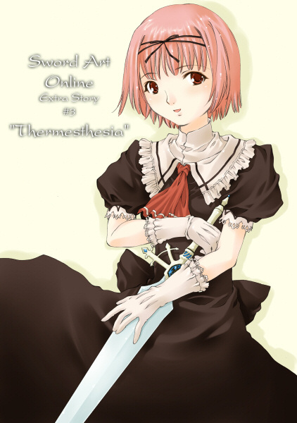

# Sword Art Online 外传3: 心之温度

&emsp;

　　巨大的水车平稳地转动着，那让人心情平静的声音充满了整间工房。

　　虽然只是间不大的职人类玩家专属房屋，但托这个水车的福，价格也高得离谱。当我在第48层主城区《琳达司【Lindarth】》开放后发现这间屋子的时候，脑中瞬间浮现「就是这里了！」的念头，接着看到价格便愕然不已。

　　从那之后，我就开始拼命工作，甚至从各方管道借钱，最后只花了两个月就存满目标金额的三百万珂尔。若这里是现实世界，我挥动铁锤的次数应该足以让自己全身长满肌肉，右手布满厚重的茧了。

　　这么做总算有了结果，我比几名劲敌稍早一步拿到了证书，在这间附有水车的房子开了《莉兹贝特-海涅曼武具店》。这是在三个月前，还带有凉意的春天发生的事情。

> rkl：2026补记，武具店后半边的冠名在文库本中被去除，之后在2019年出版的《ME Remix》中重新出现，为NPC店员汉娜·海涅曼【Hanna Heinemann】的姓氏。

### 1

　　在水车匡啷匡啷的震动声背景音乐下，我慌张地喝完早晨的咖啡——艾恩葛朗特里有这个，实在是太好了——换上锻造师的制服，并面对墙上的大镜子整理仪容。

　　虽然说是锻造师，但服装的设计却不是工作服，真要说的话，应该比较接近服务生的制服。暗赭红色的泡泡袖上衣、同色的伞裙，上面再套着纯白的围裙，胸口别上红色蝴蝶结。

　　这套服装的设计师不是我，是身兼朋友与重要客人、跟我同龄的女孩子。她是这么说的：

　　「因为莉兹贝特有张娃娃脸，笨重、粗犷的衣服一点都不适合你啦。」

　　我原本还觉得「这根本是多管闲事！」，可是换了这套制服后，店铺的营业额就上升了一倍——所以虽然并非我的本意，但从那之后就一直沿用这套制服。

　　她建议的不只服装，就连发型也斤斤计较。我现在这头淡粉红色的轻柔短发，也是她惊人改造的成果。但是就周围的反应看来，似乎也不是完全不适合我。

　　我——锻造师莉兹贝特【Lisbeth】，刚登入SAO时是十五岁。在现实世界就常让人觉得比实际年龄小，而在来到这个世界后，这种倾向又变得更加强烈。映照在镜中的我，有着粉红色头发、深蓝色的大眼睛和小巧的口鼻，配上古典的连身围裙后，更酝酿出如同洋娃娃般的气息。

　　因为在另一边的我是个跟流行绝缘的，性格认真的初中生——经常戴着眼镜，扎着麻花辫——所以总感觉有点不适应。直至最近我才好不容易习惯了这个外表，但个性就是改不过来，对客人怒吼、使客人惊慌失措更是家常便饭。

&emsp;

　　确认没有忘记装备后，我走到店门口，将写着「CLOSED」的木牌翻过来。露出最灿烂的笑容面对在店外等着的几名玩家，并大声说出「早安，欢迎光临！」招呼他们。能自然地招呼客人其实也是最近才习惯的事情。

　　经营一家店是我从小就抱有的梦想。就算是在游戏中，梦想与现实还是有很大的差距。招呼客人等服务业的难处，在以旅馆为据点摆摊贩售时，就已经尝到讨厌的地步了。

　　我自觉不擅长摆出笑脸，便决定以商品质量来决胜负，因此很早就开始专心致力于提升武器制作技能的等级。就结果而言，这是个正确的选择。自从在这里开店后，就有很多固定的客人非常爱用我制作的武器。

　　大概都打过招呼后，就把接待客人的任务丢给NPC店员，我则是躲进与卖场相邻的工房当中。因为一定要在今天完成的特制订单，还有十件左右堆积在那里。

　　拉起装设在墙上的控制杆，以水车为动力的风箱开始往火炉送入空气，旋转磨刀石也跟着发出声响。从道具窗口中取出高价的金属素材，放入火红燃烧的炉内，等温度充分上升后，放到铁砧上。单膝跪在地上，拿起惯用的铁锤，在自动菜单上指定要制作的道具后，接下来就只剩下在金属上敲下固定的次数，制作出武器道具。这个作业并没有什么特殊技巧之类的，虽然完成的武器质量完全是由随机数决定，但相信敲击时的气势会影响结果的我，还是一边集中精神，一边缓缓地举起铁锤。就在准备向金属素材敲下第一击的瞬间——

　　「早安啊！莉兹！」

　　「哇啊！」

　　因为工房的门突然打开，让我的手整个偏掉。铁锤敲到的不是金属，而是铁砧的边角，伴随着丢脸的效果音蹦出火花。

　　抬起头来，就看到闯入者搔着头、吐出舌头笑着。

　　「抱歉，我下次会多加注意。」

　　「你这句台词我已经听腻了……算了，不是在开始敲击后才这样已经很好了。」

　　叹了口气起身，并重新把金属放回火炉中后，我双手叉腰转过身去，看着那位身高稍微比我高的少女。

　　「……亚丝娜，早安。」

　　身为我的挚友，同时也是重要客人的细剑使亚丝娜熟门熟路地穿过工房，往白木制的圆椅坐了下去，接着用指尖梳开长及腰间的栗子色秀发。她的每个动作都像在拍电影一样，就连认识她很久的我也不禁看得入迷。

　　我也往铁砧前的椅子上坐了下去，并把铁锤靠在墙壁上。

　　「……所以，这么早就跑过来，究竟是有什么事？」

　　「啊，要麻烦你处理这个。」

　　亚丝娜从腰间连鞘取下细剑，轻轻丢了过来。我用单手接下，并稍微把刀身拔出。虽然因为不断使用使得光芒变弱，但锐利度应该没有降低。

　　「还不到不能使用的程度，要拿来打磨还太早了一点吧？」

　　「是没错啦，但是我希望可以保持闪闪发亮的样子。」

　　「嗯？」

　　我重新审视亚丝娜。白布上印着红色十字架的骑士服配上迷你裙，这打扮与平常没有两样，但靴子像全新的一样闪闪发亮，耳朵上甚至还戴着小小的银制耳环。

　　「实在是很可疑啊。仔细一想，今天可是平日耶，公会的攻略预定怎么样啦？」

　　我这么一说，亚丝娜便浮现出害羞的笑容。

　　「嗯——我今天请假，因为等一下跟人有约……」

　　「咦咦咦——？」

　　我不管椅子，直往亚丝娜逼近几步。

　　「给我从实招来！你要跟谁见面！」

　　「秘、秘密！」

　　脸颊微微泛红的亚丝娜撇过头去。我交抱双臂，深深地点头说道：

　　「原来如此，才觉得你最近莫名地开朗，原来是交到男朋友了啊。」

　　「才、才不是那么回事啊！」

　　亚丝娜脸颊上的红晕又更明显了。她清了清喉咙，然后余光看着我说：

　　「……我跟之前真的差很多吗……？」

　　「这个嘛，我们刚认识时，你不管睡着还是醒着，满脑子都是攻略迷宫。我还在想你会不会绷太紧了，可是从春天开始你就稍微变得不一样了。至少我实在无法想象之前的你会翘掉平日的攻略活动。」

　　「是、是吗……果然被影响了啊……」

　　「所以，是谁？我认识吗？」

　　「你应该……不认识吧……应该。」

　　「下次给我把人带过来。」

　　「真的不是你想的那样啦！根本就还只是……单相思……」

　　「啥——！」

　　我这次可是打从心底吓了一跳。亚丝娜不但是最强公会KoB的副团长，同时也是艾恩葛朗特排在前五名的美女，想追她的男人多如繁星，我作梦都没想过会有她反过来倒追男人的一天。

　　「怎么说呢，他可是个怪人啊。」

　　喃喃述说的亚丝娜陶醉地看着半空中，嘴角还露出微笑。这要是少女漫画，用来衬托她的背景肯定是大量的花朵四处飞舞。

　　「该说是捉摸不定吗……还是我行我素……而且还强得乱七八糟。」

　　「哎呀，比你还强吗？」

　　「强太多了，单挑对决的话，我大概连十秒都撑不住。」

　　「哦哦——这样就可以把名单缩减到一定程度了。」

　　当我开始翻起脑中的攻略组名册的瞬间，亚丝娜慌张地挥舞双手。

　　「哇啊！不用想象啦！」

　　「好啦，我就衷心期待你带他来见我的那一天。不过要是有机会，就多帮我宣传一下吧，拜托啰。」

　　「莉兹真是可靠呢。我会帮你介绍的——啊！糟糕，快点帮我研磨啦！」

　　「啊，是是，我立刻动手，你就稍等一下吧。」

　　我拿着亚丝娜的细剑站了起来，往装置在工房角落的旋转磨刀石移动。

　　从红色剑鞘中拔出细剑。武器类别《细剑》，专有名《Lambent Light》，是我至今锻造出来的剑当中最高级的逸品之一。即使使用现在能取得的最高级材料，配合最高级的铁锤与铁砧，因为数值完全随机，做出来的武器质量也参差不齐，每个月能打出一把这种剑就该偷笑了。

　　用双手支撑住刀身，往缓缓旋转的磨刀石送过去。研磨武器并不需要特殊的技术，只要抵着磨刀石一段时间就能完成。即使如此，我还是不想随便做做了事。

　　从刀柄开始往前端仔细地滑动刀身。橙色火花伴随着尖锐的金属音飞散开来，同时银色的光芒也逐渐苏醒过来。当研磨完成时，细剑也回复成被朝阳照射时会闪亮反射，甚至还有种穿透感的纯银色。

　　将剑完全收回鞘中，往亚丝娜丢了过去。同时用指头接住她弹过来的一百珂尔银币。

　　「谢谢惠顾！」

　　「下次再请你帮忙修理铠甲——我还要赶时间，先走啰。」

　　亚丝娜起身，把细剑吊上腰间的剑带。

　　「实在让人很在意啊——我也跟你一起去好了。」

　　「咦！不、不行啦！」

　　「哈哈哈，开玩笑啦，不过你下次要带他来喔。」

　　「有、有机会再说。」

　　挥了挥手，亚丝娜便逃跑般飞也似地奔出工房。我叹了口大气，重新坐回椅子上。

　　「……真好。」

　　这突然脱口而出的台词，让我不禁露出苦笑。

　　来到这个世界一年半，个性生来不太会钻牛角尖的我，把热情全投注在让生意兴隆上并一路走到现在。锻造技能几乎都已经完全习得，还开设了自己的店铺。最近似乎是因为找不到目标，有时也会感到寂寞、想有人陪伴。

> rkl：这里的「几乎」反映到ME02就是所有锻造类技能的最低值是784，但最高值也只有923……

　　因为女性在艾恩葛朗特占压倒性少数，至今我也不是没被人追过，但就是提不起劲来。果然还是由自己主动喜欢上的人比较好——我是这样想的。所以就这层意义来说，我真的很羡慕亚丝娜。

　　「我也能触发『华丽的邂逅』这种事件吗？」

　　我边说边把头摇得跟拨浪鼓一样，将这奇怪的想法甩开后站了起来。用火钳从炉中取出烧得通红的铸块，重新放到铁砧上。接着举起铁锤，嘿的一声敲了下去。

　　响彻工房的有规律的敲击音总是能让我的脑中变得一片空白。但只有今天，某种令我焦躁的东西怎么样也挥之不去。

&emsp;

　　那个男人光顾店里是第二天下午的事情。

　　我昨晚勉强把特制武器的订单全部完成，因为睡眠不足而陷在摆设于店头门廊的大摇椅上打瞌睡。

　　甚至还作了个梦，那是我小学时的梦。我虽然是个认真且文静的孩子（自认如此），但总是在午后第一节课感到爱困，常在半梦半醒间被老师叫醒。

　　我很崇拜那个大学刚毕业的年轻男教师，所以觉得被他抓到自己打瞌睡是很丢脸的事，但我又很喜欢他叫人起来的方法。轻轻地摇动肩膀，同时用低沉又平稳的声音——

　　「那个，不好意思打扰你……」

　　「是、是！对不起！」

　　「呜哇？」

　　在像上了发条般弹跳站起并大叫出声的我面前，有个一脸惊讶且全身僵硬的男性玩家。

　　「咦咦……？」

　　我茫然地环视周围，这里是并排着桌子的小学教室——才怪。有些过剩的行道树、宽广的石板路与环绕四周的水渠，以及铺满草坪的庭院。这里是我的第二故乡，琳达司的城镇。

　　看来我是难得地彻底睡迷糊了。咳了两声掩饰自己的不好意思后，向应该是客人的男子回打招呼。

　　「欢、欢迎光临。找武器吗？」

　　「啊，嗯、是的。」

　　男子点了点头。

　　就第一印象而言，实在不觉得他是个高等级玩家。年纪应该比我大一些，黑发、同为黑色的朴素短衫及长裤、靴子，武装只有一把背在背上的单手剑。我店里的商品几乎都是可装备等级要求高的武器，所以我实在很担心这名男子的等级够不够。话虽如此，我还是面不改色地带他走进店里。

　　「单手剑都在这个柜子上。」

　　当我指出陈列成品武器展示品的柜子后，男子便露出困扰的微笑说道：

　　「啊，这个，我想要的是定制武器……」

　　这让我越来越担心了。使用特殊素材制造的特制武器价格最低也超过十万珂尔，若是在出示价格后让客人脸色一阵红一阵白，我自己也会很尴尬，所以怎么样都要避免这种情况。

　　「那个，现在金属的价格有点贵，所以费用应该也会跟着提高……」

　　虽然我这样表示，但黑衣男子却摆出一副这没什么的表情，还回了个令人吃惊的回答。

　　「你不用在意预算，我只要你做出现在能做出的最好的剑。」

　　「……」

　　我好一阵子只能呆呆地望着男子的脸，最后终于开口：

　　「……虽然你这么说……但没给我个具体的性能目标值……」

　　我连语气都变得有点顾不得礼仪了，但男子却完全不在意地点点头。

　　「说的也是。那……」

　　他连同细长的剑带，取下挂在背后的单手剑，向我递了过来。

　　「跟这把剑同等以上的性能，这样如何？」

　　就外表看来，我并不觉得那是多了不起的武器。棕色皮革缠绕的剑柄、同色的剑鞘。不过，就在我用右手接过来的瞬间——

　　好重！

　　差点就要掉到地上了。这个的STR需求值实在高到恐怖。身兼锻造师与战锤使的我，STR也算相当高，但似乎还是无法挥动这把剑。

　　战战兢兢地拔出刀身，因经年使用而泛着暗沉光泽的厚重刀刃反射着光芒。一眼就可以看出这是相当锐利的剑。用指尖轻点，将自动菜单叫了出来。种类《长剑／单手》、专有名称《Elucidator》，制作者名不存在。由此可知这东西不是由同行打造出来的。

　　存在于艾恩葛朗特的所有武器，大约可分为两个种类。

　　一种是我们锻造师制作的「玩家制造型【Player Made】」，另一种则是在冒险中获得的「怪物掉落型【Monster Drop】」。因为锻造师们自然而然对掉落物的武器不抱好感，「无铭」或「杂牌【No Brand】」等揶揄名称也就跟着横行起来。

　　但我觉得这把剑在掉落物中也是非常稀少的道具。一般来说，若将玩家制造型的普通价格物，与怪物掉落型的一般出现物做质量上的比较，前者更胜一筹，但偶尔也会出现这种「魔剑」——大概吧。

　　总之，这东西大大刺激着我的对抗意识。赌上我身为锻造师的自尊，怎么样都不可以输给掉落物！

　　把重剑还给那名男子后，我取下一把挂在店铺正后方墙上的剑。这是两个月前锻造出来，我目前的最佳作品。从白色皮质剑鞘中拔出的刀身上带有淡蓝的光辉，看起来就像缠绕着冰点以下的冷气一样。

　　「这是我目前制造出最好的剑，应该不会输给那把剑才对。」

　　他不发一语地接过我递去的蓝剑，用单手挥了几下后歪着头说：

　　「稍微轻了点耶？」

　　「……那是因为使用了速度系的金属……」

　　「嗯——」

　　男子一副不太满意的表情，又挥了几下剑，最后看着我说：

　　「我可以稍微测试一下吗？」

　　「测试……？」

　　「嗯，耐久力。」

　　他拔出左手上的剑打横放在柜台上，站到前方摆出姿势，右手缓缓举起我的蓝剑——

　　察觉到男子意图的我慌张地说：

　　「等、等等，这么做你的剑可是会断掉喔。」

　　「断了就表示它不够格啦，到时再说吧。」

　　「太……」

　　我硬是把到嘴边的「太乱来了」吞回肚子里。把剑高举过头的男子，眼神带着非常锐利的光芒。瞬间，刀身就被淡蓝色的效果光包围住。

　　「喝啊！」

　　趁着气势的一击，剑以非常快的速度挥下。下一瞬间剑与剑互相敲击，冲击的声响令店内的空气为之震荡。炸开来的闪光过于炫目，让我瞇起眼睛退了一步，就在这个剎那——

　　刀身完美地从中间断成两半飞了出去。

　　——我最佳杰作的刀身。

&emsp;

　　「呜啊啊啊啊啊！」

　　我惨叫着往男子的右手飞奔而去，抢过留在他手上的下半截剑，拼命从各个角度观察。

　　——不可能修复了。

　　当我下了这个判断，更因此垂头丧气之后没多久，剩下一半的剑也变成多边形碎片四散消失了。在几秒钟的沉默后，我慢慢抬起头来。

　　「你……你……」

　　我的嘴唇颤抖着，右手同时用力揪住男子的胸襟。

　　「你在搞什么鬼啊！竟然把我的剑弄断了！」

　　男子也表情僵硬地回答：

　　「抱、抱歉！我没想到会是发动攻击的剑断掉……」

　　……瞬间，一把火冒上来。

　　「所以你的意思是，我的剑比你想象中的还要不堪一击？」

　　「咦——啊——嗯、大概、就是这样吧。」

　　「啊！竟然还承认了！」

　　我放开男子的衣服，两手叉腰挺胸说道：

　　「我话先说在前头！如果有材料的话，能简单砍断你那把剑的武器，要几把我都锻造得出来！」

　　「——喔喔。」

　　听了我顺势吼出来的话，男子露出不怀好意的笑容。

　　「那我郑重拜托你，做出一把可以简单砍断这把剑的家伙。」

　　看着他从柜台拿起黑剑收回鞘中，我的血液也跟着全部往脑袋冲——

　　「既然你都这么说了，我就陪你玩到底！先去找金属素材吧！」

　　想到「啊，糟了」的时候，话已经脱口而出，不过我也没有退路了。男子挑了挑眉，用肆无忌惮的眼神观察我好一阵子。

　　「……这倒不必，我一个人去会比较好吧。我可不想被你碍手碍脚。」

　　「唔呀——！」

　　这男人到底有多惹人厌啊。我不断挥动双臂，像个小孩般抗议。

　　「不、不要小看我！我好歹也是大师级战锤使！」

　　「喔喔——」

　　男子闻言便吹了声口哨。根本就是把我当笑话看。

　　「既然如此，那就让我瞧瞧你的实力吧——总之，我先付你刚刚那把剑的钱。」

　　「不必了！相反的，如果我做出比你的剑还强的武器，我可要好好敲你一笔！」

　　「请便，要多少钱我都会付给你——我的名字是桐人，在你做出剑之前请多指教。」

　　我交抱手臂，刻意撇过头说：

　　「请多指教，桐人。」

　　「哇啊，直接省去称谓了喔，莉兹贝特。」

　　「唔啊！」

　　——以队友来说，这真是坏到不行的第一印象。

---

### 2

　　跟「那个金属」相关的传闻，大约十天前开始在锻造师之间流传。

　　SAO中最终的大型任务【Grand Quest】自然是指突破到最上层。除此之外，还有其他大大小小种类繁多的任务。例如NPC委托的任务、担任护卫，还有寻找物品等，虽然任务内容广泛，但因为报酬中有着令人满足的道具，而且一旦有人完成后，就要隔好一段时间才能再触发，其中甚至有只会出现一次的任务，所以非常受到玩家们的瞩目。

　　这种任务其中之一，是在第58层角落的小村庄中发现的。某个担任村长的NPC说——

　　有只白龙栖息在西边的山中，每天将水晶当食物吃下，并囤积大量经由肚子精制而成的贵重金属。

　　这很明显是个能得到武器素材的任务，所以立刻就有大队人马组成了攻略队伍，轻松地讨伐山上的白龙。

　　——然而，什么都没拿到。掉落物只有少量的珂尔与穷酸的装备道具，甚至连药水跟回复水晶的费用都补不回来。

　　之后大家猜想金属可能是随机掉落，许多队伍便与长老对话、触发事件并把白龙打倒，但还是完全没有出现。一星期内大家宰了不计其数的白龙，却没有任何一个队伍得到金属。最后有人提出一定是遗漏了什么任务条件，现在大家似乎正努力进行考证。

&emsp;

　　听完我说的话，那个啜着我原本不想泡的茶，翘着二郎腿坐在工房的椅子上，名叫桐人的男子回了「啊啊」一声，并轻轻点了点头。

　　「这件事我也有听说过。确实是很有得到素材道具的可能啦。可是还没有人得到过不是吗？我们现在跑去真的能取得吗？」

　　「各种传闻里有一种说法，是『队伍里没有大师级锻造师就不行吧』，因为很少有锻造师会去提升战斗技能。」

　　「原来如此，那的确有尝试的价值——既然如此，我们就快点出发吧。」

　　「……」

　　我非常受不了地盯着桐人的脸。

　　「真亏你这么没有危机意识还能平安活到今天。这又不是去狩猎小妖精，要是不好好募集队伍成员……」

　　「但这么做，就算目标物真的掉落了，也可能分不到吧？那只白龙是第几层的家伙？」

　　「……第58层。」

　　「嗯——这样我一个人应该就能搞定了，莉兹贝特在暗处看着就好。」

　　「……你到底是超级强者，还是超级笨蛋啊？算了，我没差，反正看你边哭边转移逃走好像也很有趣。」

　　呵呵地笑了笑，什么话都没回的桐人迅速喝完茶，把杯子往作业台一放。

　　「那么，我随时都可以出发，莉兹贝特呢？」

　　「啊——算了，反正你也没打算加称谓，叫我莉兹就好……白龙栖息的山范围似乎不算大，可以当天来回的话，我稍微准备一下就好了。」

　　打开窗口，先在连身围裙上装备简单的防具，确认惯用的战锤收进了道具栏后，再检查手上的水晶跟药水的数量是否充足。

　　我挥了挥左手说了声OK，桐人也跟着起身。从工房来到店面一看，幸好现在一个客人都没有，我便趁机将门口的木牌翻回「CLOSED」。

　　站在门廊上抬头环视四周，透进来的阳光还相当灿烂，看来还要好一段时间天才会黑。不论是成功取得金属还是失败——怎么想都觉得后者机率比较高——看来我们能在天色变得太晚之前回来。

&emsp;

　　——事情好像演变成有点奇怪的状况……

　　走出店外，我一边往转移门广场移动，一边在内心仔细思考。

　　我对悠闲地走在身旁的黑衣男子绝对没什么好印象——应该。不但发言令人火大，还是个自以为了不起的自大狂，最重要的，还弄断了我的杰作。

　　话是这么说，我却跟这个刚认识的男人并肩走在一起。而且还组了队，准备出发到颇远的楼层进行狩猎，这样不就是——不就是约……

　　想到这里，我硬是将思考停了下来。过去我从来没碰过这种事。虽然有几名感情不错的男性玩家，但我一定会找各种理由避开两人单独出门的状况。没错……我害怕。害怕与特定的男性发展出更进一步的关系……。我原本一直认为，如果要变成那样，对象必须是自己真心喜欢的人。

　　然而等我回过神来，却是跟这个奇怪的男人……这究竟是怎么回事啊！

　　完全没发现我内心的纠葛，桐人一看到转移门广场入口处的食物摊贩，就直接往那里冲了过去。当他回过头来，嘴上已经咬着一根巨大的热狗。

　　「粒乌黑透要吃吗？」

> rkl：我们都知道你是吃货了……

　　……我的内心瞬间充满无力感，更觉得刚才烦恼的自己根本像个笨蛋。于是我大声回答：

　　「要！」

&emsp;

　　口感很脆的热狗——正确来说，那是外表类似热狗的谜样食物——残留在口中的浓厚味道还没完全消失，我们就已经抵达第58层北侧那个传说中的村落。

　　而且在野外区域遇到怪物时也没发生任何问题。

　　考虑到现在的最前线是第63层，出现在这里的怪物应该也算是强敌的类别。不过我的等级已经超过了65级，而且说了大话的桐人也有差不多的实力，所以好几场遭遇战都在几乎无伤的状况下结束。

　　唯一的失算，就是这个楼层的主题是冰雪地带这件事——

　　「哈啾！」

　　当踏进小村落的圈内而放松下来的瞬间，我打了个大大的喷嚏。其他楼层是夏天，所以我太大意了。这里的地面不但积着雪，每间房子的屋檐还垂着巨大的冰柱。

　　这股仿佛连骨头都能冻结的寒冷，让我整个人喀哒喀哒地发起抖来。而站在一旁的桐人，则是摆出一副惊讶的表情问道：

　　「……你没有带别的衣服吗？」

　　「……没有。」

　　接着，看来也没穿很多的黑衣男子便操作起窗口，先将大件的黑皮革斗蓬实体化，然后往我的头顶放了上来。

　　「……你自己不要紧吗？」

　　「我说啊，这是意志力的问题。」

　　这男的真是每一句话都要惹人生气耶。不过这件有毛皮衬里的斗蓬看来很暖和，我无法抗拒它的魅力，立刻穿了起来。感觉不到冷风的瞬间，着实让我松了口气。

　　「好了……哪一间是长老的家呢？」

　　桐人这么一说，我环视这小小的村落，发现中央广场的对面有间屋顶特别高的房子。

　　「应该是那间吧？」

　　「应该吧。」

　　互相点了点头，我们便迈开脚步。

　　——几分钟后。

　　我们如料想般找到了长满白胡子的村长NPC，也成功触发了对话。因为他的故事是诉说从漫长的儿童时期开始，经过青年、壮年期时的苦水，然后才突然提到栖息在西边山脉的白龙这种拐弯抹角的废话，等他全部讲完时，夕阳已经完全笼罩整个村庄了。

　　我们筋疲力尽地离开村长家。覆盖住所有房子的雪被夕阳染成橙色，这幅景象实在美不胜收，不过——

　　「……没想到光是触发事件就花了这么多时间……」

　　「受不了……怎么办？等明天再挑战？」

　　我转头与桐人对视。

　　「嗯——不过也有听说白龙是夜行性的啊。是那座山吧？」

　　往他指的方向看去，就看到不远处耸立着一座陡峭的白色山峰。虽说如此，在艾恩葛朗特构造的限制下，高度绝对不会超过一百米，所以爬上山顶应该不是什么多难的事。

　　「也是啦，出发吧。反正我也想早点看到你哭的样子。」

　　「你才不要被我华丽的剑术给吓到腿软咧。」

　　原本面对面的两人哼了一声便转过身去。不过，该怎么说，明明在跟桐人互相斗嘴，我的心里却开始感到有些雀跃——

> rkl：所以说桐人这小子在web版就是个花花公子啊……

　　我用力摇了摇头，把没营养的想法重置后，便踏着雪走了出去。

&emsp;

　　白龙栖息的山脉远看时相当险峻，真的开始攀登时却毫不费力就爬了上去。

　　仔细想想，至今许多混合队伍都毫无困难地登顶成功，难度本来就不可能太高。

　　虽然跟时间也有关系，在会出现的怪物当中最强的，只有名为《Frost Bone》的冰制骷髅。何况骸骨系的怪物完全不是我战锤的对手。我就这么敲出锵锵的清脆声响同时不断击倒敌人。

　　在堆满雪的路上走了几十分钟，绕过一堵格外陡峭的冰壁，眼前就是山顶了。

　　上层的底部看来距离很近。到处耸立着突破积雪的巨大水晶柱。夕阳的紫光不规则反射而发出七彩光芒，这幅景色只能用梦幻一词来形容。

　　「哇啊……！」

　　不禁发出欢呼的我正准备跑出去时，却被桐人一把抓住衣领。

　　「唔咕……你在干嘛啊！」

　　「喂，你先准备好转移水晶。」

　　面对那过度认真的表情，我只能乖乖点头答应。我将水晶实体化，并放进围裙的口袋里。

　　「还有，接下来交给我。只要白龙一出现，你就躲到那边的水晶后面，绝对不要出来。」

　　「……什么嘛，我又不是外行，我也要帮忙。」

　　「不行！」

　　桐人那黑色的瞳眸直视着我的眼睛。在眼神相交的瞬间，我了解到这个人是打从心底担心我的安危，因此屏住气息当场呆立。我什么话都没回，只是再次点了点头。

　　露出笑容的桐人拍拍我的头，说了声「那么，走吧。」而我只能不断用力点点头。

　　总觉得突然连气氛都整个改变了。

　　会跟桐人一起跑来这里，要说是想转换心情呢？还是顺势而为——总之，我完全没有意识到这是要赌上生命的战斗。

　　何况我升级所需的经验值几乎全部来自制作武器，根本不曾去过毫不容情的战场。

　　但我觉得这个人不一样。他有着每天都在充满危机的地方战斗的人才会有的眼神。

　　抱着混乱的心情走了一会，立刻抵达山顶的中央。

　　我看到那个被水晶柱围起来的空间——

　　「呜哇……」

　　开了个直径少说有十米的巨大洞穴。表面结冰而闪闪发亮的壁面垂直向下延伸，深处更覆盖着令人看不见底部的黑暗。

　　「好深啊……」

　　桐人用脚尖将一小块水晶碎片往洞穴踢了下去。掉下洞穴的碎片反射出的小光点立刻消失不见，而且连个回音也没有。

　　他轻轻敲了一下我的头说道：

　　「你可不要掉下去啊。」

　　「才不会咧！」

　　我正嘟起嘴唇回话的时候，一阵像是猛禽的尖锐叫声，将被最后一抹夕阳染成蓝色的空气撕裂开来。

　　「躲到那后面！」

　　桐人指着附近的大水晶柱，用命令的语调说着。我慌忙照他的话做，对着桐人的背影比手画脚大喊：

　　「那个……白龙的攻击模式是双手的钩爪、冰冻吐息和暴风攻击……你、你要小心喔！」

　　很快地补上最后那句话，便看到桐人保持背对着我这种耍帅的姿势，挥出竖起拇指的左拳。他前方的空间几乎同时晃动起来，巨大的物体跟着如渗透般涌出。

　　粗糙的多边形块接二连三地出现。随着那些多边形一一接合，外形逐渐成形，信息量也不断增加，最后巨大的身躯几乎完成——才刚能辨识外貌，令人全身颤抖的吼声再度响起。无数的碎片往四方飞散，接着闪着光芒蒸发消失。

　　出现的是鳞片如冰块般闪耀的白龙。它缓缓拍动着巨大的翅膀悬停在空中。那个姿态令人感到恐惧——其实用非常美丽来形容会更合适。它瞪着那红宝石般的大眼睛，居高临下睥睨着我们。

　　桐人以冷静的动作把手伸向背后，高声拔出漆黑的单手剑。接着，那个声音仿佛信号般，白龙张开了它大大的下颚——伴随硬质的音效，喷出闪着白光的气体洪流。

　　「是吐息！快点闪开！」

　　我不禁如此大叫，但桐人却一动也不动。他直挺挺地站着，将右手的剑像展示般向前举起。

　　那么细的武器怎么可能挡得住吐息攻击啦——我才刚这么想，剑就以桐人的手为中心，开始像风车般旋转起来。从包覆着淡绿色的效果光判断，那应该是剑技的一种。没多久，旋转的速度快得看不见刀身，外表看来就像是光做成的圆盾。

　　冰的吐息从正面往光盾袭击过去，发出炫目的纯白闪光，让我不禁别过头去。不过，冷气洪流打在桐人用剑做出的盾牌上，就像被吹散般扩散、蒸发。

　　我连忙凝视桐人的身体以确认他的HP条。可能因为没办法完全挡下吐息，他的生命值正一点一点往左边减少。但令人惊讶的是，那些损伤在经过几秒后又立刻回复了。这应该是超高等级战斗技能中的《战斗时回复》——然而，想让这个技能的熟练度上升，就必须在战斗中持续受到很大的伤害。以现实层面考虑，这个技能根本不可能修行。

　　他——到底是谁……？

　　事到如今，我才开始努力思考这名黑衣剑士的身分。实力如此坚强，只会让人联想到是攻略组玩家。但是以KoB为主的顶尖公会人员名单中，并没有这个名字。

　　这时，算准吐息攻击结束的桐人有了动作。他踏出爆炸般的雪尘，往停在半空中的白龙扑了过去。

　　一般来说，面对飞行的敌人时，理论上都是先使用战戟系或投掷系，这种攻击范围较长的武器将对方拖到地面后，攻击范围较短的成员才跟着加入战局。但桐人却令人惊讶地飞到几乎快碰到白龙头顶的地方，接着在空中发动单手剑连续技。

　　发出锵锵尖锐的声音，桐人的攻击以眼睛根本跟不上的高速不停往白龙身上招呼。虽然白龙也用左右手的钩爪应战，但效果实在差太多了。

　　当桐人经过漫长的滞空重新落到地面时，白龙的HP条已经减少了三成以上。

　　——压倒性的强大。看着这让人不敢相信的战斗场面，让我不禁背脊发冷。

　　虽然白龙瞄准落地的桐人喷出冰冻吐息，但他这次用冲刺进行闪避后再度跳起。随着重低音响起，单发的重攻击也接连击中目标，这时白龙的生命值也大规模地减少。

　　HP条立刻从黄色变成红色，应该再进行一、两次攻击战斗就会结束了。我决定这次就率直地夸赞桐人的实力而站起身来，从水晶柱后面踏出一步。

　　这个瞬间，桐人彷佛背后有长眼睛似的，突然大叫：

　　「笨蛋！还不要出来啊！」

　　「什么嘛，明明就要结束了不是吗，快点解决……」

　　当我高声回话时——

　　飞得比原来更高的白龙将双翼大大展开。两只翅膀在身体前方拍打的同时，白龙正下方的积雪「砰！」的一声飞舞起来。

　　「……？」

　　在不禁呆立现场的我前方数米处，将单手剑刺入地面的桐人像是要对我说什么似地动着嘴，但他的身影立刻被雪尘掩盖。下一瞬间，我在空气障壁的撞击下被轻轻松松吹到半空中。

　　完了……是暴风攻击！

　　在空中翻滚时，我才想起白龙的攻击模式。不过很幸运的，这可说没什么攻击力，所以我几乎没有受到伤害。我张开双手，摆出着地姿势。

　　然而——在雪尘散开后的前方，没有地面存在。

　　是山顶上的巨大洞穴。我被吹到那个洞穴的正上方了。

　　思考瞬间停止，身体也整个冻结。

　　「骗人……」

　　我在无意识中只能喃喃说出这句话，右手徒然往空中伸出去——

　　——一只戴着黑皮革手套的手，紧紧抓住了我的手指。

　　我大大地睁开几乎失焦的双眼。

　　「…………！」

　　在遥远的地方跟白龙对峙的桐人以惊人的速度奔驰而来，毫不犹豫地往空中纵身跃起，并用左手抓住了我的手，就这样把我拉到他的怀里。然后将放开的手臂环绕到我背后，紧紧地抱住我。

　　「抓紧了！」

　　我听着桐人那在耳边响起的吼声，并且忘我地用双手抱住他的身体。下一瞬间，两人开始坠落。

　　在巨大洞穴的中央，我们两个人抱在一起直直往下掉落。耳边风声大作，斗蓬也啪嗒啪嗒地翻飞。

　　若是这个洞穴延伸到楼层表面，从这个高度掉下去肯定会死。这个想法掠过脑袋，但我怎么也不觉得是现实中发生的事，只是呆滞地看着那逐渐远去的白光圆圈。

　　突然，桐人握着剑的右手动了起来。先是用力往后举起，接着向前方挥了出去。光芒伴随「锵咻！」的一声金属音飞散开来。

　　沉重突刺技的反作用力改变了我们落下的角度，往洞穴的壁面弹去。蓝色的冰壁眼看着渐渐逼近，我不由得咬紧牙关。要撞上了——！

　　就在差点撞上去前，桐人再度举起右手上的剑，全力往壁面刺了过去。就像武器与旋转磨刀石接触时一样，激烈的火花飞散而出。这瞬间的冲击使得落下的速度减缓下来，但还是没办法停住。

　　彷佛切开金属的声音不断响起的同时，桐人的剑正削着冰壁。我转动脖子往落下的方向看去，已经能看见积满白雪的穴底了。眼看着越来越靠近，只剩不到几秒就要撞上去了。我心想至少不要发出惨叫而拼命咬住嘴唇，并用力抱住桐人。

　　桐人将手上的剑放开，用双臂紧紧抱住我，并旋转身体使自己位于下方。接着——

　　冲击。巨响。

&emsp;

　　如同爆炸一般飞起的雪花轻轻飘落在脸颊上，接着消失。

　　那股寒冷将飞散的意识拉了回来。睁开眼睛，在非常近的距离下跟桐人的黑色眼睛视线相交。

　　桐人依旧紧紧抱住我，嘴唇微微动了动。

　　「哇哦。」

　　他歪着半边脸，轻轻笑了。

　　「……还活着啊。」

　　我也轻微地点了点头，出声回答：

　　「嗯，还活着。」

　　数十秒——也有可能是数分钟，我们动也不动地保持这个姿势躺在那里。桐人身上传来的热气让人整个放松下来，脑袋也一片空白。想要——想要让他紧紧地抱住我——

　　然而，桐人放开了手臂，慢慢坐起身来。他从腰间的袋子里拿出两个像是高级回复药水的小瓶子，把其中一个递给我。

　　「好歹还是喝了吧。」

　　「……嗯。」

　　我点着头坐起上半身接过瓶子，并确认自己的HP条。我还剩将近三分之一，但直接撞上地面的桐人则已经进入红色区域了。

　　我拔开瓶盖，把酸甜的液体一口气喝完后，往桐人的方向转过身去。保持有点随便的坐姿，我动起还不太能好好说话的嘴唇。

　　「那个……谢、谢谢你救了我……」

　　桐人一如往常地微微露出冷笑，说道：

　　「要道谢还太早了。」

　　将视线往上空一瞥。

　　「……接下来要怎么才能离开这里呢……」

　　「咦……用瞬间转移就可以了啊？」

　　我伸手探进围裙的口袋，把闪着蓝色光芒的转移水晶抓出来给桐人看。可是——

　　「应该没用，这原本就是要让玩家掉落的陷阱，我不觉得能用那么简单的手段逃出去。」

　　「怎么这样……」

　　我向桐人稍微靠了过去，接着伸出左手。在确认他握住我的手后，举起水晶：

　　「转移！琳达司！」

　　——我的叫声空虚地在冰壁上造成回音，最后消失。水晶只是无言地发出闪光。

　　桐人松开手，轻轻耸了耸肩。

　　「要是我确定可以使用水晶，刚刚在坠落的时候早就用了。因为这里感觉很像水晶无效化空间……」

　　「…………」

　　我失望地垂下头去，桐人啪的一声把手放到我头上，还把我的头发摸得乱七八糟。

　　「好啦，别那么沮丧。不能使用水晶，就表示一定还有别的方法可以从这里离开。」

　　「……很难说吧，这可能是以让掉下来的人百分之百死亡为条件的陷阱耶……应该说，通常已经死了吧！」

　　「原来如此，说的也是。」

　　看到桐人轻易地点头同意，让我再度感到全身无力。

　　「你……你这个人啊！能不能有精神一点啊。」

　　看到我瞬间吼出声，桐人露出了笑容说道：

　　「莉兹还是生气的时候更可爱。就是这股气势。」

　　「什……」

　　我的脸不知不觉间红了起来，而且身体僵硬。桐人把手从我头上拿开，并站起身来。

　　「接下来就开始做各种的尝试吧……点子募集中！」

　　「……」

　　对于桐人那就算遇到这种状况依然我行我素的态度，我只能露出苦笑。觉得自己也稍微提振起精神后，我啪的一声用双手拍了自己的脸颊，跟着站起身来。

　　环视周围，这积着薄薄的雪、还算平坦的冰地板确实是洞穴底部。直径应该与洞口相同，大约十米左右。经由冰壁反射进来的夕阳余光，从又高又远的入口处无力地照了下来，但应该立刻就会完全被黑暗包围。

　　看来不论是地面还是周围的墙壁，全都没有像是可以离开的通路。我把双手叉在腰间，拼命地动着头脑，接着将最先浮现的点子说出口：

　　「那个……找人来帮忙呢？」

　　「嗯——这里算是迷宫吧？」

　　遭到了桐人简洁的否决意见。

　　虽然跟登录在朋友名单上的玩家，例如亚丝娜，有类似邮件、名叫友人消息的联络手段，但是这个功能无法在迷宫中使用。附带一提，也无法追踪对方位置。慎重起见，我还是开启讯息窗口来看了一下，但就如桐人所言无法使用。

　　「那……大声呼叫来狩猎白龙的玩家呢？」

　　「这里距离山顶大约有八十米……声音应该传不上去……」

　　「是吗……喂！你也好好想想办法啊！」

　　当我因为意见不断被打回票而有点动怒地回嘴后，桐人就说出了非常不得了的发言。

　　「顺着墙壁跑上去吧。」

　　「……你是笨蛋吗？」

　　「是或不是，试了就知道……」

　　在我惊讶的视线下，桐人先是往墙壁靠到最近，接着突然以非常快的速度朝另一边墙壁飞奔而去。积在地板上的雪花激烈地飞起，强风也打到我的脸上。

　　就在快撞上墙壁时，桐人瞬间低下身去，随着跟爆炸一样的声响往上跳起，在又高又远的墙上立足后，就这样斜着往上方跑去。

　　「怎么可能……」

　　距离目瞪口呆地站在那里的我遥远的上方，桐人跟B级电影中的忍者一样，在冰壁上呈螺旋状往上奔驰。他的身影眼看着越来越小——在爬到约三分之一的高度时，脚一滑跌了一跤。

　　「哇啊啊啊啊啊！」

　　桐人再次将剑刺向墙面，刮了一下后掉了下来。

　　「哇啊啊啊？」

　　我尖叫着跑向他落下的地点。虽然我伸出了手，但还是差了一点——随着「砰！」的一声，桐人落到了地面上。

&emsp;

　　几分钟后，与喝完第二瓶回复药水的桐人并肩靠墙坐着的我，忍不住叹了口大气。

　　「——虽然我一直觉得你是笨蛋，但没想到会笨到这种地步。」

　　「助跑距离再长一点就爬得上去了啦。」

　　「才没这回事咧——」

　　我轻声嘀咕着。

　　把喝干的瓶子往袋子扔的桐人无视我的吐嘈，用力伸了个懒腰后开口：

　　「嗯，总之天色也暗了，今天就在这里露宿吧……」

　　确实，夕阳的颜色已经完全退去，深不见底的黑暗完全包围着洞底。

　　「也是……」

　　「既然决定了就……」

　　桐人打开窗口，移动手指，开始把各种东西一个接一个实体化。

　　大型露宿用提灯、锅子、几个神秘的小袋子，以及两个大马克杯。

　　「……你一直随身携带这些东西？」

　　「在迷宫彻夜未归可是家常便饭啊。」

　　他摆出认真的表情回着话，看来不是在开玩笑，并点击提灯点火。啵的一声，明亮的橙色光芒照耀四周。

　　将小小的锅子放在提灯上，桐人先拿起雪团丢了进去，接着又把装在小袋子里的东西全倒下去。盖上锅盖，连点两下锅子，倒数料理等待时间的窗口便浮现出来。

　　不久，药草类的芳香传进了我的鼻子。仔细想想，中餐根本只啃了一根热狗。我势利的胃就像清醒过来一样，开始强烈主张自己饿了。

　　伴随砰的效果音，倒计时也跟着消失。桐人拿起锅子，把里面的东西倒进两个杯子里。

　　「我料理技能的熟练度是零，所以别期待味道啊。」

　　「谢谢……」

　　接下递过来的杯子，一股温暖慢慢在双掌间扩散开来。

　　虽然只是用药草跟肉干简单做成的汤，但食材道具似乎很高级，味道真是好得不得了，温暖渐渐渗透冰冷的身体。

　　「真是……奇妙的感觉……好不真实……」

　　我喝着热汤轻声嘀咕。

　　「像这样……在没来过的地方，跟初次见面的人坐在一起吃着饭……」

　　「是吗……因为莉兹是职人等级嘛。闯荡迷宫时，跟遇到的玩家组成野团露宿的状况可是屡见不鲜呢。」

　　「嗯——这样啊……再多讲一些关于迷宫的事嘛。」

　　「咦、嗯、好吧，我是不觉得多有趣啦……啊！在那之前……」

　　桐人动手回收两个空掉的杯子，和锅子一起收进窗口。接着又继续操作，这次拿出的是两块大布块。

　　从摊开后的模样看来，应该是露宿用的携带式床铺。外表跟现实世界里的睡袋很像，但是非常大。

　　「这可是高级品喔，隔热效果绝佳，还附有对主动怪物用的隐蔽效果。」

　　他笑着丢了一个过来。我接住后在雪地上摊开，发现这东西大到足以装进三个人。我再度惊讶地说：

　　「亏你可以带着这种东西到处跑，而且还两个……」

　　「要彻底利用道具持有量嘛。」

　　桐人迅速解除武装，钻进左边的携带床铺中。我也跟着解除了斗蓬跟战锤，把身体滑进袋状的布垫中。

　　不愧是他得意的道具，里面确实很温暖，而且还比看起来要蓬松柔软。

　　我们之间放着提灯，各自躺在相隔大约一米的地方。不知为何——我感到有些害羞。

　　彷佛要驱散这股害羞，我开口说道：

　　「欸，继续刚刚的话题吧。」

　　「啊啊，嗯……」

　　桐人将两只手臂交叉放到头后面，接着开始娓娓道来。

　　在迷宫区踩到MPK——刻意聚集怪物以袭击其他玩家的恶质犯罪者——陷阱时的事。与不知道弱点的BOSS怪物连续战斗了整整两天的事。为了分配稀有道具而举办的百人猜拳大会的事。

　　每个故事都很刺激、令人痛快，有时也有些滑稽。而且，所有的故事都明确地指出，桐人是不断在最前线战斗的攻略组成员之一。

　　然而，如果是这样——这个人的肩上可以说背负了四万名玩家的命运。应该不是可以为我这种人付出性命的人。

　　我转过身看着桐人的脸，那反射着提灯光芒的黑色眼睛看了我一眼。

　　「那个……桐人，可以问你一件事吗……？」

　　「——怎么突然那么慎重？」

　　他的嘴角浮现出一丝有些害羞的笑意。

　　「那个时候，为什么要来救我……？又不是保证一定能得救，不对……应该说你也一起死掉的机率还高得多，可是……为什么……」

　　桐人的笑容瞬间消失。过了一会儿，他用非常平稳的声音低声说道。

　　「……比起对人见死不救，那还不如一起死了算了。而且对象又是像莉兹这种女孩子。」

　　「……你真是笨蛋耶，不会有像你这样的家伙了。」

　　嘴上这么说着——眼眶却不禁渗出眼泪。胸口深处无可救药地紧紧揪成一团，我拼命想打消这种感觉。

　　这种老实到不行又直接的温暖话语，在来到这个世界之后还是第一次听见。

　　不对——即使在原本的世界也不曾听过。

　　这几个月来持续留在我内心深处，不断刺痛我的那股渴望有人陪伴、以及寂寞的感觉，突然变成大浪侵袭着我。我想要以能接触到内心的距离，更直接地确认桐人的温暖——

　　无意识中，话语从我口中流泄而出：

　　「呐……我可以……到你那边吗……？」

　　桐人一瞬间睁大眼睛，我在看到他的脸微微泛红的时候，才意识到自己刚才说了什么。

　　「那……那个……」

　　脸一下子变得好热，心脏也开始砰砰地跳动。我好不容易才动起原本动不了的嘴唇，说出条理不清的话：

　　「感，感觉有点冷……然后……」

　　——我正想接着说「不过，我能忍住」，桐人就动了。他把身体移到床铺的里侧，低着头低声说道：

　　「……可以。」

　　桐人的身旁——很温暖。想要触碰他、想和他贴在一起的欲望，冲走了纠结缠绕的思绪。

　　我在这微微发热的轻飘飘的感情驱使下坐起身，从床铺里钻出，移动到桐人的枕边。

　　脸已经完全发红的桐人，虽然没有和我对视，右手还是轻轻揭起了床铺的布。

　　我默默想钻进狭窄的缝隙，却觉得硬质长裙和围裙有点碍事。之后虽然很不好意思但也没办法——脑子里这样想后，我呼出窗口立刻解除了装备，变成只穿着淡蓝色贴身背心的样子，从脚到头滑进了床铺里。

　　接着，轻柔而安稳的温暖包围了我的身体，仅仅如此就让我感觉到心情舒畅。想要——想要更多的感触。于是我又将身体移动到桐人旁边，上半身紧贴着他，又将脚缠在一起。

　　可以感觉到桐人的手臂战战兢兢地绕过了我的身体。我将脸贴在他的肩膀，用微弱的声音说道：

　　「请……抱得再紧一点……」

> rkl：在日语的语境中，「抱いて」是较为明显的性暗示。

　　他的手臂开始用力，我感觉脑子里已经麻木了。

　　「哈啊……」

　　我终于忍受不住，深深地吐出了一口气。

&emsp;

　　是人的温暖啊……我这么想着。

　　来到这个世界以后，时常盘据在我一部分内心的那股渴望，我现在似乎终于了解它的真面目了。

　　这里是虚拟世界——真正的身体被丢在遥远的地方，再怎么伸手也够不到。我害怕意识到这件事，所以不断设定目标，全心投入工作。不断告诉自己磨练锻造的技术、让店铺更繁荣就是我的现实生活。

　　但是在我的内心深处，仍然觉得这一切都是假的，只是单纯的数据。我渴望着真正的人的温暖。

　　当然，桐人的身体也是由数据构成的。如今包围着我的温暖，也只不过是电子信号使我的脑部产生了感觉到温度的错觉而已。

　　但是，我终于了解到那根本不是问题所在。感受对方的真心——不论在现实世界或这个虚拟世界，只有这点是唯一的真实。

&emsp;

　　从桐人心中散发出的热量，让我就这样融化了。身体的界限变得暧昧，只有心中的痛楚支配着意识。

　　我知道存在着解除伦理代码的设置项。如果桐人有这样的请求，我想我大概也会回应吧。但是，已经没有这个必要了。在两人间交错的电子脉冲，已经将心的距离缩减为零——

　　「再——再多碰碰我……」

> rkl：完了，我果然不适合翻译R-18或者擦边球的内容……

　　随着桐人双手的动作，我的脑海里劈啪作响。包围着身体的热量变得越来越多。

　　「…………！！」

　　突然，原本应当紧闭着的眼里染成一片空白。意识一下子飞散开来。在平滑的黑暗中，不断落下——

　　到底是睡着了呢，还是失去意识了呢，我已经不知道了。

> rkl：说到底……我估计其实没有发生任何R-18的事情……虽然川原曾经参与了某篇与此相关的R-18文的合作撰写工作……关键词：カラダの温度……各位请自己放狗……

&emsp;

[Main](../index.md) [Next](saoex3-02.md)
