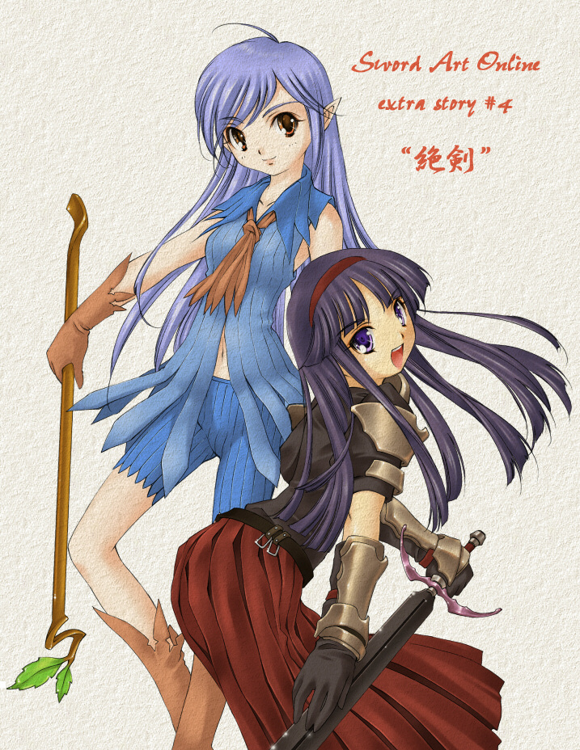

#  Sword Art Online 外传4: 绝剑

&emsp;

　　「——亚丝娜，你听说了吗？《绝剑》的事。」

　　听到莉兹贝特的声音，亚丝娜停下敲打全息键盘的手指，抬起头来。

　　「号码布？要开运动会吗？」

> rkl：日语中「号码布」和「绝剑」读音相同，均为 zekken。

　　「不是不是。」

　　莉兹贝特笑着摇摇头，从桌上端起冒着热气的马克杯喝了一口，接着说道。

　　「不是片假名，是汉字。绝对的绝，加上一个剑，写作绝剑。」

　　「绝……剑。是新实装的稀有道具之类的吗？」

　　「不不。是人名啦。外号……或者说是名号吧。虽然谁也不知道本名就是了。因为实在太强，不知道是谁先叫起来的，就得了《绝剑》这个名字。绝对无敌的剑，空前绝后的剑……我想大概是这个意思。」

　　听到「很强」二字，亚丝娜的好奇心被大大激起。她原本对自己的剑术就大有自信。如今身为《Alfheim Online》的玩家，她虽然选择了水妖精这一种族，主要职责是在后方咏唱回复魔法，但有时仍会热血上涌，拔出腰间的细剑冲进敌阵大闹一场，因此还得了个《狂暴治疗者【Berserk Healer】》这样与优雅毫不沾边的称号。

　　她也积极参加每月举行的决斗大会。如今习惯了ALO的三维战斗，实力已能与火妖精族的尤金将军、风妖精族的朔夜领主等强者比肩，听说又有高手出现，自然无法置之不理。

　　亚丝娜保存了写到一半的生物学报告，关闭全息键盘，端起手边的马克杯，用指尖轻轻一点，让杯中盛满热茶。她重新往那把直接从地板上生长出来的活树椅里坐深了些，摆好了认真听她讲下去的姿势。

　　「然后呢……？那位《绝剑》，是个什么样的人？」

　　「我想想啊……」

***

### 1

　　新生艾恩葛朗特第22层的幽深森林，已被白雪严严实实地覆盖。

　　外面的世界也正值一月上旬的隆冬，但近年来全球变暖愈发严重，东京的气温几乎不会降到零度以下。听说，等到目前正在规划建设的《都心第二阶层》在数十年后竣工，就连真正的雪也不会再下了。

　　然而，不知是不是运营方服务精神的体现，妖精之国阿尔普海姆却一直维持着名副其实的严冬气候。在大陆中央的世界树以北，野外区域的体感温度降到零下十度、二十度是家常便饭。若没有备好防寒装备，或没有耐寒咒文的庇护，根本不会想飞上天空。

　　不过，即便是足以让小河冻透到底的寒气，也侵入不了这间有厚实木墙保护的屋子。

　　自2015年5月《Alfheim Online》大规模更新——实装《浮游城艾恩葛朗特》以来，驱使亚丝娜投入游戏的动力就只有一个。

　　那就是拼命存够所需的珂尔，不，是尤尔德硬币，比谁都早一步激活第22层的转移门，买下那栋孤零零地坐落在针叶林深处的原木制玩家住宅。当然，原本建在曾存在于遥远过去的另一座浮游城里的那栋房子，正是她曾度过短短两周快乐、甜蜜而又令人心酸时光的那个地方。

　　第22层只有森林，人烟稀少，主城区的村子里也有不少玩家住宅，她觉得应该不至于有人和自己看中同一栋房子。即便如此，她还是在桐人以及莉兹贝特、西莉卡、莉珐她们的帮助下，总算凑齐了那笔巨款。她仿佛踢开亲手打倒的第21层BOSS怪物的尸骸一般，冲到了原木屋前。点击购买窗口的OK按钮后，她忍不住蹲下来哭了。（那天晚上，派对结束、客人都回去以后，她与桐人，还有恢复原本少女模样的结衣三人举杯庆祝时，又大哭了一场。）

　　为什么对这个地方如此执着，连亚丝娜自己也很难说清。说是因为在这里，她与第一次真心爱上的男孩子，虽身处虚拟世界，却历经艰难困苦终于走到一起，度过了一段短暂而幸福的日子，倒是很简单。然而，亚丝娜觉得并不只是如此。

　　或许，这栋房子，就是一直在现实世界中寻找归属的亚丝娜，终于找到的真正意义上的《家》。如同一对鸟儿收起翅膀、相依而眠的小小暖巢。心灵得以回归的地方。

　　不过，费尽辛苦买下原木屋以后，这里却彻底成了伙伴们的聚会场所，几乎没有一天断过客人。这间经亚丝娜倾心布置的小屋，似乎舒适得能让每一位来过的人都为之着迷。SAO时代的伙伴自不必说，在ALO新结识的朋友也时常来访，津津有味地享用她亲手做的料理。——只是有一回，不知怎么凑巧，朔夜和尤金坐上了同一张餐桌，那顿饭的气氛着实紧张。

　　今天，也就是2016年1月6日，「长」在森林之家客厅里的那张树桌旁，也坐满了熟悉的面孔。

　　亚丝娜右边坐着西莉卡，正对着全息窗口上显示的算式，也就是寒假作业，绞尽脑汁，不时发出呻吟。左边的莉珐也盯着英文，皱紧了眉头。

　　对面坐着的莉兹贝特则一手拿着树莓利口酒【liqueur】，翘着腿大大咧咧地靠在椅背上，似乎正沉浸在游戏里出售的小说中。

　　现实世界里才下午四点左右，窗外却早已暮色深沉，静静飘落、渐渐积起的白雪映着灯光。即使不听那隐约的风声，也知道外面一定冷得刺骨。但屋子深处的壁炉里，木柴烧得通红，上面一口深锅中的蘑菇炖菜正咕嘟咕嘟地冒着热气，将香味与暖意一同送了过来。

　　亚丝娜也将双手放在全息键盘上，在空中展开好几个浏览器窗口（在ALO的玩家住宅里，通过选项设置，也能连接游戏外的网络），一边浏览调出的资料，一边顺利地撰写课题报告。

　　母亲（当然是现实中的母亲）虽然不赞成亚丝娜把现实世界里能做的事放到VR世界里完成，但像长时间输入文字这样的工作，显然还是在这边效率更高。不仅眼睛和手腕都不会疲劳，还能在便于查看的位置悬浮许多资料窗口，数量远不是自己房间里那台UXGA分辨率的显示器所能显示的。

　　她曾向母亲这样解释过，还让母亲试用了一款AmuSphere上的文字输入专用应用程序。然而，母亲才用了几分钟，就说着『我头晕』登出了，从此再也不肯碰。

　　虚拟世界眩晕症确实存在，但对如今甚至可以说是直接式VR世界原住民的亚丝娜而言，这边的真实感，在某种意义上甚至胜过现实。她的十指飞快地移动，没有一次误输入，编辑器里的文章也稳步接近结论——

　　就在这时，有什么东西轻轻靠上了她的右肩。

　　转头一看，原来是西莉卡将一头黑色短发的脑袋倚在了亚丝娜肩上，突出的三角形耳朵微微抖动，脸上带着幸福的神情，正发出均匀的呼吸声。

　　亚丝娜不由得微微一笑，伸出左手食指，轻轻挠了挠西莉卡的猫耳。

　　「喂，西莉卡。现在睡了，晚上又睡不着，可就麻烦了哦。」

　　「唔……嗯……」

　　「寒假只剩三天了哦。得加把劲做作业才行。」

　　揪了一下耳朵，西莉卡的身体先是一颤，接着抬起头来。她神情恍惚地眨了几下眼，甩甩脑袋，望向亚丝娜。

　　「呜……呜呜……好困啊。」

　　她一边嘟囔，一边张大长着小小白色尖牙的嘴，打了个大哈欠。亚丝娜认识的猫妖精族玩家，只要来到这栋房子就都特别能睡，让她不禁怀疑，这莫非也是某种种族特性。

　　亚丝娜探头看了看西莉卡面前的全息面板，说道。

　　「这一页不是快做完了吗。再加把劲，一口气解决掉吧？」

　　「唔……好……」

　　「是不是房间里有点太暖和了？要不要把温度调低一点？」

　　听她这么问，这回是左边的莉珐带着笑意开了口。

　　「不，不是这个原因，我觉得是那个害的啦。」

　　「？」

　　亚丝娜转头看去，只见莉珐晃动着黄绿色的长发，将视线投向房间深处、壁炉那边。

　　「……啊，原来如此……」

　　顺着那个方向望去，亚丝娜深有同感地点了点头。

　　烧得通红的壁炉前，摆着一把用磨光木料制成的大摇椅。

　　深陷在椅子里、睡得浑然不知周遭一切的，是个肤色微黑、漆黑短发根根翘起的影妖精族少年。不用说，正是桐人。

　　他的胸口上，一只长着水蓝色羽毛的小龙也蜷着身子，将脑袋埋进蓬松的尾巴里，睡得十分舒服。那是驯兽师西莉卡从SAO时代起的搭档，小龙毕娜。

　　而一个身形又小上一圈的妖精，则把毕娜覆着柔软羽毛的身体当成床，露出天真无邪的睡脸。她有一头光泽莹润的深蓝色直发，穿着白色连衣裙，是桐人专用的导航妖精，也是亚丝娜和桐人的「女儿」——结衣。她的真实身份，是旧SAO服务器中因突变而诞生的人工智能。

　　桐人、毕娜和结衣像三层镜饼一样叠在一起，在摇椅上幸福酣睡的模样，释放出一种堪称魔力的催眠效果。光是盯着看上几秒，连亚丝娜的眼皮也会渐渐沉重起来。

　　桐人这个人实在是很能睡。仿佛现在就要讨回SAO时代舍不得睡觉、没日没夜攻略迷宫区所欠下的债似的，只要待在这个家里，亚丝娜稍一不留神，他就会倒进那把心爱的摇椅，呼呼大睡。

　　而在亚丝娜所知的事物里，也没有什么比摇椅上桐人的睡相更能勾起睡意。

　　从前身在SAO的时候，无论是在森林之家，还是在艾基尔店里的二楼，只要桐人摇着椅子，亚丝娜几乎总会坐上去，与他共享温暖的浅眠。也就是说，亚丝娜自己也深有体会，自然能理解西莉卡和莉珐为什么会被勾起睡意。

　　可奇怪的是，就连本该只依照极其简单的算法行动的毕娜，只要碰上桐人睡觉，也会扑扇着翅膀从主人西莉卡的肩头飞起，在他身上蜷成一团睡下。这实在让人怀疑，熟睡的桐人身上是不是会散发某种「睡意参数」。事实上，自己明明直到刚才还在全力开动脑筋写报告，不知不觉间，身体却变得轻飘飘的……

　　「喂，亚丝娜小姐，你自己都睡着了呀！啊，连莉兹小姐也！」

　　西莉卡摇晃着她的肩膀，亚丝娜猛然抬起头来。

　　与此同时，桌子对面的莉兹贝特也猛地一惊，坐直身体，连眨了几下眼，然后不好意思地笑了。她拢起那头泛着金属光泽的淡粉色头发——这是锻造妖精族的特征，像是为自己辩解般嘟囔起来。

　　「为什么一看那个就这么想睡啊……该不会是影妖精的幻影魔法吧。」

　　「呵呵，怎么可能。我来泡点茶提提神吧。虽说是泡茶，其实也是偷懒啦。」

　　亚丝娜站起身，从身后的架子上取下四只杯子。那是最近做任务时得到的魔法马克杯，「只要点击一下，就会随机涌出九十九种口味中的一种茶」。

　　杯子和配茶的水果挞一摆上桌，西莉卡立刻就来了精神，睡意一扫而空。四人随即各自端起杯子，将散发着不同香气的热饮送到嘴边。

　　「说起来啊。」

　　正是在这个时候，莉兹贝特像是想起什么似的开了口。

　　「——亚丝娜，你听说了吗？《绝剑》的事。」

&emsp;

　　「经常听到传闻，大概是从年末年初那阵子开始的……也就是一周前左右吧。」

　　说到这里，莉兹贝特像是想通了什么，轻轻点了点头，看向亚丝娜。

　　「也是，那亚丝娜不知道就很正常了。你从年末开始就一直待在京都嘛。」

　　「真是的，莉兹，人在这边的时候，就别让我想起那些讨厌的事了嘛。」

　　见亚丝娜皱起脸，莉兹张大嘴巴，哈哈笑了起来。

　　「哎呀，名门大小姐也不容易啊。」

　　「真的很辛苦啊。整天穿着和服跪坐着，不停地向人问好。晚上想『潜行』一下吧，这年头主屋居然还没装无线局域网。明明带了AmuSphere去，结果完全没用上。」

　　她呼地叹了口气，一口喝干杯里的茶。

　　从去年年底起，亚丝娜便半强制地随父母和哥哥一同去了京都的结城本家，也就是父亲的老家。家里说，她「住院」的两年间让亲戚们担了不少心，也受了不少照顾，应该去道个谢。听到这样的话，她也没法说不愿意。

　　小时候，她觉得在本家过新年是理所当然的事，也很期待与年纪相仿的堂表亲们见面。

　　然而，大概是从升上初中起吧，亚丝娜渐渐觉得，这项每年的惯例让人很不自在。

　　结城本家，毫不夸张地说，是两百多年前就在京都经营钱庄的家族。历经维新与战争的动乱，依然顽强地延续至今，如今经营着一家分行遍布关西的地方银行。父亲结城彰三能在自己这一代创办RECT这家大型电器制造商，也正是多亏了本家雄厚的资金支持。放眼亲戚之间，社长、官僚之流更是比比皆是。

　　仿佛理所当然一般，堂表亲们也都和亚丝娜以及她的哥哥一样，是「好学校」里的「优等生」。宴席上，孩子们规规矩矩地并排坐着，旁边的父母则说着自家孩子在什么比赛中受了表彰、全国模拟考拿了第几名，表面和气，却没完没了地你来我往。那时的亚丝娜已开始害怕包围自己的世界那种「坚硬」的质地。对她而言，每年这场聚会，就像是在给所有孩子重新排定名次一样。

　　2012年11月，初三那年的冬天，亚丝娜被困在SAO中，直到2015年1月才经桐人之手获得解放，因此今年是时隔四年再次新年拜访。在本家那座京都风格、数寄屋式的宽敞宅邸里，她被迫穿上束得紧紧的振袖和服，向以祖父、祖母为首的大批亲戚一遍又一遍地问好，到最后，甚至觉得自己成了接待客人的NPC。

　　即便如此，能与久未见面的堂表兄弟姐妹重逢，本来还是件令人开心的事。他们也都像是自己遇上了喜事一般，庆幸亚丝娜平安归来。然而，她却在他们的眼中，发现了令自己不快的东西。

　　堂表亲们无一例外地怜悯着亚丝娜。那场从出生就已开始、今后还将持续多年的竞赛，她却这么早就掉了队，他们因此同情她，觉得她可怜。这不是她想得太多。从小就一直看人脸色长大的亚丝娜，能够分辨出来。

　　当然，如今的亚丝娜，早已与那时判若两人。那个世界，以及一位少年，不容分说地让她脱胎换骨。因此，堂表亲们和叔伯姨舅们的怜悯，也不过如微风一般掠过她的心头。支撑着她的，是这样一个信念：自己首先是一名剑士，是一个战斗的人。即使那个世界已经消失，这一点也不会改变。

　　然而，这种价值观，恐怕根本无法让那些只把VRMMO视作祸害的堂表亲们理解。在本家期间始终有些不高兴的母亲，想必也是如此。

　　一定要上好大学、找好工作的那种强迫观念，早已一点不剩。她很喜欢现在的学校，打算用接下来的一年，慢慢寻找自己真正想做的事。当然，最终目标还是与那个比自己小一岁的男孩子，在现实世界里也建立一个家庭。

　　——亚丝娜一边想着这些，一边始终带着笑容，应付亲戚们各式各样的探问。可最让她招架不住的，还是在终于能回东京的前一晚，她被安排与一个据说是远房从兄、比自己大两岁的大学生，单独待在宅邸深处的一间房里。

　　那个男人据说是本家银行某位专务之类的高管的儿子，一直滔滔不绝地说着自己专攻什么，进了已经确定录用他的银行后会担任怎样的职务，又将如何步步高升。亚丝娜心里只想着「哦，是吗」，脸上却也只能带着笑，装出佩服的样子。让她在意的是，周围的人简直像事先商量好了一样，偏偏留下她与那个男人独处。莫非，大人们有什么可疑的打算……

　　「喂，亚丝娜，你在听吗？」

　　莉兹贝特从桌下用脚尖轻轻碰了碰她，亚丝娜这才猛地从思绪中回过神来。

　　「啊，抱、抱歉。想起了点讨厌的事。」

　　「什么事啊？在京都被安排相亲了？」

　　「…………」

　　「……你表情怎么僵成这样了。……难道……」

　　「没有没有，什么都没有啦！」

　　亚丝娜连连摇头，再次点击空了的马克杯，将杯里涌出的可疑紫色茶水咕咚咕咚地灌进喉咙。

　　「然后呢……你说很强，那个人是PKer吗？」

　　「不是，是决斗者啦。赛尔姆堡再往北一点，不是有座长着大树、算是观光景点的小岛吗？那个人每天下午三点都会出现在那棵树下，和想来较量的玩家一对一地交手。」

　　「诶——是参加过大会之类的人吗？」

　　「不，听说完全是个新面孔。不过等级似乎相当高，可能是从别的游戏转移过来的吧。最开始，是《MMO Today》的论坛上出现了一则征求对手的帖子。『一个ALO新手居然这么嚣张，去挫挫那家伙的锐气吧。』抱着这种念头涌过去的人，好像有三十个左右……」

　　「结果反倒被打败了？」

　　「全都输了，而且输得干脆利落。据说连一个能削掉对方三成以上HP的人都没有，厉害得很吧。」

　　「真有点让人难以相信呢。」

　　西莉卡一边嚼着水果挞，一边插话道。

　　「像我，可是花了半年左右才能像样地进行空战呢。可那个人才刚转移过来，就已经飞得那么好了！」

　　「西莉卡也去交过手吗？」

　　亚丝娜这么一问，西莉卡便瞪圆了眼睛，连连摇头。

　　「怎么可能！光是看了决斗，我就知道自己肯定赢不了了。不过，莉兹小姐和莉珐就算知道，还是去交了手呢。真有挑战精神呀。」

　　「吵死了。」

　　「什么事都要体验一下嘛。」

　　听着莉兹贝特和莉珐噘着嘴这么说，亚丝娜脸上带着笑，心里却有些惊讶。

　　莉兹贝特的种族原本就不擅长战斗，她又优先提升锻造技能，输掉倒也罢了。可莉珐堪称风妖精族首屈一指的空战高手，而那个人能在空中战胜她，绝非等闲之辈。何况还是刚转移过来的玩家，简直可以说是前所未闻。

　　「看来确实有真本事呢。唔，有点跃跃欲试了。」

　　「呵呵，我就知道亚丝娜会这么说。每月大会里常居前列的高手，还没去挑战的，就只剩朔夜、尤金那些领主、将军之类的人了。不过，以他们的身份，也不方便去参加街头决斗嘛。」

　　「可是，展现出那么强的实力以后，不就没人愿意再去挑战了吗？街头决斗输了，扣掉的经验值可不少吧？」

　　「那倒也没有。因为拿来当赌注的东西很不一般呢。」

　　西莉卡再次接过话头。

　　「哦？是拿什么特别厉害的稀有道具当赌注吗？」

　　「不是道具。赌上的居然是《原创剑技【Original Sword Skill】》哦。非常强，足以称得上必杀技的那种。」

　　亚丝娜不由得想学桐人惯常的样子，耸耸肩，吹一声口哨，不过总算还是忍住了。

　　「OSS啊。什么类型的？几连击？」

　　「嗯，看起来是单手剑类通用的剑技。说出来吓你一跳，是十一连击哦。」

　　「十一连击！」

　　这一次，她终于还是反射性地拢起嘴唇，吹出了一声尖亮的口哨。

　　在如今已不复存在的旧《Sword Art Online》中，让SAO成为SAO的代表性游戏系统，正是「剑技」。

　　所谓剑技，就是为无数种武器类别分别设定的「招式」，从一击必杀的单发攻击，到疾风怒涛般的连续攻击，种类繁多。它与使用武器进行普通攻击的区别在于，一旦做出起手动作，便能无视脑神经直连环境技术固有的通信延迟，由系统以最高速度自动操控身体，直到招式施展完毕。作为附带效果，攻击时会伴随华丽的光效与音效，让使用者体会到仿佛化身为超级战士的快感。

　　作为《Alfheim Online》一系列大规模更新的一环，新运营方做出了一个大胆的决定：将《剑技系统》也几乎原封不动地实装进来。

　　也就是说，新生ALO的战斗系统经历了一场根本性的变革。这自然在玩家间引起了激烈的争论，但即便是持反对意见的人，大多数只要体验过一次剑技，也会被那种快感所吸引。即使在更新已过去半年多的今天，「空中机动」加「剑技」这一全新的战斗体系，依然是许多玩家社区每天热烈分享、讨论的话题。

　　不过，谈到剑技，富有冒险精神的运营者们，并不满足于原样借用前人的遗产。

　　于是，他们开发并引入了一项新要素，那就是「原创剑技」系统。

　　顾名思义，就是「独创的剑技」。不同于所有动作都已预先设定好的既有剑技，这是玩家能够自行创编并登记的剑技。

　　这项功能公布时，许多玩家为了获得华丽又帅气、只属于自己的必杀技，争先恐后地挥舞起各自的武器。

　　然后，无一例外地尝到了深深的挫败感。

　　原创剑技，简称OSS，登记步骤十分简单。

　　首先打开窗口，切换到OSS选项卡，进入剑技记录模式，按下开始记录按钮。然后从容地挥动武器，招式结束时再按下结束记录按钮。仅此而已。

　　然而，要让「我想出来的必杀技」被系统认可为剑技，必须满足极为严苛的条件。

　　斩击【Slash】与突刺【Thrust】的单发招式，几乎所有变化都已登记为既有剑技。因此，想创出OSS，就必然得设计成连续技。然而，在这一连串动作中，重心移动、攻击轨迹等其他各个方面，都不能有丝毫不合理或勉强之处；整套动作的速度，也必须接近完成版剑技。

　　也就是说，必须在没有辅助的情况下，使出原本不靠系统辅助就不可能达到那种速度的连续技。这种严苛的条件，甚至可以说是自相矛盾。

　　跨过这道门槛的方法只有一个：进行多到令人头晕的反复练习，直到大脑的神经突触彻底记住这一连串动作。

　　VRMMO玩家原本就大多不擅长这种枯燥的锻炼，几乎所有人都轻易放弃了拥有「我的必杀技」的梦想。即便如此，仍有一部分肯下苦功的人成功开发并登记了OSS，获得了仿佛中世纪剑术流派开山祖师一般的荣誉。

　　事实上，已有一些玩家建立了以「某某流」命名的公会，甚至有人在城里开起了道场。

　　让这一切成为可能的，正是OSS系统附带的「剑技传承」系统。

　　也就是说，成功创出OSS的人，可以将招式的「秘传书」传授给其他玩家，但复制仅限一代。

　　OSS在对玩家战中自不必说，对付怪物时也能发挥极大的威力，因此人人都想得到。如此一来，剑技传承渐渐需要支付极为高昂的代价，超过五连击的「必杀技」秘传书，正逐渐成为ALO世界里最昂贵的东西。目前广为人知的OSS中，最强的是火妖精族将军尤金创出的八连击《Volcanic Blazer》。不过，尤金并不缺钱，也就没有将它传授给任何人。亚丝娜自己好歹也在苦练数月后，成功开发出了六连击剑技，但这已经耗尽了她的心力，一时半会儿恐怕都不会有着手开发新招式的念头。

　　而在这样的情况下，带着超乎常规的十一连击剑技登场的，便是那位神秘剑豪《绝剑》。

&emsp;

　　「这样啊，那就难怪会有那么多人涌去挑战了。你们亲眼见过那招剑技吗？」

　　听到亚丝娜的提问，三人一齐摇头，由莉兹贝特代表大家开了口。

　　「没有。听说开始街头决斗的第一天，最初曾经以演武的形式展示过一次，此后似乎就没在实战中用过。……或者该说，到现在还没有人能把《绝剑》逼到非用OSS不可的地步吧。」

　　「连莉珐也不行吗？」

　　听她这么问，莉珐沮丧地垂下肩膀，摇了摇头。

　　「在双方HP都降到六成以下之前，还算打得难分高下……可到最后，还是被对方全程只用默认技压制住了。」

　　「这样啊……——说起来，最要紧的事还什么都没问呢。种族呢？装备呢？是什么样的？」

　　「啊，是暗妖精。武器是细剑，不过应该比亚丝娜小姐的剑稍重一些。——总之，就是快。连普通攻击的速度都和剑技差不多……动作快得眼睛都追不上。我还是头一次遇到这种事，真的很受打击。」

　　「速度型啊。连莉珐都看不清的话，我大概也没什么胜算吧。……——啊。」

　　说到这里，亚丝娜才终于想起了一件重要的事。

　　「说起动作速度，那边不是就睡着一个快得犯规的人吗？桐人君呢？他应该会对这种事感兴趣吧。」

　　她话音刚落，莉兹贝特、西莉卡和莉珐便互相看了看，突然噗地笑出了声。

　　「——什、什么，怎么了？」

　　面对目瞪口呆的亚丝娜，莉珐一边轻笑，一边说出了令人震惊的事。

　　「呵呵呵。——哥哥已经交过手了哦。而且啊，输得干干净净。」

　　「难、难道……」

　　输了。那个桐人竟然输了。

　　亚丝娜张大了嘴，就这样愣了足足好几秒。

　　身为剑士的桐人，在亚丝娜心中，可以说早已成了名为「绝对强者」的概念性存在。从SAO到ALO，历经两个时代，据亚丝娜所知，在一对一决斗中击败过桐人的，只有《血盟骑士团》团长希斯克利夫一人。而那甚至还是借助游戏管理员身份所享有的系统优待措施才取得的结果。

　　虽然从未对莉兹贝特她们提起过，但其实在SAO时代，亚丝娜自己也曾与桐人进行过一次拼到极限的认真决斗。

　　那是两人相识不久，亚丝娜身为KoB副团长，担任最前线攻略指挥时的事。

　　围绕某一层强大BOSS怪物的攻略方针，以KoB为首、主张优先追求最快攻略速度的公会，与桐人等几名独行玩家发生了对立。双方的主张始终如同平行线，找不到妥协之处，最后决定由双方代表以决斗来作出定论。

　　那时，亚丝娜心里已经渐渐被桐人吸引，却仍强烈地想要压下这份感情。她认为，绝不能让个人感情凌驾于通关游戏的大义之上。

　　亚丝娜认为，这场决斗正是抹去内心软弱的好机会。只要击败桐人，再干净利落、高效地打倒BOSS怪物，应该就能重新变回那个冷静透彻的自己。

　　然而，她并不知道，桐人这个乍看之下不太可靠的剑士，究竟隐藏着怎样的实力。

　　那场决斗，完全称得上是一场激战。刀剑交击之间，亚丝娜脑海中的一切束缚都被抛到了九霄云外，唯有与劲敌交锋的喜悦充盈全身。那是她从未体验过的境界，仿佛双方的脑神经脉冲直接相互感应。战斗持续了约二十分钟，她却连时间的流逝都浑然不觉。

　　最终，亚丝娜败了。她倾注全部心神与气势的一记突刺，被对方以几乎不像人类所能做到的反应避开。紧接着，细剑便从她右手中被弹飞，在高空翻舞。

　　结果，经历了那场决斗，亚丝娜的爱意反而变得再也无法抹去。与此同时，桐人的剑也在她心中深深刻下了另一个印象。

　　——最强的剑士。即使如今，SAO时代那个名为「桐人」的角色数据已经消失，这份确信也丝毫未曾淡去。

　　所以，听说桐人败给了《绝剑》，亚丝娜才会受到甚至伴随着战栗的冲击。

　　亚丝娜将目光从莉珐移向莉兹贝特，用沙哑的声音问道。

　　「桐人君……是认真的吗？」

　　「唔——嗯……」

　　莉兹贝特抱起双臂，皱了皱眉。

　　「这么说可能不太好，可到了那种层次的战斗，以我的水平，实在分不清他到底是不是认真的……不过，桐人那次没用双刀，从这个意义上说，应该也不能算是全力以赴吧。而且啊……」

　　莉兹贝特忽然停下话头，将映着炉火、闪闪发亮的双眼转向熟睡的桐人。她的嘴角浮起了一丝温和的微笑。

　　「我想，大概在正常的游戏里，桐人已经不会真正地、彻彻底底地认真战斗了吧。反过来说，只有游戏不再是游戏、虚拟世界变成了现实世界的时候，桐人才会认真起来……所以，那种非得让他认真战斗不可的局面，还是别再出现比较好。他本来就够容易被卷进麻烦里了。」

　　「…………」

　　亚丝娜感到胸口微微一刺，轻轻点头，赞同了莉兹贝特的话。

　　「嗯……是啊。」

　　坐在两侧的莉珐和西莉卡，也各怀感慨，缓缓点了点头。

　　短暂的沉默过后，莉珐率先开口。

　　「——不过，就我的感觉来说……我觉得哥哥当时是认真的。至少，我觉得他完全没有放水。而且……」

　　「……而且什么？」

　　「虽然不敢确定，不过就在分出胜负前不久，两人兵刃相抵、近身僵持，动作停下来的时候，我觉得哥哥好像说了什么……紧接着，两人拉开距离，哥哥没能完全避开《绝剑》的突进攻击，就这样分出了胜负……」

　　「唔……到底说了什么呢？」

　　「这就不知道了，问他也不肯告诉我。不过，总觉得这里面好像有什么事……」

　　「这样啊。那大概我去问也没用吧。看来，只能亲自交手看看了吧。」

　　听到亚丝娜的低语，莉兹贝特挑起了眉毛。

　　「果然还是想去交手啊？」

　　「虽然不觉得自己能赢就是了。总觉得那个叫《绝剑》的人，是带着什么目的来到ALO的。而不只是街头决斗。」

　　「嗯，我也有这种感觉。」

　　「总之，我明天去赛尔姆堡看看。你们愿意陪我去吗？」

　　她转头环顾，莉兹贝特、西莉卡和莉珐同时点了点头。西莉卡一边欢快地甩着尾巴，一边说道。

　　「当然愿意！这么精彩的对决，可不能错过。」

　　「还不知道能不能打得有来有回呢……那就这么定了。是说下午三点会出现吧？那我们两点半在这里集合。」

　　亚丝娜轻轻一拍手，调出窗口，扫了一眼显示现实时间的小窗。

　　「不好，已经六点了。要赶不上晚饭了。」

　　「那今天就到这里吧。」

　　莉珐保存了面前窗口里的内容，利落地收拾起来。其余三人也照做时，莉珐已经走到摇椅旁，抓住椅背，夸张地嘎吱嘎吱摇了起来。

　　「喂，哥哥，快起来！要回去啦！」

　　亚丝娜微笑着望着这一幕，忽然想起一件事，便将脸凑近莉兹贝特。

　　「我说，莉兹。」

　　「怎么了？」

　　「刚才你说，《绝剑》应该是从别的游戏转移过来的玩家吧……既然那么强，会不会有一种可能……其实原本是SAO玩家呢？」

　　听到她压低声音询问，莉兹神色认真起来，轻轻点了点头。

　　「嗯，我首先怀疑的也是这一点。然后，桐人和《绝剑》交手之后，我就问了他怎么看……」

　　「桐人君……怎么说？」

　　「他说，《绝剑》原本是SAO玩家的可能性，应该基本没有。因为……」

　　「…………」

　　「他说，要是《绝剑》当时也在那个世界里，《二刀流》技能应该就不会给我，而是给那家伙了。」

***

### 2

　　哔哔。

　　伴随着短促的电子音，AmuSphere的电源关闭了。

　　明日奈微微睁开眼睛，同时感到潮湿的冷气缠上皮肤。

　　她原本把空调设成了低档制热，却似乎忘了解除定时，在潜行期间停了机。这间足有十张榻榻米大小、显得略微空旷的卧室，温度已经完全与室外达到热平衡。察觉到细微的声响，她望向大窗，只见漆黑的玻璃上凝着无数水滴。

　　明日奈打着寒战，在床上慢慢坐起。她伸手探向嵌在边柜里的集成操作面板，轻点了一下触摸感应器。仅仅这样，伴着轻微的马达声，两处窗户的窗帘便合拢了，空调重新运转起来，天花板角落的照明面板亮起略带橙色的光。

　　RECT家电部门开发的最新一体化室内技术【Packaging Interior】，也用在了明日奈的房间里。住院期间，房间不知何时已被重新装修，但她不知为何就是喜欢不上这套便利的装置。只凭一个窗口就能操控房内的一切，在VR世界里理所当然，可当它出现在现实中，却让人隐隐感到一阵寒意。遍布墙壁与地板的感应器投来的无机质的视线，总让她觉得皮肤也能感受到。

> rkl：这就属于某种对「仪式感」的执着了，算是11区这种资源匮乏国家才会出现的情况。

　　或许会这样想，是因为她曾去过几次的桐人——和人的家。那栋传统的日式住宅，让她不由得把那里的温暖与自家的冰冷作比较。外祖父母的家也恰好有那种感觉。暑假去玩时，她总坐在阳光洒落的檐廊上，晃着双脚，吃外婆亲手做的刨冰。可外祖父母都已过世多年，那栋房子也早已拆除了——

　　轻轻叹了口气，明日奈把脚伸进拖鞋，站起身来。刚一起身，她便感到一阵轻微的眩晕，低下头静静待着。现实中的重力沉沉地牵扯着全身，这种感觉格外鲜明。

　　当然，虚拟世界中也模拟着同样的重力感受。不过，那个世界的亚丝娜随时都能轻盈地蹬地，将身体与灵魂释放到天空中。现实世界的重力，却不仅仅是物理上的力。其中还包含着种种现实境遇的重量，无论如何也挣脱不开。她很想重新倒回床上，可马上就是晚饭时间了。哪怕只迟到一分钟，母亲也会多一项数落她的理由。

　　她拖着沉重的脚步走到衣柜前，还没伸手，柜门便折叠着滑开了。她脱下宽松厚实的运动衫和运动裤，像是在反抗什么似的扔到地板上。换上一尘不染的白色衬衫与深樱桃色长裙，在旁边梳妆台的凳子上坐下，三面镜又自动展开，上方亮起明灯。

　　即使在家里，母亲也不喜欢明日奈穿着随便。她拿起梳子，迅速理好潜行期间弄乱的长发。

　　不经意间，她想起了川越的桐之谷家。不知道此刻，那里正上演着怎样的光景。

　　直叶说过，今天轮到她和和人一起做饭。她会把仍睡眼惺忪的和人拖下楼，两人并排站在厨房里，直叶挥动菜刀，和人在旁边烤鱼。过一会儿，和人的母亲翠女士回到家，一边看电视，一边喝起啤酒来。热闹的交谈中，一道道菜渐渐做好，摆上餐桌，三个人齐声说着「我开动了」。

　　明日奈长长吐出一口颤抖的气，忍住几乎涌出的泪水。她放下梳子，站起身来。

　　从房间迈进昏暗的走廊，刚要关门，身后的灯便自行熄灭了。

&emsp;

　　沿宽阔的半圆形楼梯走下一楼大厅时，负责家政的佐田明惠恰好正要打开玄关的门。大概是准备好晚餐，要回家了吧。

　　明日奈向这位四十岁出头、身材娇小的女性低头行礼。

　　「您辛苦了，佐田小姐。每天都很感谢您。抱歉让您忙到这么晚。」

　　听到这句话，明惠瞪圆眼睛，连连摇头，一副「哪里的话」的模样，随即深深鞠了一躬。

　　「哪、哪里，大小姐。这是我的工作。」

　　这一年来，明日奈早已明白，就算说「叫我明日奈就好」也没有用。于是她走近几步，小声问道：

　　「妈妈和哥哥已经回来了吗？」

　　「浩一郎少爷说要晚些回来。太太已经在餐厅里了。」

　　「……这样啊，谢谢。抱歉叫住您了。」

　　明日奈再次点头致意，明惠又深深弯下腰，打开厚重的门，匆匆回家去了。

　　记得她有两个孩子，一个上初中，一个上小学。虽然也住在世田谷区，但现在再去买菜、回家，恐怕要过七点半才能到家。对正长身体、食量渐增的孩子来说，这段时间很难熬。明日奈曾委婉地对母亲说过，请明惠提前把晚饭做好，不也可以吗？母亲却连理也没理。

　　听着三处门锁扣上的金属声，明日奈转身穿过大厅，走向餐厅。

　　刚推开厚重的橡木门，一道平静却绷得很紧的声音便叩响了她的耳膜。

　　「你迟到了。」

　　她瞥了一眼墙上的钟，正好六点半。但还没来得及开口，那声音又传了过来。

　　「要提前五分钟到餐桌前。」

　　「……对不起。」

　　她低声应着，踩过绒毛厚长的地毯，走近餐桌，垂着目光坐进高背椅。

　　约有二十张榻榻米大小的餐厅中央，摆着一张配有十二把椅子的长桌。从东北角数起第二个位置，固定是明日奈的座位。左边属于哥哥浩一郎，东端属于父亲彰三，此刻都空着。

　　左斜对面的椅子上，母亲结城京子【Yuuki Kyouko】手持一杯喜爱的雪莉酒，垂眼看着便携终端。

> rkl：动画改编的时候请了林原女王配音，不知是不是一种巧合呢？

　　以女性而言，她的个子相当高。身形虽瘦，结实的骨架却使她毫无纤弱之感。头发染成有光泽的深褐色，向左右分开，在下巴下方整齐地剪成一线。

　　五官端正，但锐利的鼻梁与下颌线条，加上嘴角短而深的皱纹，让人无法忽略她冷峻严厉的气质。或许这正是她有意塑造的形象。她凭着锐利的言辞与强硬的政治手腕挤下校内的竞争者，去年以四十九岁之龄坐上了教授之位。

　　明日奈落座后，京子没有抬头，只收起终端，将餐巾展开放在膝上。直到拿起刀叉，才终于朝女儿的脸瞥了一眼。

　　这回换明日奈垂下目光，轻声说了句「我开动了」，伸手拿起汤匙。

　　餐厅里一时只有银器碰撞的细微声响。

　　加了蓝纹奶酪【blue cheese】的蔬菜沙拉、蚕豆浓汤、配香草酱汁的烤白身鱼、全麦面包，等等……每天的菜单都由京子依据营养学计算、决定，当然，下厨的不是她。

　　究竟从什么时候开始，只有自己和母亲的餐桌，变得如此紧张？明日奈一边想，一边机械地动着手。

　　不，或许很久以前便是如此。她记得，洒出汤或剩下蔬菜时，总会受到严厉斥责。只是从前的她，还不知道世上有热闹的餐桌而已。

　　机械地吃着饭，意识正要飘向记忆深处、异世界中的家，京子的声音便将她拉了回来。

　　「……又在用那个机器了？」

　　明日奈瞥了一眼母亲，轻轻点头。

　　「……嗯。跟大家约好了一起做作业。」

　　「那种东西，不自己好好动手做，是学不到东西的。」

　　就算解释自己同样是在亲手做作业，京子显然也不会理解。明日奈低着头，换了个说法。

　　「大家住得很远。在那边，马上就能见面了。」

　　「靠那种机器根本不算见面。再说，作业本来就是一个人做的。和朋友一起，只会玩起来。」

　　京子倾斜雪莉酒杯，语速又快了几分。

　　「听好了，你哪有闲工夫玩。既然比其他孩子落后了两年，多学两年不是理所当然吗？」

　　「……我有好好学习。第二学期的成绩单，已经打印出来放在桌上了吧？」

　　「那个我看了，可那种学校的成绩评价根本靠不住。」

　　「那种……学校？」

　　「听好了，明日奈。第三学期，除了学校，我还要给你请家庭教师。不是最近流行的隔着机器上课的那种，要请人好好到家里来教。」

　　「等……等一下啊，这么突然……」

　　「你看看这个。」

　　京子用不容分说的语气打断她，从桌上拿起终端面板。明日奈接过来，皱着眉扫过屏幕。

　　「……这是什么……插班考试……概要？」

　　「妈妈有位朋友在一所高中当理事，我特地拜托人家，让你参加升入高三的插班考试。那可不是现在这种拼凑起来的学校，是所正规的高中。那里采用学分制，你只需读完上半学期就能达到毕业要求。这样九月便能上大学了。」

　　明日奈愕然看着京子的脸。她把终端放回桌上，微微举起右手，打断还要继续说下去的京子。

　　「等、等等。你擅自决定这种事，我很困扰。我喜欢现在的学校。那里有很多好老师，也能好好学习。没有转学的必要。」

　　好不容易说完这些，京子便故意夸张地叹了口气。她闭上眼睛，用指尖按着金边眼镜的鼻梁架，身体靠向椅背。这种停顿，也是京子惯用的话术之一，时时提醒对方她占据着优势。如果在教授室的沙发上被这样对待，想必连男性也会畏缩。就连丈夫彰三，在家里也似乎尽量避免与她意见相左。

　　「……妈妈已经好好调查过了。」

　　京子用劝诫的口吻说下去。

　　「你上的那个地方，根本不能称作学校。课程安排随随便便，教学水平又低。教师也是拼凑来的，几乎没有几个履历像样的人。那里与其说是教育机构，不如说是矫正设施，或是收容设施。」

　　「怎……怎么能这么说……」

　　「嘴上说得好听，说是要接纳因事故耽误了学业的学生，其实只是把将来可能惹出问题的孩子集中起来监视，仅此而已。听说确实有些孩子一直在那个奇怪的世界里互相残杀，或许需要那样的设施，可没必要连你也进去。」

　　「…………」

　　面对这些一味砸来的话，明日奈连嘴也张不开。麻木的思绪深处，一瞬间涌起了倾吐一切的冲动。她也曾参与那场厮杀，也曾亲手夺走一个人的性命。而且，她对此毫无悔意。

> rkl：Web版第一部的内容中，杀死克拉蒂尔的人是亚丝娜。

　　「待在那种地方，怎么可能正常升学。」

　　京子丝毫没有察觉明日奈的挣扎，仍旧语速飞快地说着。

　　「听好了，你今年就要十九岁了。可要是继续待在现在的学校，谁知道什么时候才能上大学。你初中时的朋友，现在都正忙着准备升学考试呢。你就一点也不着急吗？」

　　「升学这种事……晚几年也没什么大不了的。而且，出路也不只有上大学……」

　　「不行。」

　　京子毫不留情地否定了她。

　　「你有能力。为了发掘你的能力，爸爸妈妈花了多少心思，你也知道吧？可你却被那种奇怪的游戏白白耽误了两年……要是个平庸的孩子，妈妈也不会说这些。但你不是吧？不能充分发挥上天赋予的才能，任它荒废，那就是罪过。你有资格、有能力进好大学，接受一流教育，就应该这样做。进入政府部门或企业发挥能力也好，留在大学从事学术研究也好，妈妈不会干涉到那种程度。但我不允许你连接受高等教育的机会都放弃。」

　　「根本就没有什么先天的才能。」

　　明日奈好不容易趁京子长篇大论的间隙插进一句话。

　　「一个人要怎么活，不就取决于现在的自己吗？我以前也觉得，上好大学、找好工作，就是人生的全部。可是我变了。虽然现在还说不出答案，但我觉得，自己快要找到真正想做的事了。我想在现在的学校再上一年，把它找出来。」

　　「自己缩小选择范围有什么用？待在那种地方多少年，也不会有出路。但要转去的学校不同，与它衔接的大学也是名校。在那里取得好成绩，甚至还能进入妈妈任教的大学的研究生院。听好了，明日奈。妈妈不希望你过上悲惨的人生，希望你建立起能在任何人面前挺胸自豪的事业。」

　　「我的事业……那，那个人又算什么？在本家介绍给我的……不知道他被灌输了什么，可他的口气已经像跟我订了婚一样。限制我的人生选择的，不就是妈妈吗？」

　　明日奈抑制不住声音中轻微的颤抖。她用尽力气瞪过去，京子却毫不动摇，端起酒杯抿了一口。

　　「婚姻也是事业的一部分。要是婚后生活拮据，五年、十年后你会后悔的。连你说的那些想做的事，也会做不成。这一点，裕也君无可挑剔。如今，比起大型都市银行，根基稳固的地方银行更让人放心。妈妈很中意裕也君，是个老实的好孩子，不是吗？」

　　「……看来你根本没反省。引发那场事件，让我和那么多人受苦，让RECT的经营陷入危机的，正是妈妈选中的须乡伸之。」

　　「别说了。」

　　京子狠狠皱起脸，挥了挥左手，仿佛在驱赶烦人的飞虫。

　　「我不想听到那个人的事。……再说，喜欢他、提出要收他为养子的，是爸爸。从以前起，看人就没眼光。没关系，裕也君虽然有点缺乏进取心，不过这样反而更让人放心，不是吗？」

　　确实，父亲彰三很早以前便不太顾及身边的人。他将精力全放在公司经营上，即使已卸任社长，如今仍为了协调与海外资本的合作，日日不着家。只看重须乡的开发、经营能力与上进心，却没有去正视他的人品，这是自己识人不明，彰三本人也曾这么说。

　　不过，明日奈觉得，须乡伸之从初中起逐渐变得富有攻击性，周围施加的苛刻压力也是原因之一。而这些压力里，无疑也有一部分来自京子的话语。

　　明日奈咽下苦涩，用僵硬的声音说道：

　　「——总之，我完全不打算和那个人交往。对象由我自己选。」

　　「可以，只要是与你相称的优秀人物，谁都行。不过我先说清楚，那种孩子——那种设施的学生，不包括在内。」

　　「…………」

　　听出母亲话里仿佛指向了某个特定的人，明日奈再次愣住。

　　「……难道……你调查过了？他的事……」

　　她嗓音沙哑地低语。京子却既不否认也不承认，若无其事地转开话题。

　　「你要明白，爸爸妈妈都希望你幸福。从你上幼儿园起，我们盼的就只有这个。虽然稍微绊了一跤，但只要现在认真努力，还完全来得及重新振作。你的话，一定能建立起辉煌的事业。」

　　不是我的，是妈妈你的吧。明日奈在心底低语。

　　自己与哥哥浩一郎，都是京子自身辉煌事业的一部分。浩一郎进入一流大学，在RECT就职后也稳步做出成绩，让京子很满意。明日奈本该紧随其后，却被卷进了SAO事件这种莫名其妙的事情，随后须乡引发的事件又损害了RECT的企业形象。京子觉得，自己的事业也因此蒙上了污点。

　　明日奈失去了继续争辩的力气，把刀叉放在还剩近一半食物的盘子旁，站起身来。

　　「……插班的事，让我再考虑一阵。」

　　她好不容易说出这句话，京子的回答却毫无温度。

　　「期限就在下周内。在那之前填好必要事项，打印三份放到书桌上。」

　　明日奈低下头，转身走向门口。本想就这样回房间，可心底郁积的东西仍压不住。刚走进走廊，她还是忍不住回头，对餐桌旁的京子说道：

　　「妈妈。」

　　「……什么事？」

　　「你觉得去世的外公、外婆很丢脸吧。你不满自己出生在种稻的农家，而不是历史悠久的名门，对吧？」

　　京子一瞬间愕然瞪大双眼，随即眉间与嘴角都刻下深深的、严厉的纹路。

　　「……明日奈！你给我过来！」

　　尖锐的话语追来，明日奈却关上厚重的门，把后面的话关在了门后。

&emsp;

　　她像逃跑一样快步上楼，推开自己的房门。

　　感应器的眼睛立刻捕捉到她，灯光与空调自动开启。

　　难以忍受的烦躁涌上心头。她径直走到边柜前，彻底关闭了房间的集成控制AI，随后扑通一声把自己扔到床上，不顾昂贵的衬衫压出皱褶，将脸埋进大靠垫。

　　她没打算哭。身为剑士，她早已决定，不再流悲伤与不甘的泪水。可连这份决心，都仿佛在无止境地放大那堵在胸口、无从排遣的苦闷。

　　算什么剑士。心底某处传来一声嘲笑。只不过能在游戏里稍微熟练地挥舞多边形构成的剑，在现实中又能发挥多少力量？明日奈咬紧牙关，质问自己。

　　那一天，在那个世界与一位少年相遇，自己本该已经改变了。本该不再盲从别人赋予的价值观，成为能为真正该做的事而战的人。

　　可是从外面看来，现在的自己，和前往那个世界之前有什么区别？在亲戚面前仍像装饰人偶般露出空洞的微笑，也无法断然拒绝父母强加的道路。如果只有在VR世界里，才能变回自己认定的真正模样，那她究竟是为什么回到现实世界的？

　　「桐人君……桐人君。」

　　不知不觉间，那个名字已一次次从唇间溢出。

　　桐人——桐之谷和人，回到现实已一年有余，却似乎依旧毫不费力地保持着在SAO中获得的坚韧。他也应该承受着相当的压力，却从不在脸上显露。

　　以前，她曾不经意地问起他的未来目标。桐人有些难为情地笑着说，他想成为的不是玩游戏的人，而是创作者。而且，不是游戏世界这样的软件，而是能取代限制重重的现行NERDLES技术、更贴近人的人机界面。为此，他似乎已经开始出入海外的技术类论坛世界，积极学习并与人交换意见。

　　他一定能毫不迷惘地朝那个目标直奔而去，明日奈想。如果可以，她希望一直陪在他身边，追逐同样的梦想。为此该学些什么，她想再和他一起上学一年，慢慢看清楚。

　　可是，这条路如今也正要被切断。而她被无力感攫住，觉得自己最终或许仍然无法反抗。

　　「桐人君……」

　　好想立刻见到他。不在现实中也没关系，只想和他两个人待在那个家里，扑在他怀中痛哭，将一切都说出来。

　　可是，她做不到。桐人所爱的，不是这个无力的结城明日奈，而是曾跻身最强剑士之列的《闪光》亚丝娜。这样的认知化作沉重的锁链，将她紧紧缠住。

　　『亚丝娜……真强啊……比我强得多……』

　　桐人曾在那个世界低语的话，又在耳边响起。一旦明日奈暴露出软弱，他的心也许就会离她而去。

　　她很害怕。

　　她就这样俯卧着，不知不觉陷入浅眠。

　　她看见自己腰间垂着表面光洁如银镜的剑鞘，与桐人挽着手臂，在树叶间洒落的阳光下，一直走、一直走。可另一个自己却被关在某处阴暗的地方，只能无声地窥望着相视而笑的两人。

　　在浅浅的梦里，明日奈强烈地想着：好想回到那个世界。

&emsp;

[Main](../index.md) [Next](saoex4-02.md)
