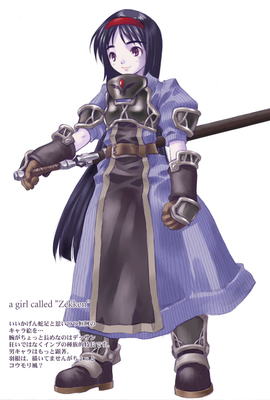

# Sword Art Online 外传4: 绝剑

&emsp;

### 3

　　久违的湖上都市赛尔姆堡，把与从前毫无二致的美丽身姿倒映在湛蓝的水面上。

　　亚丝娜遥望远处那座白色城堡，轻轻把头靠在身旁桐人的肩上。

　　整座岛屿就是一座要塞都市，赛尔姆堡主城区巍然耸立在横跨整个第61层的湖泊中央。湖上还散布着大小不一的岛屿，两人正并肩坐在主城区稍北一座小岛的岸边。背后大树伸展枝丫，细浪轻轻拍洗脚边。以冬天而言颇为温暖的风掠过湖面，吹得周围细草沙沙作响。

　　「呐，还记得吗？桐人君第一次来我房间的时候。」

　　她抬头问道。桐人微微笑着回答：

　　「不是我自夸，我最有把握的，就是自己记性不好——」

　　「诶——」

　　「——不过，那时候的事我记得很清楚。」

　　「……真的？」

　　「当然。那时我弄到了超稀有的食材道具，你给我做了炖肉。啊……那肉真好吃啊……现在还时不时想起来。」

　　「真是的！你不就只记得吃饭吗！」

　　亚丝娜噘起嘴，声音里却仍带着笑意，戳了戳桐人的胸口。

　　「……不过，我偶尔也会想起来就是了。」

　　「什么嘛，你还不是一样。……呐，那道炖肉，能不能在现实里做出来？」

　　「怎么说呢……基本上很像鸡肉，要是在酱汁上下点功夫，说不定……不过啊，大概还是让它留在回忆里比较好。再也尝不到的料理，不觉得很美好吗？」

　　「唔，嗯，倒也是。」

> rkl：这就是所谓的一期一会了，又是我不能认同的观点（叹气）

　　看着点头后仍有些遗憾的桐人，亚丝娜又笑了。

　　「啊，对了。……呐。」

　　「什么？」

　　「不知不觉又攒了不少尤尔德。下次在赛尔姆堡买个房间怎么样？就是你原来住的那间。前阵子我去看过，还空着呢。」

　　「嗯……」

　　亚丝娜想了一会儿，摇了摇头。

　　「不了，算了。那里也不全是美好的回忆。那些钱，不如拿去帮艾基尔在阿尔盖德开店吧。」

　　「那个宰客的黑店要复活了吗……要是借钱给他，利息就收十天一成……」

　　「哇，太过分了吧。」

　　和桐人聊起旧艾恩葛朗特的往事，真是怎么也聊不完。笑着你一言我一语时，亚丝娜忽然注意到，从赛尔姆堡飞来这座岛的玩家越来越多。他们越过两人头顶，纷纷飞向岛中央耸立的大树。

　　「啊，差不多到时间了。得走了。」

　　话虽如此，她仍舍不得身体相依的温暖。这时，桐人神情有些认真地低声说道：

　　「要和《绝剑》交手的话……」

　　「……诶？」

　　「那个……唔，不，怎么说……真的很强。」

　　听出他话里有些吞吞吐吐，亚丝娜歪了歪头。

　　「很强这件事，莉兹她们早就跟我说够啦。再说，连桐人君也没能赢。我从一开始就没觉得自己能拿对方怎么样，只是想亲眼看看那把剑而已……可还是难以置信，桐人君居然会输。」

　　「现在比我强的人多着呢。不过，就算在那些人里，《绝剑》也是另一个等级。」

　　「说起来，莉珐酱说，你们决斗时好像还说了些什么。说什么了？」

　　「啊，那个，有件事有点在意……」

　　「什么事？」

　　「呃，就是……」

　　亚丝娜敏锐地察觉，桐人的目光中混着某种担忧。她越发摸不着头脑，皱起眉。

　　就算那个叫《绝剑》的男人再强，这里也已经不是SAO。即使决斗时来不及认输，HP耗尽，只要有人施放复活魔法，立刻就能原地复活。虽然死亡惩罚会扣除经验值，但狩猎几个小时便能补回来。

　　然而，桐人低声说出了她意想不到的话。

　　「我问过那家伙——你已经完全是这个世界的居民了，对吧。她的回答，是一记快得惊人的突进技。那速度……超越了极限……」

　　「……你是说，是个超级废人玩家？」

　　亚丝娜歪头问道，桐人连忙摇头。

　　「不、不是那个意思。是更纯粹的意思。纯粹地活在这个世界里的人……我有那种感觉。」

　　「那……是什么意思……？」

　　「——不想让你有太多先入为主的印象。剩下的，希望你自己去感受。我想，只要交手就会明白。」

　　桐人轻轻拍了拍她的头。她正眨着眼，身后树的另一边接连响起几道降落声，紧接着传来熟悉的大嗓门。

　　「稍微一不留神，你们就这样了！」

　　听着踩得草叶沙沙响的脚步声走近，亚丝娜慌忙直起身。

　　莉兹贝特双手叉腰站住，用带着几分埋怨的眼神俯视她，说道：

　　「不好意思，打扰你们了，差不多到时间啦。」

　　「我、我知道啦。」

　　亚丝娜用背后的翅膀托起身体，稳稳站直，检查全身装备。青银丝线织成的短衣与配套短裙，水龙皮制成的靴子和手套，腰间剑带上别着水晶柄的细剑。每一件都是目前能入手的顶级装备。这样即使输了，也不能归咎于装备差距。

　　连魔法饰品也一一检查完，她最后看了眼时钟。眼看就要过现实时间下午三点了。

　　她瞥了一眼身旁站起的桐人，转过身，环视莉兹贝特、她身后的西莉卡与莉珐，以及莉珐头顶的结衣，说道：

　　「——那，走吧。」

&emsp;

　　一行人横排着低空飞行，朝小岛中央前进。连成一片的树梢到了尽头，一座大山丘随即映入眼帘。山顶的巨树向四方伸展枝丫，根部早已聚集了大批玩家，围出层层人圈。盛大的欢呼声如海啸般起伏着传来。

　　找到围观人群中的空处，亚丝娜一行刚刚降落，一位玩家便大声叫喊着从高空坠下。他以惊人的势头一头扎进大树脚下的地面，扬起大片尘土。

　　那剑士看起来是火妖精。他呈大字形瘫了好一会儿，才左右摇着脑袋，慢慢撑起上身。似乎还没缓过坠落的冲击，他皱着脸，举起双手大喊：

　　「我输了！投降！Resign!」

　　决斗结束的号角声随即在空中响起，更热烈的掌声与欢呼紧随其后。

　　好厉害，已经六十七连胜了，就没人能阻止那家伙吗——无数不知是赞叹还是抱怨的叫喊交错着。亚丝娜听着这些声音，仰头眯起眼，寻找胜者的身影。

　　大树枝叶间洒落的阳光中，一位玩家正盘旋着降下。

　　比想象中娇小。因为那个名字给人的印象，她本以为对方是肌肉隆起的巨汉，实际看来却更接近纤细的体型。逆光中的身影缓缓靠近，细节也逐渐清晰。

　　肤色是暗妖精特有的、略带紫色的白。长长的直发如润湿的乌羽般，漆黑而富有光泽。覆盖胸部的黑曜石铠甲呈现出柔和圆润的轮廓，下面的长上衣与迎风飘动的长裙，则是矢车菊般的青紫色。腰间挂着黑而细的剑鞘。

　　在亚丝娜愕然的注视中，不败的刚强剑士《绝剑》在着地前轻巧转了一圈，脚尖轻盈落地。随即向一旁伸出左手，右手按在胸前，以舞台表演般的姿势行了一礼。四周的男性再次爆发出热烈的欢呼与口哨声。

　　《绝剑》一下直起身来，满脸绽开笑容，转而天真无邪地比出V形手势。她明显比亚丝娜矮。小巧的脸上，两颊浮着酒窝，鼻尖微微上翘，枣核形的大眼睛灵动圆润，闪着紫水晶般的光泽。

　　亚丝娜仍未从惊讶中回神，用手肘戳了戳旁边莉兹贝特的腰侧。

　　「……喂，莉兹。」

　　「什么？」

　　「《绝剑》——这不是个女孩子吗！」

　　「咦，我没说过吗？」

　　「没说过啊！……啊，难道……」

　　这回，她斜眼看向另一边的桐人。

　　「桐人君输掉的理由是……」

　　「不、不是啦。」

　　桐人一脸认真地连连摇头。

　　「不是因为对方是女孩子就放水了。我可是超级认真的。真的。……至少从中途开始是这样。」

　　「谁知道呢。」

　　亚丝娜轻哼一声，把脸转开。

　　这时，那位爬起来的火妖精虽然输了，却仍笑着与《绝剑》握了手，挠着脑袋回到人群中。有着夜色般黑发的少女一边给自己施放很低阶的治疗魔法，一边环顾四周。

　　「那个，还有没有人想来比试一下？」

　　她的声音也像年幼少女一样，高而可爱。现实中玩家的特征，反映到角色上的只有性别，在游戏里是无法得知实际年龄的。可眼前这副模样，却让人觉得仿佛就是她实际年龄的样子。

　　四周只有「你去啊」「不要，会被秒杀的」之类的交谈声，迟迟没人应战。这回换莉兹贝特用手肘顶了顶亚丝娜的腰侧。

　　「喂，去呀。」

　　「不……等一下，得先重新打起精神……」

　　「跟那孩子交手一招，你立刻就会斗志十足了。快去，快去！」

　　「哇。」

　　背后被重重一推，亚丝娜踉跄着迈出几步，连忙张开翅膀稳住身形。抬起头，恰好与那位拥有《绝剑》称号的少女正面对上视线。

　　「啊，姐姐，要来吗？」

　　对方朝她嫣然一笑，亚丝娜只好——

　　「呃，那个……那，就来吧。」

　　小声回答。她原本还想在赛前，与想象中那位面目凶悍的大汉来一番气势十足的唇枪舌剑，可眼前的一切实在太打乱步调了。

　　不过，周围的欢呼声立刻沸腾起来。亚丝娜经常登上每月大会的领奖台，认识她的玩家似乎不少，间或还能听见喊她名字的声音。

　　「OK！」

　　少女啪地打了个响指，挥手调出窗口，飞快操作。亚丝娜面前随即出现决斗申请窗口。

　　指尖触上OK按钮时，亚丝娜问道：

　　「那个，规则就按魔法、道具都可以使用的来，对吗？」

　　「当然。魔法和道具都尽管用。不过我只用这个。」

　　《绝剑》立刻答道，左手轻拍剑柄。那份近乎天真无邪的自信，终于微微刺激起亚丝娜的战意。

　　既然这么说，就不能再用远距离魔法攻击之类的迂回手段了。剑与剑正面交锋，那正是我想要的。亚丝娜心里这样想着，将右手搭在细剑柄上。就在这时——

　　《绝剑》又大声说出一句更显从容的话。

　　「啊，对了。姐姐喜欢地面战，还是空战？」

　　亚丝娜本以为理所当然会在空中交手，听到这话，不由一怔，正要拔剑的右手停住了。

　　「……哪种都可以？」

　　《绝剑》笑眯眯地点头。亚丝娜不禁怀疑，这是否也是一种策略，可暗妖精少女的笑脸中，感受不到丝毫狡黠。也就是说，她单纯认为不论在哪里打，自己都能赢。

　　既然如此，我也就不客气了。亚丝娜想着，回答道：

　　「那就地面战。」

　　「OK。可以跳，但不能用翅膀哦！」

　　《绝剑》立刻点头，收起背后那对轮廓独特的翅膀。形似蝙蝠翅翼的它迅速褪色，几乎消失不见。亚丝娜也照做，切断与肩胛骨后方翅膀的意识连接。

　　登录ALO的第一天，她便基本掌握了不用辅助摇杆的随意飞行。如今她的空战本领，已不逊于更新前就在玩的老玩家。

　　即便如此，在SAO长达两年的战斗中深植于身体的动作，也不是轻易就会消退的。说实话，能在地面上战斗，是件值得庆幸的事。她动了动脚尖，仔细感受透过靴底传来的地面硬度。

　　两人几乎同时拔剑，两道清亮的铿鸣重叠着响起。

　　《绝剑》装备的是一把较细的双刃直剑，与铠甲一样，带着黑曜石般深暗、半透明的色泽。武器等级与亚丝娜手中的细剑大致相当，应该没有某些传说级武器附带的那种额外能力。

　　《绝剑》将剑置于中段，剑锋朝前，自然地侧身站立。亚丝娜则把右手收在体侧，近乎垂直地举起细剑。周围的欢呼声如退潮般渐渐远去。

　　她深吸一口气，再吐出。倒计时恰好归零。

　　「DUEL」字样闪亮的同时，亚丝娜全力蹬地。她瞬间冲过约七米的距离，身体向右扭紧。

　　「吒！」

　　随着一声短喝，右手如离弦之箭般笔直刺出。载着全部惯性与扭转力的突刺，朝《绝剑》身体中心稍偏左处连出两击，再略微错开时机，向右补上一击。这不是剑技，而是普通攻击，速度不算极快，瞄准却更为精确。若向右避开最初两击，便几乎不可能躲过接下来的一击。

　　《绝剑》如她所料，身体迅速向右一闪，避开前两击。动作刚停，第三击便准确地刺了过去——

　　然而，就在剑尖即将触及胸甲时，《绝剑》的右手如烟般一晃。亚丝娜的细剑右侧随即迸出小小的火花，突刺轨迹微微偏移。

　　《绝剑》用自己的武器，准确格开了正在高速突刺中的细剑。亚丝娜刚理解这一点，剑尖便已擦过《绝剑》的铠甲，落入空处。

　　预感到反击，亚丝娜后颈的皮肤阵阵发麻。可此刻收剑，身体便会僵住。她顺着招式的惯性，果断向左旋转。

　　同时，一道瞄准颈部向上跃起的黑光闯进视野。

　　「——！！」

　　那如雷电般骇人的速度，让战栗窜过全身。她咬紧牙关，右脚尖使出几乎要刨开地面的力量，扭转身体。

　　脚下细短的草密密生长，设定的摩擦力比石板路或裸地略低。这个数值背叛了亚丝娜，右脚猛地一滑，身体瞬间偏移。

　　可也幸亏如此，《绝剑》的剑尖只掠过她的胸前。一阵猛烈的冲击贴着耳边掠过。如果头发也有命中判定，她的水蓝色长发恐怕已被削去一半。眼角余光里，释放到空中的能量震动空气，扩散开去。

　　亚丝娜用恢复了抓地力的靴子猛蹬地面，大幅向右跃开。左脚再次一蹬，拉出足够的距离才停下。

　　她压低身体，防备追击，《绝剑》却仍带着笑，把剑重新摆回中段，停了下来。亚丝娜平复着狂跳的心脏，勉强回以一笑——心底却已冷汗如瀑。

　　迎面飞来的突刺，轨迹看起来只是不断逼近的一个小点。想躲开，基本只能依靠脚步移动防御，可《绝剑》竟准确弹开了细剑的侧面。比起反击的速度，更让亚丝娜惊叹的是那超乎常人的反应速度。尽管早已听够了她有多强，可对方出乎意料的可爱容貌还是让她松懈了，此刻仿佛被迎头泼了一盆冷水。她一度怀疑，桐人是因为对手是女孩而大意或手下留情，才会落败，看来完全是冤枉他了。就连桐人，也从未成功格开过亚丝娜全力刺出的一击。

　　亚丝娜再次深吸一口气，屏住呼吸。对手确实可怕，可只交手一招就放弃，有辱剑士之名——

　　忽然，耳朵深处响起回声。

　　（算什么剑士——那种东西——不过是游戏里的——）

　　她用力咬紧牙关，把杂音从意识中甩掉。这个世界是另一个现实世界，在这里进行的战斗，也无一不是真正的较量。必须如此。

　　仿佛在狠狠鞭策自己，亚丝娜挥剑鸣响，将它架到右肩上方。这次将剑尖笔直对准对手。

　　既然普通攻击不管用，就只能冒险使出剑技了。然而，系统为剑技设定了技后硬直时间，若全部被避开，必然会遭到致命反击。必须先打乱对方的姿势，制造出必中的局面。她握紧空着的左手。

　　再次蹬地冲出时，意识已彻底澄澈。那种在ALO战斗中几乎从未体验过、仿佛神经都在燃烧的加速感，包裹住全身。

　　这回，《绝剑》也冲了过来。嘴角笑意消失，紫水晶般的眼瞳闪出光芒。

　　黑曜石剑从右上方轰然劈来，亚丝娜由左挥剑迎击。火花与金属声迸起，惊人的冲击传入右手。被弹回的剑又以让人几乎感觉不到剑身重量的速度折返，一击接着一击。等看见再反应，绝对来不及。她凭整个视野捕捉对手全身的动作，预测下一击的方向，招架，闪避。偶尔剑锋擦过彼此身体，两人的HP都在缓缓减少，却没有任何一击真正打实。

　　在超高速的剑刃交击声中，亚丝娜忽然察觉到某种不协调。

　　《绝剑》的攻击速度与反应速度确实可怕。单论速度，还在桐人之上。但亚丝娜之所以勉强跟得上，除了SAO积累的庞大战斗经验，也因为对方的攻击太过直率。她完全不使用刚挥起武器就停住、或把出招节奏稍稍延后之类的假动作。

　　或许，她与玩家交战的经验并不多。亚丝娜这样想着。若果真如此，只要能让她意外哪怕一瞬，就能找到胜机。

　　穿过右上、左上、左侧接踵而至的三连击，亚丝娜果断冲入《绝剑》怀中。距离近得几乎贴在一起，双方都无法再用脚步移动防御。

　　亚丝娜压低身体，右手细剑瞄准对手身体中心，正要猛力刺出——

　　《绝剑》随之反应，正要由下向上挥剑斩起——

　　就在那一瞬，亚丝娜猛地收回右手，同时将握紧的左拳砸向《绝剑》的右侧。这是她远赴土妖精领地首都的修炼场修行后，以《拳术》技能打出的攻击。虽然没有装备专用的拳套类武器，威力不大，却仍能造成未习得技能时不可能有的伤害。

　　咚的一声，冲击传回左拳，《绝剑》惊讶地睁圆双眼。

　　——这是最初也是最后的机会。亚丝娜毫不犹豫，发动了四连击剑技《Quadruple Pain》。

　　细剑亮起耀眼的红光，右手同时被系统无形的手推动，如闪电般撕裂空气。

　　她确信这一击会命中。对方的姿势已被打乱，距离也近得无法闪避。

　　然而，将右手交给系统加速、看向《绝剑》的脸时，又一阵战栗掠过她的背脊。《绝剑》睁大着眼，紫色的眼瞳中却没有惊讶之色。她的目光，正准确地聚焦在细剑尖端。

　　她看得见这次突刺——？！

　　亚丝娜这样想的瞬间，《绝剑》的右手闪动了。

　　如同把剑抵在砂轮上，四道刺耳的金属摩擦声接连响起。四连击被准确地向上下左右弹开，没有一击命中。亚丝娜只看见黑剑留下的、薄墨般的残影。

　　最后一击被卸开，右手仍向前伸着，零点几秒——却令人绝望——的硬直袭来。《绝剑》岂会错过这道空隙。

　　黑曜石剑迅猛收回，泛起青紫色的光芒。

　　那记直刺快得恐怕就算不在硬直中也难以躲避，准确击中亚丝娜的左肩。从左肩斜向右腹，五连击接连刺入。她全数吃下，HP条剧烈缩短。这是记忆中没有的招式，也就是原创剑技。居然能编出如此迅疾的五连突刺——

　　她正愕然想着，剑光未消，剑又被举到左上方。

　　五击还没结束。后面还有。她撑起终于摆脱硬直的身体，第三次感到战栗。

　　假如同样的突刺再来五下，HP几乎必定归零。然而，已经无法回避。

　　与其徒劳逃跑、背后中剑，不如赌那渺小的可能。她将力量灌入握着细剑的右手，再次发动剑技。那是自己唯一掌握的五连击OSS——《Astral Tear》。

> rkl：前文称亚丝娜开发的是六连击OSS，本处原文则写作五连击，前后不一致，此处照原文保留。

　　红与蓝的闪光耀眼地交错。剑尖从亚丝娜右肩朝左下方接连刺入，与刚才的连击一起划出叉形。

　　但这一次，她的细剑也终于捉住了《绝剑》。沿着小小星形的顶点，五记突刺贯穿黑色铠甲。

　　五连击交换完毕，一瞬的寂静降临。两人都还没有倒下。

　　亚丝娜看不见《绝剑》的HP，自己的HP条却只剩极少的一截。她继承了SAO时期的角色数据，HP原本甚至高于ALO的老玩家。那惊人的十连击竟几乎将其削尽，《绝剑》的OSS威力实在骇人——

　　——可包裹着那把剑的青紫色光辉，仍未消失。

　　再次收回的剑，准确瞄准了亚丝娜身体中央、叉形的交点。

　　原来，这就是《绝剑》赌在决斗中的十一连击OSS。亚丝娜带着赞叹想着。

　　好强。而这招式的美丽，更在其威力之上。败给这样的剑技，也无遗憾。她在心底低语，等待最后一击。

　　猛然袭来的第十一击，却在即将贯穿亚丝娜的瞬间骤然停住。

　　「——？！」

　　在她愕然睁大的双眼前，《绝剑》放下武器，不知想到什么，快步走近。她用左手轻拍亚丝娜的肩膀，绽开灿烂的笑容，唇间传出充满气势的声音。

　　「嗯，真是太棒了！就决定是姐姐了！！」

　　「什……哎哎……？」

　　亚丝娜已经完全摸不着头脑，只能发出一声呆呆的轻呼。

　　「那、那个……决斗的胜负还没定吧……？」

　　「能打成这样，我已经满足了。姐姐还想打到最后吗？」

　　被她这样笑着一问，亚丝娜也只能摇头。无论如何，如果《绝剑》没有停下最后一击，亚丝娜的HP必定已经归零。少女高兴地重重点头，继续说道。

　　「我一直在找，能让我一下子觉得『就是这个人』的人。终于找到了！呐，姐姐，你还有时间吗？」

　　「唔……嗯。还有时间……」

　　「那，陪我一下！」

　　《绝剑》让剑发出一声清响，收进腰间的剑鞘，随即有力地伸出右手。亚丝娜也先把剑收回鞘中，有些迟疑地握住那只手。

　　下一刻，《绝剑》背后的翅膀猛然展开，以火箭般的势头蹬地而起。

　　「哇。」

　　亚丝娜慌忙也展开翅膀，浮上空中。

　　「喂，亚丝娜，你要去哪里啊！」

　　听到那尖亮的声音，亚丝娜回头一看，只见莉兹贝特脸上半是惊讶半是无奈，正朝她挥着手。

　　「呃、那个……回头再联系你——！」

　　她回答的同时，《绝剑》双翼发光，猛然冲刺出去。亚丝娜被拉着右手，拼命振动背后的翅膀，追赶那位充满谜团的少女剑士。

&emsp;

　　《绝剑》沿着第61层的湖面上空一路向南，毫不犹豫地从艾恩葛朗特外周的开口飞了出去。

　　「哇噗！」

　　紧接着，浓密的云团迎面拍上亚丝娜的脸。她在纯白一片的空间中继续冲了数秒，云层忽然断开，蔚蓝的天空无限延伸开来。

　　视野右下方很远的地方，能看到一个绿色圆锥穿透云层伸出来。那是耸立在阿尔普海姆中央的世界树顶端。移动视线朝正下方望去，可以隐约看见泛蓝而朦胧的地表。从海岸线上那片圆弧形海湾的轮廓来看，艾恩葛朗特此刻似乎正飞行在水妖精领地的上空。

　　她正想着究竟要去哪里，飞在前方的《绝剑》忽然转为上升。

　　身体转过半圈，艾恩葛朗特弯曲的巨大身躯便如绝壁般矗立在眼前。她接连横穿过一层又一层高达百米的楼层，《绝剑》仍继续朝更高处飞去。

　　——话虽如此，能够自由进出巨大浮游城外周的，仅限于已经攻略的楼层。尚未踏破的楼层外围属于不可侵入区域。亚丝娜有些担心，想开口确认，可就在她深吸一口气准备大喊时，飞行角度又骤然转了九十度。

　　《绝剑》的目标看来是第67层。如果亚丝娜记忆没错，那里正是当前的最前线。她像穿过缝隙般钻过长满苔藓的外壁，一下飞进内部，四周骤然暗了下来。

　　艾恩葛朗特第67层是常暗之国。外周的开口极少，即使在白天，也几乎等于没有阳光照入。内部有许多嶙峋的岩山一直向上延伸至上一层的底面，岩山各处生长出的巨大水晶六棱柱散发着朦胧的蓝光。整体印象接近构成阿尔普海姆北方土妖精领地的地底世界。

　　这位暗妖精少女的夜视能力与影妖精不相上下，她拉着亚丝娜的手，轻盈地在岩山之间穿梭飞行。前方不时出现飞行怪物《Gargoyle》的群体，但她似乎无意战斗，巧妙避开敌群的索敌范围，继续翱翔。

　　不久，两人飞进一座深谷，又以低速飞行了大约一分钟，便看见一座小镇紧贴在圆形开阔的谷底。那是第67层的主城区，名字记得是《隆巴尔【Rombal】》。

　　那座小镇仿佛是从整块岩石中直接凿出来的，狭窄的小巷与台阶复杂地交错在一起，橙色灯光照亮了这些通路。那景象就像寒冷夜色中孤零零燃起的一堆篝火，让人莫名感到安心。

　　《绝剑》与亚丝娜在黑暗中拖出紫色与水色的轨迹，朝镇中央的圆形广场缓缓下降。

　　代表进入街区范围的柔和背景音乐传入耳中，一缕淡淡的炖菜香气轻轻搔过鼻尖——刚想到这里，靴底已经稳稳落在石板路上。

　　亚丝娜呼地吐了口气，先环顾四周。依照「夜之精灵们的城镇」这一设定，隆巴尔没有任何巨大建筑。泛着蓝色的岩石建成的小工房、商店与旅馆紧密相连，橙色灯光照亮这些屋檐，景象兼具梦幻般的美感与夜间祭典般的热闹。

　　旧SAO时代，虽然攻略这一层颇费工夫，但镇上没有什么重要设施，因此玩家聚集在这里的时间很短。亚丝娜也只记得自己在此逗留过几天。

　　但如今，这里毕竟是攻略最前线，许多玩家让装备发出碰撞声，昂首阔步。人人似乎都颇有个性，散发着身经百战的老手气场。看到这些，亚丝娜心中涌起怀念与微苦交织的感慨。

　　为了得到森林之家，亚丝娜直到第22层都始终站在最前线，但之后的楼层几乎没再参加过BOSS攻略。她觉得，开启新城镇的畅快感，应该由那些新近开始享受浮游城冒险的玩家去体会；而且待在最前线，能想起的也不全是快乐的事。

　　她闭上眼睛，轻轻拂了拂头发，甩开感伤，望向站在身旁的《绝剑》。

　　「你找我有什么事？这里有什么吗？」

　　听她这么问，《绝剑》咧嘴一笑，再次拉起亚丝娜的手。

　　「在那之前，先把你介绍给我的同伴！这边！」

　　「啊，等……」

　　亚丝娜追上突然跑起来的《绝剑》，钻进从广场呈放射状延伸的狭窄小巷之一。

　　两人登上小台阶，又走下台阶，渡过小桥，穿过隧道，来到一间看起来像是旅馆的店前。门口摇晃着一块铸成大锅形状的铸铁吊牌，上面有「INN」字样。两人穿过门口，从打盹的白胡子NPC身旁走过，进入里面兼作餐厅的酒馆。就在那一瞬间——

　　「欢迎回来，优纪【Yuuki】！找到了？！」

　　一个欢快的少年声音迎接了两人。

　　酒馆中央的圆桌旁坐着五名玩家，此外不见人影。《绝剑》快步走到他们面前，倏地转向亚丝娜，向一旁伸出右手，

　　「——我来介绍。这是我的公会《沉睡骑士【Sleeping Knights】》的同伴们。」

　　她又转了半圈，这次用手示意亚丝娜，

　　「然后，这位姐姐是——……」

　　话说到这里，她突然卡住了。她缩了缩脖子，转动着大眼睛，吐了吐舌头。

　　「……抱歉，我还没问你的名字。」

　　五名玩家「哇啊——」地在椅子上栽倒。亚丝娜见状忍不住轻笑，低头行了一礼，报上名字。

　　「我叫亚丝娜。」

　　从亚丝娜这边看，坐在最左边的那位身材矮小的火妖精少年站了起来。他脑后扎着一撮小辫，橙色头发随之晃动，用充满活力的声音说道：

　　「我是淳【Jun】！亚丝娜小姐，你好！」

　　他旁边是一位土妖精巨汉。砂色卷发下，一双笑成细缝的眼睛为他添了几分和蔼。他像是硬要把突出的肚子收回去似的弯腰行礼，用慢悠悠的语气报上名字：

　　「啊——那个，我叫铁奇【Tecchi】。请多关照。」

　　接着站起来的是个瘦高细长的锻造妖精青年。梳得整整齐齐的黄铜色头发与铁框圆眼镜，给他一种学生的印象。他把小小的圆眼睛睁到最大，猛地弯腰行礼，不知为何红着脸，慌慌张张地一口气说道：

　　「我、我是，那、那个，叫塔尔肯【Talken】。请、请、请多多指……疼！！」

　　句尾之所以变成惨叫，是因为坐在他左边的女性玩家用看起来沉重的靴子狠狠踢了他的小腿。

　　「塔尔，你那怯场的毛病也该改改了！每次一到女孩子面前就这样。」

　　她爽朗地说着，把椅子弄得咣当一响，站起身来。她朝惊讶地睁大双眼的亚丝娜咧嘴一笑，把如太阳般散开的黑发揉得乱蓬蓬的，报上名字：

　　「我是诺莉【Nori】。很高兴见到你。」

　　从微黑的肤色与灰色翅膀来看，她似乎是影妖精，但那粗浓的眉毛、锐利的眼睛、偏厚的嘴唇与粗壮的体格，却不太符合影妖精给人的印象。

　　最后一位，是和亚丝娜一样的水妖精女性玩家。近乎纯白的水蓝色长发垂在双肩，低垂的长睫毛下，沉静的深蓝色眼眸闪着光。挺直修长的鼻梁、润泽的嘴唇，以及令人惊讶的纤细身体，正符合水妖精族原本给人的印象——身为治疗师能力出众。

　　她以轻柔的动作站起，用平静而润泽的声音自我介绍：

　　「初次见面。我是希安【Shiien】。谢谢你愿意来。」

　　「然后——」

　　最后，站在五人右侧的《绝剑》让大眼睛闪闪发亮，说道：

　　「我姑且算是公会会长，优纪！亚丝娜小姐……」

　　她紧紧握住亚丝娜的双手，

　　「一起加油吧！」

　　「那个……要加油做什么？」

　　亚丝娜忍着笑问道。《绝剑》——也就是优纪，愣了一下，又吐了吐舌头。

　　「对哦，我什么都还没说明！」

　　看到五人再次「噗通——」地瘫在椅子上，亚丝娜终于忍不住笑出声来。她捂着肚子咯咯笑着，不久优纪和其他人也放声大笑。

　　亚丝娜努力压住笑意，再次环顾《沉睡骑士》的成员——然后，感到背脊上掠过一阵轻微的寒意。

　　每个人都是惊人的老手。仅凭那不经意的举手投足有多流畅，亚丝娜就能看出来。六人都已完全习惯VR世界中的动作。若拿起武器，恐怕都能发挥出接近《绝剑》的实力。

　　亚丝娜不知道有这样一支高手集团存在，桐人和莉兹他们恐怕也完全不知道。假如六人都和《绝剑》一样是从别的世界转移而来，那么在原来的VR世界里，他们一定也是颇有名气的队伍。

　　为什么要舍弃熟悉的VR角色身体和全部道具，转移到ALO来生活呢……亚丝娜正想着，终于止住笑的《绝剑》——优纪挠了挠戴着红色发箍的脑袋，有些抱歉地说：

　　「对不起，亚丝娜小姐。什么都没说明就把你带到这种地方来。好不容易找到和我差不多强的人，我一高兴就……那个，再次拜托你。请你……帮帮我……帮帮我们！」

　　「帮……忙？」

　　亚丝娜歪着头重复，同时在脑中迅速转过各种猜测。

　　应该不是单纯为了金钱、道具或技能提升点数而请她帮忙狩猎。以这样高水平的公会来说，事到如今即使亚丝娜一个人加入，能做的事也有限。

　　同样，也很难想象目的是取得特定的稀有道具或玩家住宅。与情报本身曾被高价买卖的旧SAO不同，ALO里有大量免费刊登攻略情报的外部网站。只要参考这些资料，沉下心来去做，几乎所有道具迟早都能取得。

　　如果还有别的可能，那么《绝剑》向她寻求的「强大」，或许并非单纯的数值能力，而是包括战斗中的策略与周旋在内的各方面实战诀窍。这样一来，最需要这种能力的，便不是对怪物战，而是对玩家战。而且既然把亚丝娜介绍给公会，那就不是《绝剑》此前进行的一对一决斗，而是集团规模的大战——说白了，就是和某个公会毫无规则地厮杀。

　　一瞬间想到这里，亚丝娜轻轻咬了咬嘴唇，才有些迟疑地开口：

　　「那个……如果是要帮忙和其他公会打仗，那就抱歉了……」

　　比赛形式的大会与遵守系统规则的决斗之外，对人战难免会在事后留下感情上的芥蒂。当然，会为了一时的冲突而长久记仇的玩家只是少数，但即便如此，也不能否认日后可能不仅给亚丝娜本人，还会给她周围的朋友们添麻烦。

　　因此，哪怕在狩猎场被人用毫无道理的失礼举动对待，亚丝娜也绝不对玩家拔剑。

　　她正想尽量简洁地说明这一点，继续开口。可《绝剑》先是一愣，眨了几下眼，随即连连摇头。

　　「不是，不是啦，不是和哪里打仗那种事。那个……就是我们……可能会被你笑……」

　　她忽然低下头，害羞似的蠕动着嘴唇，然后抬眼看向亚丝娜，说出了完全出乎意料的话：

　　「……那个，我们想打倒这一层的BOSS怪物。」

　　「哈……哈啊？！」

　　亚丝娜完全被打了个措手不及，发出一声古怪的叫声。

　　「BOSS……BOSS怪物是说迷宫区最深处那个……？不是那种定时刷新的《Flagged Mob》之类的怪物？」

　　「嗯，对，就是只能被打倒一次的那个。」

　　「嗯……这样啊……BOSS吗——」

　　亚丝娜一时说不出话，环视其余五名公会成员，他们全都眼睛发亮，似乎在等待她的回答。看来是认真的。

　　「那……嗯，绝……不对，以优纪小姐你们的实力……」

　　她连眨了几下眼，切换思路，开始考虑实际攻略BOSS的可能性。

　　「说得也是……虽然要花不少钱，但再召集三十五人左右，组个六支队伍规模的阵势，我想也不是不可能……」

　　然而《绝剑》更加扭捏地左右摇了摇头。

　　「那个……那样不行。我想只靠我们六个人和亚丝娜小姐打倒它……可以吗……」

　　「诶诶？！」

　　亚丝娜又一次大声叫了出来。

　　新生艾恩葛朗特中配置的楼层守护怪物，与旧SAO相比，被施加了近乎胡来的强化。当然，游戏系统已大幅改变，不能单纯比较；不过，旧时代的大多数BOSS都可以在无人死亡的情况下攻略，相比之下，新BOSS群却以超强力的普通攻击与特殊攻击，把玩家像蒲公英绒毛一样吹散，拥有不讲理的强大。

　　当然，攻略作战也必须改变。要召集尽可能多的人手，而且预想到会接连出现死者，因此还要增加治疗师的人数。比起一个人造成10点伤害，更重视十个人合起来造成12点伤害。亚丝娜最后参加的BOSS攻略战是第21层的，可即使是那么低的楼层，动员全部伙伴组成总数21人的三支队伍，也险些全灭。

　　BOSS的强度当然会随着楼层上升而增加。逐渐能看到终局的第65、66层附近，听说是由好几家有力的大公会缔结协定，才终于攻略的。

　　也就是说，就算个个都是强者，区区七个人想打倒BOSS，也实在是胡来。

　　亚丝娜斟酌着措辞，简短说明了这些情况。

　　「……所以……我觉得七个人还是有点勉强……」

　　话一说完，优纪他们互相看了看，不知为何全员都不好意思地笑了。优纪作为代表开口：

　　「嗯，完全不行。其实我们也挑战过第65层和第66层的BOSS。」

　　「诶——？！就……就六个人？！」

　　「对。我们自认为已经很努力了……可MP和回复道具实在撑不住。就在我们还商量这商量那的时候，BOSS被规模更大的集团打倒了。」

　　「这……这样啊……你们是认真的呢。」

　　亚丝娜再次慢慢看了六人的脸。这确实是鲁莽至极的挑战，但她并不讨厌这种气概。对游戏过于熟悉的玩家，总容易迅速对做不到的事死心。而《沉睡骑士》拥有的那股能量，在亚丝娜眼中显得十分新鲜。

　　「可是……为什么？为什么要做到这种地步，也想打倒BOSS？」

　　打倒BOSS，就能获得数额惊人的尤尔德，以及稀有的武具和道具。可是这种动机，总觉得和这六个人不太相称。

　　「那个……那个啊。」

　　优纪睁大紫水晶色的眼睛，动了动嘴唇，似乎想说什么。可她却说不出话来。像是有什么堵在胸口，她几次张开嘴又闭上，似乎迟迟找不到该说的话。

　　这时，坐在优纪身旁那位高挑的水妖精——自称希安的女性，像伸出援手般开口说道：

　　「那个，由我来说明吧。在那之前，请先坐下。」

　　包含亚丝娜在内的七人在桌旁坐下，向NPC点好的饮品摆上桌后，希安在桌面上交叠纤细的手指，用平静的声音开始讲述。

　　「其实，我们并不是在这个世界认识的。我们是在游戏外的某个网络社区相遇……很快就意气相投，成了朋友。已经……过了两年左右吧。」

　　她低垂着睫毛，像是回忆起什么，话语停顿了一瞬。

　　「他们是最棒的同伴。大家一起去了各种各样的世界，经历了各种各样的冒险。可是很遗憾，我们能一起旅行的时间，大概也只到这个春天为止了。因为大家……都要各自忙碌起来了。于是我们决定，在解散之前，创造一段绝对不会忘记的回忆。在无数的VRMMO世界中，找出最快乐、最美丽、最令人心动的世界，在那里合力完成一件事。就这样，我们在各处不断转移，最后找到的，就是这个世界。」

　　希安依次环视同伴们的脸。淳、铁奇、塔尔肯、诺莉、优纪五人各自容光焕发，重重点头。希安也轻轻微笑，继续说道：

　　「这个世界——阿尔普海姆，还有艾恩葛朗特，都是非常美好的地方。美丽的城镇、森林、草原、世界树——还有大家结伴绕着这座城飞翔的经历，我们所有人永远都不会忘记。我们还有一个愿望……就是想在这个世界里，留下我们的足迹。」

　　几乎阖拢的眼帘深处，希安的靛蓝色眼眸透出认真的光芒。

　　「只要攻略BOSS怪物，起始之城镇里的黑铁宫，那里面的《剑士之碑》就会留下名字，对吧。」

　　「啊……」

　　亚丝娜一瞬间睁大眼睛，随即重重点头。因为是很久以前的事，她都快忘了，但打倒BOSS的玩家名字确实会记录在黑铁宫里。亚丝娜自己的名字也留在第21层那一栏。

　　「这个……虽然这纯属自我满足，但我们无论如何都想把名字刻在那座碑上。不过，有一个问题。如果攻略BOSS的是一支队伍，全员的姓名都会被记录下来；可如果有多支队伍，留下的就只有队长的名字了。」

　　「这……这样啊。嗯，确实如此。」

　　亚丝娜也重重点头。

　　「也就是说，若想留下全员的名字，能去挑战的就只能有一支队伍。我们在第65层和第66层拼命努力过，可总是差那么一点……于是大家商量后决定，队伍人数上限是七人，还空着一个位置。虽然有些冒昧，但我们想找一个实力与队内最强的优纪相当或更强的人，拜托对方来帮忙。」

　　「原来如此……是这么回事啊。」

　　亚丝娜点了一下头，把视线落在白色桌布上。

　　在《剑士之碑》上留下名字。这个愿望，她能够理解。

　　不只是VRMMO，网络游戏这种东西本来就会占用玩家大量时间，因此因升学或就业而在春天前后引退的人很多。那些延续多年的亲密公会，也难免被迫解散。想把这段回忆刻在只要这个世界继续存在就会一直保留的纪念碑上，是很自然的想法。

　　亚丝娜自己也一样，不知道究竟还能继续玩ALO到什么时候。如果母亲采取更强硬的态度，甚至可能连使用AmuSphere都被禁止。既然剩下的时间有限，就想让每一分每一秒都过得充实——这份心情，和他们相通。

　　「……怎么样？可以请你答应吗？我们转移过来还没多久，可能没法准备足够的谢礼……」

　　希安正要操作交易窗口，出示金额，亚丝娜抬起双手制止了她。

　　「啊，不用。反正需要花钱的地方还多，手头的钱还是用在那些开销上比较好。报酬的话，只要把BOSS掉落的随便什么东西分我一点就好……」

　　「那么，你愿意答应了吗？！」

　　希安和其余五人的脸一下子亮了起来。

　　「呃……那个……」

　　亚丝娜轻轻抿紧嘴唇，正想考虑作战成功的可能性。

　　很久以前，她曾作为如今已不存在的公会的副会长，拟定过许多BOSS怪物的攻略作战。那段记忆又苏醒过来。当时，她拼命调度有限的人手和道具，投入绝望的战斗。她曾和其他攻略公会或独行玩家讨论好几个小时，互相怒吼，有时甚至把手撑在地上乞求协助。之所以要辛苦到那种地步，是因为那个世界有一个无论如何都必须坚守的条件。那就是，一名死者也不能出现。

　　可是如今，一切都已经改变。在这个世界里，赋予玩家的义务与权利只有一项——享受游戏。因为没有胜算就退缩，真的能算是在享受游戏吗？优纪他们已经只凭六个人挑战过第65、66层的BOSS怪物，而且似乎还打得相当不错。

　　与其反复考虑失败，不如先冲上去试试。这种莽撞的玩法，她已经很久没有过了。反正即使全灭，失去的也不过是少量经验值。

　　「……那就尽力试试吧。成功率什么的先放一边。」

　　亚丝娜抬起头，带着几分淘气的微笑说道。最先欢呼的是优纪。她用双手紧紧包住亚丝娜放在桌上的右手，把大眼睛睁得圆圆的。

　　「谢谢你，亚丝娜小姐！从最初和你交手的时候起，我就知道你会这么说！」

　　「那、那可能有点太高估我了……还有，你可以直接叫我亚丝娜。」

　　「那你也叫我优纪！」

　　其他五人争先恐后地伸出手，亚丝娜也一一与他们紧紧握手。

　　用新点来的大杯饮品干过杯后，亚丝娜把忽然浮上心头的疑问说给优纪听。

　　「说起来，优纪酱……优纪是在通过决斗寻找强者，对吧？」

　　「嗯，是啊。」

　　「那样的话，在我之前应该也有很多强者才对吧。尤其是那个头发尖尖翘着、使用大剑的影妖精，你还记得吗？我觉得那个人多半比我更有用……」

　　「啊——」

　　仅凭这一句，优纪似乎就想到了桐人。她连连点头，不知为何摆出为难的表情，抱起双臂。

　　「记得。那个人确实也很强！」

　　「那……为什么没有请他帮忙？」

　　「嗯……」

　　优纪难得地支吾了一下，随后露出一丝意味难明的微笑。

　　「果然，那个人不行。」

　　「为……为什么？」

　　「因为他发现了我的秘密。」

&emsp;

　　优纪和希安他们似乎都不想再谈这件事，亚丝娜也就无法继续追问。那个秘密恐怕与《绝剑》——优纪那突出的强大有关，但她完全猜不出来。

　　她正歪着头思索，锻造妖精塔尔肯像是要转移话题似的推了推圆眼镜，说道：

　　「那么……攻略的具体步骤，要……要怎么做呢？」

　　「啊……那个……」

　　亚丝娜用大杯里的果酒咽下堵在喉头的疑问，竖起食指：

　　「首先，重要的是掌握BOSS的攻击模式。该躲的地方躲开，该防的地方防住，该进攻的时候全力进攻，或许就能看到胜机。问题是要怎么得到这些情报……去问专门狩猎BOSS的大公会，多半也是白费。我觉得，必须先在做好全灭准备的前提下挑战一次。」

　　「嗯，我们没问题！只是……之前两层也是，没经过演练就直接挑战，结果全灭之后，BOSS很快便被其他公会攻略了。」

　　优纪露出沮丧的表情，桌子对面的火妖精少年淳皱着锯齿般的眉毛，接着说：

　　「三小时后再去的时候，已经结束了。也许只是多心……但总觉得，他们像是在等我们失败似的……」

　　「嘿诶……」

　　亚丝娜把手放在嘴边沉思。最近她听说过，BOSS攻略方面发生了不少纠纷。主要内容是大规模公会同盟过于专横，但那样的同盟，真的会注意到一个只有六个人的公会吗？

　　「嗯……那姑且先做好准备，以便全灭后能马上再次挑战。大家什么时候方便？」

　　「啊，抱歉。我和塔尔肯晚上不行。明天下午一点开始怎么样？」

　　高挑壮实的影妖精诺莉挠着头，有些歉意地说。

　　「嗯，我没问题。那明天一点在这家旅馆集合，可以吗？」

　　众人纷纷点头，说着「OK」「知道了」。亚丝娜再次朝他们露出笑容，大声说道：

　　「——一起加油吧！」

&emsp;

　　亚丝娜依依不舍地摸了摸反复说着「真的很感谢你」的优纪的头，离开旅馆，决定先回莉兹贝特她们那里。要是把这意想不到的经过告诉她们，她们一定会吓一跳吧——她心里雀跃着，快步走向隆巴尔中央广场的转移门。

　　她凭着不太可靠的记忆穿过窄路，眼前终于出现热闹的圆形广场——就在这时——

　　啪的一下，仿佛有人关掉了开关，世界骤然暗了下来。所有感觉骤然消失，亚丝娜被抛进一片彻底的黑暗之中。

***

### 4

　　如同被扔进无底深洞，急坠感猛然袭来，她紧紧咬住牙关。天地的方向突然转了九十度，背上被一股力量猛地压住。紧接着，五感的开关被粗暴地啪嗒啪嗒重新接上，那股冲击让亚丝娜全身僵硬，只能强忍着。

　　眼皮抽搐了两三次后，她勉强睁开被泪水模糊的双眼，隐约看见自己房间的天花板。

　　熟悉的床铺柔软感终于从背后传来。随着一次次浅浅的呼吸，神经系统的紊乱才渐渐平息。

　　究竟发生了什么？是瞬间停电，还是AmuSphere出了什么故障——她一边想，一边用手臂撑起上身，转头看向床头，随即愕然张开了嘴。床边站着表情严峻的京子，右手正放在AmuSphere本体上方。

　　意识到异常断线是因为京子关掉了机器电源，明日奈终于忍不住提高了声音。

　　「妈……妈妈，你干什么啊！」

　　可京子只是眉间刻着深深的皱纹，一言不发地看向北侧的墙壁。明日奈顺着她的视线望去，注意到嵌入式时钟的指针，距离六点半已经过了大约五分钟。

　　明日奈不由自主地抿紧嘴唇，京子这才开口：

　　「上个月你吃饭来晚的时候，妈妈就说过吧。下次再因为玩这个游戏机迟到，我就关掉电源。」

　　那语气听起来有些得意，明日奈几乎反射性地想大声顶回去。她低下头，勉强咽下这股冲动，才用低沉而颤抖的声音说：

　　「……忘了时间是我不好。可是，也不用切断电源吧。只要摇摇我的身体，或者在耳边大声叫我，里面就会收到警报……」

　　「上次那样做，你不是也花了五分钟才睁眼吗？」

　　「那是因为……要移动啦，打招呼啦，各种各样……」

　　「打什么招呼啊。你是要把那种莫名其妙游戏里的招呼，排在真正的约定前面吗？饭菜凉了，你不觉得对不起特意为你准备晚饭的家政人员吗？」

　　她脑中闪过无数反驳：就算在游戏里，对方也是活生生的人；而且妈妈你在大学的时候，不也常常一个电话就让整桌饭菜白做了吗——但明日奈还是再次低下头，颤抖着深深吐出一口气。最后说出口的，只有短短一句：

　　「……对不起。下次我会注意。」

　　「没有下次了。下次再因为这东西耽误了约定好的事，我就没收机器。再说了……」

　　京子微微歪了歪嘴角，瞥了一眼仍戴在明日奈额上的AmuSphere。

　　「妈妈真是不明白你。就是因为那个奇怪的机器，你白白浪费了两年宝贵时光啊。你不觉得看着就讨厌吗？」

　　「这个……和NerveGear不一样。」

　　她嘟囔着，从头上取下双重金属圆环。她本想解释，吸取SAO事件的教训后，AmuSphere增设了多重安全机制，但随即觉得说了也没用。而且，虽说使用的机器不同，但明日奈因VRMMO游戏曾陷入植物状态长达两年，这是事实。那段时间，京子一定也非常担心，听说她一度甚至做好了明日奈会死的心理准备。母亲讨厌这台机器的心情，她明白，也必须理解。

　　明日奈沉默不语，京子重重叹了口气，转身朝向门口。

　　「吃饭了。马上换好衣服下来。」

　　「……今天不吃了。」

　　虽然对做晚饭的家政人员明惠感到抱歉，但明日奈实在不想和母亲面对面吃饭。

　　「——随你便。」

　　京子轻轻摇了摇头，走出房间。门咔嗒一声关上后，明日奈伸手探向控制面板，把空调运行模式改成快速换气，想赶走母亲身上那股浓烈古龙水的余香，可那香味却执拗地久久飘荡，令人心烦。

　　与《绝剑》优纪以及她那些充满魅力的同伴的相遇，以及新冒险的预感所留下的雀跃心情，都像被阳光照到的雪球一样，消失得无影无踪。

　　明日奈站起身来，打开衣柜，拉出一条褪色、膝盖破洞的牛仔裤穿上。她套上印有图案的运动衫，再披上白色合成材质羽绒服。

　　她迅速整理好头发，抓起腰包和移动终端，快步走出房间。下楼后，她在门厅穿上运动鞋，正要推开沉重的大门，旁边墙壁上的面板突然响起尖锐的声音：

　　『明日奈！这种时间要去哪里？！』

　　但明日奈没有回答，在母亲远程锁门之前转动了门把。双开门敞开的瞬间，两侧发出声响，弹出金属棒，但明日奈抢先一步，堪堪从缝隙中滑到外面。带着湿气的冰冷夜风拍打着她的脸颊。

　　她快步穿过车道，从大门旁的小门走出自家院落，这才终于吐出一直憋着的气。呼出的白气在眼前飘浮，随即变淡消失。她把夹克拉链拉到脖子，双手插进口袋，朝东急宫阪站的方向走去。

　　她并没有明确的去处。虽然像是在跟母亲赌气一样跑出家门，但明日奈自己也明白，这不过是孩子气的反抗姿态。放在牛仔裤口袋里的终端具有位置信息监测功能，母亲能逐一知道她在哪里。可即便如此，她也没有把终端丢下的胆量。对自己的这种焦躁，让心底的无力感越发加重。

　　走过一片大宅林立的住宅区时，她来到一座孤零零伫立的小儿童公园前，停下了脚步。她在入口处的倒U形金属管上坐下，从口袋里掏出终端。

　　啪地翻开终端，用拇指操作按键，在画面上调出桐人——和人的号码。她把手指放在呼叫键上，却在那里闭上眼，低下了头。

　　她想给和人打电话，对他说，多带一个头盔，骑摩托车来接我。她想跨上那辆吵闹却快速的摩托车后座，紧紧抱住和人的腰，让他在新年空荡荡的干线道路上一直向前飞驰。那样的话，脑中的迷惘一定会像在阿尔普海姆全力飞行时那样，转眼间烟消云散吧。

　　可是，现在见到和人的话，她一定会压抑不住感情，哭着把一切都坦白出来。必须转学的事。可能再也去不了ALO的事。将明日奈推向既定方向的冷酷现实，以及无法反抗它的自己——也就是她一直隐藏起来的软弱本身。

　　明日奈把手指从终端的按钮上移开，静静地合上。她紧紧握了一瞬，才放回口袋。

　　想要变强。想要那种一刻也不会动摇的精神强度。想要不依赖扶养者、能朝自己期望的方向前进的强大。

　　可是同时，又有一个声音叫喊着想要变弱。想要不伪装自己、想哭就能哭的软弱。她想要那种能够依偎过去，说出「保护我，帮帮我」的软弱。

　　开始飘落的一片雪花碰到脸颊，立刻融化流下。明日奈抬起头，无言地注视着从灰白昏暗中落下的稀疏白点。

&emsp;

[Previous](saoex4-01.md) [Main](../index.md) [Next](saoex4-03.md)
