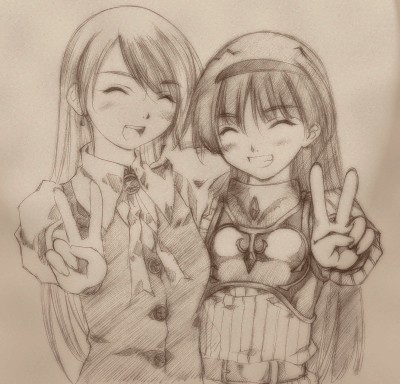

# Sword Art Online 外传4: 绝剑

&emsp;

### 10

　　翌日，1月12日，下午12点50分，校舍三层北端。

　　在午休的喧闹微微传来的计算机房里，明日奈伸展着后背坐在椅子上。

　　西装样式的制服右肩上用细带固定着一台直径约7厘米的半球形机器。

　　底部是黑色金属材质，球顶部分则由透明的有机玻璃制成，可以看见内部收容的镜头结构。从底部伸出两根电缆，一根和放在明日奈上衣口袋里的移动终端连接，另一根则连接着放在眼前桌子上的小型电脑。

　　电脑前，桐之谷和人跟和他一起上硬件控制课程的两名学生凑着脑袋，从刚才开始就用各种咒语似的词汇交换着意见。

　　「所以说啊，这个对陀螺仪【gyro】太过敏感了。我觉得应该优先视线追随性，这里的参数【parameter】要再放宽松一点……」

　　「但是那样的话，要有突然的动作的话就会延迟【lag】了吧。」

　　「这些就只能期待最优化程序【program】的学习效果了啊。」

　　「呐，桐人君，还没好？午休要结束了哟。」

　　明日奈被强制以姿势固定的呆了超过三十分钟，终于忍不住问了，和人「唔~嗯」地嘟囔着抬起脸。

　　「总之初期设定是OK了。优纪小姐，听得到吗？」

　　和人没有对明日奈，而是朝圆顶装置问道。紧接着，机器配备的扬声器里立刻传来《绝剑》优纪精神十足的声音。

　　『是~，听得很清楚哟。』

　　「好，那，接下来要进行镜头的校准【calibration】，在视野清晰的时候请出声。」

　　『是，明白。』

　　戴在明日奈肩上的半球形机器，是通称为《视听觉双向通信探测器》的东西——这是和人他们班从今年年初开始就一直反复试错的课题。

　　简单来说，这是让AmuSphere连接网络，在现实世界远距离交换视觉与听觉的机器。探测器内部的镜头和麦克风收集到的数据，通过明日奈的移动终端连上网络，再经由横滨港北综合医院的Medicuboid传到虚拟空间里的优纪那里。镜头能在半球内自由旋转，从而获得与优纪视线同步的影像。优纪现在大概感觉自己缩小成了十分之一，坐在亚丝娜肩上。

　　明日奈之前被迫听了许多对这个课题的抱怨，所以在优纪说出想去学校的时候，立刻想了起来。

　　呜吟，伴随着非常微弱的声音，镜头的焦点开始移动，和优纪的「这里」的声音同时停止。

　　「好，这就结束了。姑且放进了水平稳定器【stabilizer】，不过还是避免激烈的动作吧。也不要太大声的说话哟。悄悄话的程度就足够听见了。」

　　「明—白。」

　　对不停说着注意事项的和人大大的伸了个懒腰回答后，亚丝娜慢慢站起身来。立刻对肩部上的探测器小声说。

　　「抱歉啊优纪，本来想带你在学校里逛逛的，不过午休马上就要结束了。」

　　立刻，从小型扩音器里优纪的声音回答道。

　　『没关系，参观上课也很高兴！』

　　「OK，那首先，先跟下一节上课的老师打个招呼吧。」

　　对一口气完成探测器的设定，略微有些疲惫表情的和人他们三个挥挥手，明日奈走出了机房。

　　在走廊里走着，下楼梯，走过联络桥的时候，优纪每发现了什么都会发出啊的欢声，不过一到挂着『职员室』牌子的门前，马上安静了。

　　「……怎么了？」

　　『那个……我，从以前就不擅长啊，职员室……』

　　「呵呵呵，没关系。这个学校全是些不像老师的老师。」

　　带着笑轻声说着，明日奈有气势的打开了门。

　　「打扰了！」

　　『打，打扰了。』

　　大小两声招呼同时进入屋里，快速穿过桌子的行列。

　　上第五节的现代国语课的教师，是曾经作为都立中学的教导主任干到了退休，被这个实验性教育设施乞求才再就职的人物。已经是将近七十岁的年纪，却能巧妙的运用学校各处引进的网络设备，言谈举止充满理性，明日奈对他很有好感。

　　想着这个人的话应该不会排斥吧，明日奈多少有些紧张地说明了情况。满头白发的教师一手拿着大茶杯，侧耳倾听，听完了之后点了一下头说。

　　「嗯，没关系哟。那个，你，名字叫什么来着？」

　　『啊，是……优纪——绀野木绵季。』

　　实际从探测器里听到即席的回答，老师也稍微有些吃惊，不过马上绽开了嘴角。

　　「绀野君，可以的话以后也来上课吧。从今天开始讲芥川的《斗车》，那个不读到结尾就没意思。」

　　『是……是，谢谢您！』

　　跟在优纪后面明日奈也道了谢，这时预备铃响了。慌忙再次低头行礼，从职员室里出来，两人同时呼的松了一口气。

　　相视一笑，明日奈快步走向教室。

　　一座到自己的座位上，肩上的谜之机器立刻受到周围同学的问题围攻，于是说明了优纪住院的事情，实际上优纪一说大家立刻就理解了原委，一个接一个的开始自我介绍。告一段落的时候上课铃响了，老师从前门进来了。

　　在值日生的口号下行完礼——探测器中的镜头也嗡、嗡的上下——走到讲台旁的老教师摸了一把胡子，和平时毫无变化的开始上课。

　　「哎，那么，今天开始讲教科书九十八页，芥川龙之介的《斗车》。这是芥川三十岁时的作品——」

　　教师的概括继续着，明日奈拿起平板式终端，找出课本的适当位置，为了让优纪也能看见，拿在身前。但教师接下来的话，几乎让她把终端没拿住掉了。

　　「——那么，就从最开始读吧。绀野木绵季君，可以拜托你吗？」

　　「哈？！」

　　『是、是！』

　　明日奈和优纪同时发出错愕的声音。教室里一下子噪杂了起来。

　　「不行吗？」

　　对问着的教师，在明日奈回答之前，优纪大声叫道。

　　『我、我读！』

　　探测器的扬声器内置了输出功率足够的放大器，那个声音可以轻松传到教室角落。明日奈慌忙站起来，双手把平板终端举到镜头前。头向右歪，小声说。

　　「优纪……能、能读吗？」

　　『当然。别看这样我可是读书家哟！』

　　立刻回答后，停了一下，优纪精神的开始朗读课文。

　　『……小田原和热海之间开始铺设小火车轨道是在……』

　　举着课本，明日奈轻轻闭上眼睛，把意识集中在抑扬顿挫的读着文章的优纪的声音上。

　　在心中的场景里，清晰的看见站在明日奈旁边的位置上，穿着制服的优纪的身影。绝对有一天这个光景会变为现实，明日奈在那个瞬间确信。医学每年都有着长足的进步。在非常近的未来，一定可以开发出根绝HIV这种恶魔的药品，优纪回归现实世界的日子一定会到来。那个时候，一定要真正的手拉着手，带她参观学校和城镇。在回去的路上去快餐店买吃的，到公园闲逛，说些不疼不痒的话。

　　明日奈以不让优纪注意到的动作，用左手轻轻擦拭眼角。优纪充满感情的，不断读着上世纪的名文，教师也没有让她停下的意思。午后的校内一片寂静，仿佛全校的学生都在侧耳倾听她的朗诵。

&emsp;

　　就这样第六节课也一起上过之后，明日奈如约带优纪参观校内。班上的同学们有十个人也一起跟着，争先恐后地和优纪搭话，这倒是预定外。

　　总算回到两人独处，在中庭的长椅上坐下来的时候，天空已经被染成了橙色。

　　『亚丝娜……今天真的谢谢你。特别的开心……我，绝对不会忘记今天的事情。』

　　突然优纪认真的说，明日奈反射性的用开朗的声音回答。

　　「说什么呢。老师不也说了每天来都可以吗。明天的现代国语是第三节，不能迟到哟！还有啊……还有别的想去看的东西吗？校长室以外什么地方都可以哟。」

　　优纪呵呵的笑过之后，沉默了一会儿。接着，战战兢兢地开口。

　　『那个啊……有一个，想去的地方。』

　　「哪里？」

　　『那个，学校外面，可以吗？』

　　「哎……」

　　明日奈不由得沉默了。不过想了一下，探测器电池的电量还很充裕，只要是移动终端能连上网的地方，应该就没有移动的限制。

　　「嗯，没关系哟。只要有移动信号的地方哪里都可以！」

　　『真的？！那个啊……虽然稍微有点远……横滨的，保土谷区，叫做月见台的地方……』

&emsp;

　　从学校所在的调布出发，依次换乘京王线、东横线、相铁线，前往横滨市保土谷区。

　　在电车上只能嘀嘀咕咕的说悄悄话，不过在那之外的路上，明日奈都完全不在意周围的眼光和肩膀上的双向通信探测器说着话。优纪住院的三年间，街道的风情似乎也变化了不少，对她感兴趣的东西全都走近加以解说。

　　一边做着这种事，从星川站下了电车的时候，设在路口中央的大时钟的指针已经指到了五点半。

　　仰望从深红色慢慢变成紫色的天空，明日奈深深的吸了一口气。由于旁边就延伸着留有很多树木的丘陵，寒冷空气的味道似乎和东京相当不同。

　　「真是漂亮的城市呢，优纪。天空非常宽广哟。」

　　明日奈用开朗的声音说着，但优纪却用抱歉的声音回答。

　　『嗯……。抱歉啊，亚丝娜。因为我的任性弄到这么晚。家里边，没问题吗？』

　　「没事没事！晚回去是常有的事啦。」

　　反射性的这么回答，但实际上，明日奈几乎没有错过过晚饭的时间，而且那种场合，会让母亲相当不高兴。但是今天，有种不管回去后被怎么骂都没关系的感觉。优纪希望的话，只要探测器还有电，走到多远都愿意。

　　「稍微，发个邮件哦。」

　　若无其事的说着，明日奈取出移动终端。保持着和探测器的连接，启动邮件程序，给自家电脑发了会晚回去的信息。恐怕从母亲那里，会发来责备无视时限的邮件、接着无疑会直接打来电话，但一直把终端调到上网状态的话应该会转到留言服务的。

　　「这样就OK了。那，优纪，想去的地方，在哪？」

　　『那个啊……在站前向左拐，第二个红绿灯向右……』

　　「嗯，知道了。」

　　点了一下头，明日奈迈开脚步。照着优纪的叙述，穿过了站前的小小商业街。

　　优纪在面包店、鱼店、邮局、神社等各个地方的前面通过的时候，都会怀念地嘟囔一两句。接着进入住宅区后，在有大型犬的房子啦、枝叶宽广的树啦之类上也会停留目光，发出赞叹。

　　所以明日奈，即使优纪什么也没说，就察觉到了这个城市是她之前生活的地方。然后，在两人行走的前方等待着的，也是——。

　　『……在前面转弯的地方的，白色房子前停下吧……』

　　明日奈注意到，这么说着的优纪的声音，有些微的颤抖。沿着树叶落光的白杨排成一排的公园向右拐，左侧，墙上贴着白瓷砖的房子寂静的矗立着。

　　再走了几步，在青铜制的门扉前，明日奈站住了脚步。

　　『…………』

　　肩膀上优纪漏出长长的呼吸。明日奈不由得伸出手指放在探测器的有机玻璃圆顶上，小声说。

　　「这里是……优纪的家吧。」

　　『嗯。……没想到还能再次见到啊……』

　　白墙绿屋顶的房子和周围的住宅相比略微有些小，但相对的有着相当大的院子。草坪上，放着白木的桌椅，里面的地方还设置着红砖围绕的大花坛。

　　但是桌子由于风雨冲刷颜色变得暗淡，花坛的黑土上也只稀稀拉拉的长着枯萎了的杂草。两边的房子的窗户玻璃里，都溢出团圆的温暖的橙色，但白色房子的窗户全部都关着木板外窗，完全没有生活的气息。

　　不过这也可以说是当然的。曾经在这个家里生活的，父亲、母亲和两个女儿的家庭，如今只剩一人了。而且那一人也在隔绝空气的门的对面，躺在机器环绕的床上，一步也无法走出来。

　　一段时间里，明日奈和优纪无言的看着在最后的夕阳下被染成紫罗兰色的房子。接着，优纪轻声嘟囔道。

　　『谢谢，亚丝娜。把我带到这里来……』

　　「……要进去看看吗？」

　　明知如果被谁看见了的话会很困扰，明日奈还是这样问了。但是，优纪嗡嗡的左右摇着镜头，说。

　　『不，已经够了。你看……不快点回去的话，要晚了哟，亚丝娜。』

　　「还……再呆一会儿的话，没关系哟。」

　　反射性的这样回答，亚丝娜转过身。隔着窄窄的道路的对面有个公园，它的外围被石堆底座的树篱环绕着。

　　亚丝娜穿过小路，坐在齐膝高的石砌矮墙上。探测器的正对面，就是长眠中的小小的家。在这里的话，优纪的视野应该能看见院子的全景。

　　又沉默了一会儿，优纪说。

　　『虽然在这个家里生活还不到一年呢……。但是，那个时候的每一天，都清清楚楚地记得。之前是住在大楼里的，所以有院子非常高兴呢。虽然妈妈因为担心感染症不太愿意，但我总是和姐姐跑来跑去的玩……。在那张长椅那里烤肉，还和爸爸一起做过书架哟。非常快乐……』

　　「真好啊。我都没经历过那种事情呢。」

　　明日奈的家里也有可以称得上是广大的庭院。但明日奈完全没有和父母或兄长在那里游戏的记忆。总是一个人玩过家家、画画。所以，优纪所说的家庭的回忆，伴随着深深的憧憬响彻明日奈的心中。

　　『那，这次在22层亚丝娜的家里烤肉如何？』

> rkl：此处及后面两处原文均为第18层，与第1节存在矛盾，已全部修改为第22层。

　　「嗯！……绝对，约好了哟。把我的朋友们，还有希安她们也都叫来……」

　　『嗯，那就要准备很多很多肉才行哟。淳和塔尔肯都很能吃。』

　　「哎哎？看上去没觉得啊。」

　　啊哈哈，这样笑着，再次把视线投回到家上。

　　『现在啊……这个家，好像在亲戚间闹得不可开交。』

　　小声说着的优纪的声音，再次渗进了些许寂寞的音色。

　　「闹得不可开交……？」

　　『拆了盖便利店啦，甚至把地卖了，或者就这样出租出去……大家好像有各种各样的想法。前一阵好像是爸爸的姐姐的一个人，甚至到VR世界里见我来了哟。明明知道我们生病后，在现实里一直躲着我们……。要让我……——写……』

　　遗书——是这回事吧。明日奈不禁屏住呼吸，咬紧了牙齿。

　　『啊，抱歉啊，说了奇怪的牢骚。』

　　「唔……不，没关系啊。要多说一点才能舒服哟。」

　　总算，发出了像样的声音。

　　『那我就说了。然后啊……我对她说了。在现实世界里我连笔都拿不了，也盖不了章，要怎么写信啊？——姑姑当时张口结舌呢。』

　　呵呵呵，优纪漏出笑声。受她影响，明日奈也轻轻微笑。

　　『然后啊，那个时候，拜托她说希望这个家能够原样留下来。管理费的话，爸爸的遗产应该能支持十年左右的。但是啊……果然，好像不行。我想多半会被拆了吧。所以，在那之前，还想再看一次……』

　　是对焦到家的各处吧，伺服机构发出的轻响，传进明日奈的右耳。听着仿佛满载着优纪感情的那个声音，明日奈的心中被塞满了，突然，把想到的事情冲口而出。

　　「那……这样就好了。」

　　『哎……？』

　　「优纪，今年十五岁对吧。到十六岁的话，就能和喜欢的人结婚了。那样的话，那个人就能一直守护着这个家了哟……」

　　正说着，啊的想到了。如果优纪有喜欢的人的话，那无疑是《沉睡骑士》里的男生之一吧，但那里的成员全部是和难治性疾病战斗之身。据说其中已有人被宣告余命不多。也就是说即使结婚也好，状况也不会有太大变化，甚至可能更加复杂，而且本来说到结婚对方的情况啦是不是有感情啦也不知道……。

　　但是，优纪沉默了一瞬之后，啊哈哈哈哈的大笑起来。

　　『啊哈哈哈，亚、亚丝娜，好厉害的想法啊！原来如此，没想到还有这一招啊。嗯是吗，说不定是好想法。结婚申请书什么的，感觉也会努力去写呢！——但是，很遗憾，没有对象啊。』

　　对还在啊哈哈的不停笑着的优纪，明日奈缩着脖子说。

　　「是、是吗……？淳一类的，气氛不是不错嘛。」

　　『啊，不行不行，那种简直是小孩子！确实呢……那个……』

　　突然声音里混进了淘气的响声，优纪说。

　　『呐，亚丝娜……要不要跟我结婚？』

　　「哎……」

　　不禁说不出话来。效法美国在法律上认可同性间的婚姻这种议论，每年都会多次成为公众的话题，却迟迟没能提到众议院的全体会议上。瞬间性的考虑了这种事情，明日奈惊慌失措着，优纪先再次愉快的笑了。

　　『抱歉抱歉，开玩笑的。亚丝娜已经有重要的人了呢。是那个人吧……调整这个镜头的……』

　　「哎……那个……嗯，嘛……」

　　『小心一点比较好哟。』

　　「哎……？」

　　『那个人也有种，在和我们不同的意义上，生活在现实以外的地方的感觉。』

　　「…………」

　　虽然想思考优纪的话的意义，但脑子里乱成一锅粥。明日奈摸着变热了的脸颊，镜头扫了一下她的侧脸，优纪用平静的声音说。

　　『真的，谢谢你，亚丝娜。只要再一次看见这个家，我就相当满足了。即使家不在了，回忆还在这里。和妈妈、爸爸、还有姐姐一起度过的快乐时光的记忆，会一直留在这里……』

　　亚丝娜明白，这里，这个词指的并不是家所处的土地，而是优纪的心中。

　　这个家的样子，也已经刻在自己心中了，明日奈带着这种心情大大的点头。优纪继续说。

　　『……我和姐姐，每次吃药吃得难受得哭出来的时候，妈妈都会说耶稣大人的事情。她说耶稣大人是不会给予我们无法忍耐的痛苦的。然后，姐姐就和妈妈一起祈祷，但是，我稍稍有些不满。其实想听的，不是圣经上的，而是妈妈自己的话，一直这样想……』

> rkl：这让我想起了NERV标语的翻译——「神不为者，人为之」。不过这句话真正在EVA系列里落到实处，已经是新剧场版的Wille了。

　　稍停了一会儿。完全变成深藏青色的天空上，大大的红色星星开始闪烁。

　　『但是啊，今天再次看到这个家，我明白了。妈妈其实一直都在对我说着的。不是用言语……而是用感情包裹着。一直祈祷着，希望我直到最后都能一直笔直向前进，……总算，明白了啊。』

　　明日奈也仿佛看见了跪在白色房子的窗边，向着星空祈祷的母亲和两个女儿的身影。被优纪平静的声音引导着，明日奈不知怎的，说出了很久、很久以前开始就一直藏在心底的感情。

　　「我也是呢……我也……已经很久，没有听到妈妈的声音了。即使面对面说话，也听不到心。我的话语也传达不到。优纪之前说过呢。也有不正面碰撞就传达不到的事情。要怎样，才能像优纪那样呢……？要怎样，才能像优纪那样强呢……？」

　　这对已经失去双亲的优纪来说，说不定是欠考虑的话。至少，平时的明日奈的话会这样考虑，不会说出口吧。但是只有现在，通过肩膀上的探测器传来的优纪的精神波动，溶解了覆盖着明日奈的心的墙壁。明日奈简直像回到小时候似的，以天真的心情问着。

　　优纪用好像有些困扰的声音回答。

　　『我……一点都不强啊。』

　　「没有那种事。像我这样的人，看着别人脸色会害怕、会畏缩，但优纪完全不会这样不是吗。看起来非常……非常自然。」

　　『嗯……但是啊，我以前还在现实世界的时候，也总是扮演着不同的自己。爸爸和妈妈都对生下我和姐姐的事情一直在心里道歉，这种事我也知道……。所以我想，为了爸爸和妈妈，我一定要总是很精神才行，生病的事情什么的完全不在意才行。所以，进入Medicuboid以后也是，也许只是装成那样。真正的我，也许是对周围的一切都讨厌着、憎恶着、每天都哭天喊地的孩子也说不定哟。』

> rkl：虽然莎士比亚曾经写过「世界是一个舞台，每个人都不过是台上的演员」，但11区由于资源匮乏而产生了名为「排序」和「扮演」的集体无意识，或者说所有人都是「伪人」的这种局面，也算是全球罕见了。

　　「……优纪……」

　　『但是啊，我想了。演技也无所谓……。即使只是装作很强也好，如果这样能露出笑脸的时间就能增加的话，不是完全无所谓吗。你看，我已经没什么时间了嘛……。和谁接触的时候，带着顾虑，隔得远远的试探心情的话太浪费时间了，我可一直是这么想的呢。那样的话从一开始就狠狠地撞上去好了。即使被对方讨厌了，那也没关系。因为走到了那个人的心旁边这件事没有改变啊。』

　　「……确实呢……。因为优纪这样做了，我们才短短几天就这么要好了呢……」

　　『不是的，那不是我哟。是因为即使我逃走了，亚丝娜也拼命追过来哟。——昨天，看见在监控室里的亚丝娜，听到声音，亚丝娜的心情非常强烈地传了过来。这个人，即使知道我生病的事，还想着希望再见我一次而来，知道了这个，真的……真的，高兴得快要哭出来了。』

　　声音停了一瞬后，优纪继续说。

　　『……所以，和你妈妈也像那个时候那样谈谈怎么样？心情这种东西，我想是只要想传达就能传达到的东西哟。没问题，亚丝娜比我强多了。真的哟。不正面碰撞就传达不到……亚丝娜那样用力撞过来了，所以我，认为这个人可以托付我的一切。』

　　「……谢谢。谢谢你，优纪。」

　　只说了这些，明日奈仿佛要不让眼角渗出的泪水流下似的，望向天空。在首都圈那不会完全变暗的夜空中，也能数出许多不输给人工光的星星。

&emsp;

　　回到车站时，探测器的电池剩余警报响了。明日奈和优纪约好了明天也一起去上课，就切断了移动终端的连接。

　　再次乘上电车，回到世田谷的自家的时候，已经远远超过九点了。

　　在被寂静而冰冷的空气笼罩的门厅里，听到门锁锁上的声音异常大的响起，明日奈深吸了一口气。右肩上，还微微留着优纪坐在那里的沉重感。轻轻用左手按着那个温暖，脱下鞋，快步走向自己的房间。

　　换上室内装，马上走到走廊。走向的是位于同样是二楼深处的哥哥浩一郎的书房。和父亲一样几乎不着家的浩一郎当然还没回来吧，一边这样想着一边敲门，不过果然没有回应。不管他，擅自打开了门。

> rkl：这里和后面段落中，哥哥的名字在原文内写为「裕明」，大概是川原把设定忘掉了。文库本此处已经修正。

　　在只有书房之名，几乎不存在真正的书本的房间中央，摆着大大的办公桌。在它左边，有想找的东西。是浩一郎在虚拟空间里开会之类的时候使用的AmuSphere。拿起比明日奈自己的新许多的头戴设备和驱动器，回到自己屋子。快速接入本体的电源，把预备的《Alfheim Online》光盘插进驱动器。躺在床上，把浩一郎的AmuSphere调整成自己头的尺寸，啪的一声戴上。

　　按下电源，连接程序立刻开始了，接着被传送到了ALO的登录空间。但是明日奈没有用平时使用的主账户，而是使用希望成为「别人」时使用的副账户潜行进了ALO。

　　登录的地方是第22层，森之家的客厅。但是身体不是平时的「亚丝娜」，而是名为「艾莉卡【Erika】」的其他角色。检查了服装，取下别在腰间的两把匕首收起来。立刻打开菜单，执行了暂时登出指令。

　　仅仅几十秒的潜行后，明日奈立刻回到了现实的自己的房间。从头上取下AmuSphere，但蓝色的指示灯还在缓慢的闪烁。这表示和VR世界的连接处于待机状态，再次戴在头上按下电源开关的话，就能省略登录过程回到游戏中。

　　拿着哥哥的AmuSphere，明日奈站起身来。和NerveGear不同，AmuSphere和驱动器本体是无线连接的，在家里的话应该差不多从这头到那头都能保持连接。

　　打开门，再次走出到走廊，这次是用稍微重一些的脚步下了楼梯。

　　窥探了一下一楼的客厅和饭厅，不过果然桌子已经收拾干净，不见母亲的身影。接着走向房子的深处，走廊拐了一个弯，在那前方，注意到了母亲的工作房间的门下方隐约透出的光。

　　站在门前，想要敲门而举起右手时，犹豫了很久。

　　是从何时开始，到访母亲的房间变得如此让人喘不过气来的呢，明日奈苦笑着思考着。但是这大概，有一半以上是明日奈的原因吧。心情无法传达到是——因为没有想要去传达。这是优纪让明日奈意识到的。

　　明日奈深吸一口气，高声的敲门。

　　立刻，听到了请进的声音。转动把手，从打开的空隙中钻了进去，又反手关上门。

　　京子朝向厚重的柚木材的桌子，和以前一样敲着电脑的键盘。又高声的敲了一会儿键盘，最后用力按了回车键，总算把身体靠在了椅背上。推上眼镜看向明日奈的视线里，可以看出平常没有的焦躁。

　　「……真晚啊。」

　　对只说出这句话的京子，明日奈低头道歉。

　　「对不起。」

　　「晚饭已经收拾了啊。要想吃什么的话，自己去冰箱里拿吧。前一段说过的插班申请书的期限是明天，要在明早之前写好啊。」

　　说完话，京子正要把手放回键盘上。这时，明日奈说出了事先想好的话。

　　「关于那件事……我有话要说，妈妈。」

　　「说来听听。」

　　「在这里很难说明。」

　　「那要到哪儿说啊。」

　　没有马上回答，明日奈走到京子旁边，左手递出了藏在身体后面的东西。是处于待机状态中的AmuSphere。

　　「VR世界……。只要一会儿就好，用这个，有一个想让你去的地方。」

　　略微瞥了一眼银色的圆环，京子像看见了讨厌的东西似的皱紧了眉头。毫无商议的余地似的挥了挥右手。

　　「我讨厌那种东西。没法好好地脸对脸说出来的话，我也不想听。」

　　「求您了，妈妈。有样东西无论如何都想让您看看。只要五分钟就好了……」

　　平常的话，这种情况一定会只说一句对不起就退下吧。但是明日奈又上前了一步，从近距离盯着京子的眼睛，越说越激动。

　　「求求您了。我现在，感觉到了什么、在想着什么，要把这些说出来的话，这里是不行的啊。只要一次就好……想让妈妈，看看我的世界。」

　　「…………」

　　京子的眉头越皱越紧，嘴抿得紧紧的盯着明日奈看，不过几秒后，呼的长长的叹了口气。

　　「——只有五分钟哟。而且不管你说什么，妈妈也不会同意你下个学年接着去上那个学校的。说完了以后，乖乖去写申请书。」

　　「……是。」

　　明日奈点头，递出左手的AmuSphere。京子带着碰都不想碰的表情接了过来，用不熟练的手法戴到了头上。

　　「这个要怎么弄？」

　　明日奈迅速的调节着大小，一边说。

　　「打开电源就可以自动连接了。进到里面去以后，等我也进去。」

　　京子轻轻点头，把身体靠在椅子的靠背上。确认她靠好了以后，明日奈按下了AmuSphere右侧面的电源开关。主指示灯亮了起来，连接指示灯开始不规则地闪动。立刻，京子浑身脱力。

　　明日奈急忙奔出工作房间，全力跑过走廊和楼梯，回到自己的房间。扑通一声扑到床上，把常用的AmuSphere戴到头上。

　　按下电源开关，眼前出现放射状的光，明日奈的意识被从现实中割离了。

&emsp;

　　降落在熟悉的白木做的客厅的亚丝娜环视着房间寻找艾莉卡的身影。立刻，看见了一位嫩草色短发的少女站在碗柜旁边的镜子前，窥视着自己的样子。

　　亚丝娜走近的时候，艾莉卡/京子转过身，用和现实世界的她一模一样的方式皱起了眉头。

　　「总觉得，很奇怪呢。不认识的脸如自己所想的动起来什么的。而且……」

　　垫了几下脚尖。

　　「身体轻得很奇怪啊。」

　　「那当然了。那个身体的体感重量也就只有40公斤左右。应该和现实相当不同哟。」

　　亚丝娜带着微笑这么一说，京子再次不愉快的皱起眉头。

　　「真失礼，我可没有那么重。——说起来……你倒是和那边长得一样啊。」

　　「嗯……算是吧。」

　　「但是，不过真人的轮廓倒是稍微圆润一点呢。」

　　「妈妈才失礼呢。我和现实完全一样。」

　　斗着嘴，亚丝娜想，上一次和京子这样毫无心机的对话到底是什么时候呢。虽然还想再这样说一会儿，但京子在胸前抱起胳膊，示意玩笑到此为止。

　　「那，已经没有时间了哟。要给我看的东西是什么啊。」

　　「……到这边来。」

　　亚丝娜咽下叹息穿过客厅，打开平时作为储藏室使用的小房间的门。等着京子用不稳当的脚步走进，把她引到小房间里的小小的窗户前。

　　从朝南的客厅可以一眼望到大大的草坪庭院和小路、平缓的小丘和那另一边的湖组成的美丽如画的景色，但从朝北的储藏室的窗户里，只能看见草很深的后院、小河还有迫近的针叶树的森林。那是在这个季节基本都被雪覆盖着，只能表现出寒冷感觉的风景。

　　但是，这才是亚丝娜想让京子看的景色。

　　亚丝娜推开窗户，眺望着深深的森林说。

　　「怎么样，不觉得很像吗？」

　　京子再次皱起眉头，小幅度的摇头。

　　「你说像什么啊？不只是无聊的杉树林——」

　　话说到一半，就像被吸走般消失了。京子半张着嘴，用茫然的视线眺望着窗外。对着她的侧脸，亚丝娜小声说。

　　「呐，想起来了吧……外公和外婆的家。」

　　明日奈母亲那边的外祖父母，也就是京子的双亲，在宫城县的山区里务农。家所在的地方是仿佛切开峻峭的山谷开辟出来的小村庄。田地全部像架子那样紧贴着大山，根本无法机械化。主要种植的是大米，但能够收获的就只有刚刚够一家人吃一年的分量而已。

　　多亏了祖先传下来的一小片杉山，总算还能供京子上到大学。陈旧的木质的家建得好似蹲在山脚下，坐在门廊上，看得见的东西就只有小小的庭院、小河、还有那深深的杉树林而已。

　　但是明日奈从小时候起，就比起京都的结城本家更喜欢去「宫城的外公外婆」的家。每年暑假和寒假都撒娇着要去，和外公外婆一起躺在被子里，听各种各样的故事。夏天在门廊上吃刨冰，秋天和外婆一起晒柿子，而在这些各种各样的回忆中，记得特别清楚的是，严冬里，在冷得刺骨的天气里钻进炉桌下，吃着橘子，看着窗外的杉树林的情景。

　　外祖父母虽然对树林有什么好看的感到很纳闷，但明日奈看着白雪中黑色的杉树的树干一个挨着一个、一望无际的样子，感觉心都被吸引进去了。感觉自己好像变成了在雪下的洞穴里等待春天的小老鼠似的，被好像不安、好像温暖的不可思议的感慨包围着，不停的望着杉树林。

　　外祖父和外祖母在明日奈初中二年级的时候相继去世了。梯田和山林都被卖掉，失去了居住者的家也被拆掉了。

　　所以，买下这个处在和宫城的山村不论是物理上还是观念上都相隔甚远的地方的，艾恩葛朗特第22层的家，从北边的窗户看见积着厚厚白雪的针叶树林的时候，明日奈的心中浮起了几乎要哭出来的乡愁。

　　明日奈知道，京子对出生的家庭是贫苦的农家这件事感到羞耻。但即便如此，明日奈也无论如何都想让京子看到这个窗户外的景致。看到这个她过去每天都眺望，然后又强行忘却的风景。

　　京子无言的望着杉树林。走到她身旁，亚丝娜缓缓的开始说。

　　「还记得我初一那年的盂兰盆节的事情吗？爸爸妈妈还有哥哥都去了京都，但我无论如何都坚持说想去宫城，结果真的一个人擅自跑去了的那时候的事情。」

　　「…………记得啊。」

　　「那时候啊，我对外公和外婆道歉了。说，妈妈不能来扫墓对不起。」

　　「那个时候是……结城本家有一项一定要出席不可的法事……」

　　「不，我不是在责备您哟。然后呢……外公他们，在我道歉后从茶柜里拿出了厚厚的相册。一看里面，可真是吓了一大跳啊。——妈妈的，从第一篇论文开始，登在各种杂志上的报道啦采访啦，全部都整理起来了。连登在网上的东西，都打印出来贴上了哟。因为他们俩都完全不会用电脑呢……」

　　「…………」

　　「然后，他们给我看那个相册的时候，外公说了啊。说妈妈是他们唯一的骄傲。对您从村里出去上了大学，成为了学者，在杂志上发表了许多文章，变得越来越出色，感到特别高兴。因为忙于论文和学术会议，在盂兰盆节的时候回不来也是当然的，从来都没有对此感到不满……他们这样说……」

　　京子只是直直的盯着森林，无言的听着亚丝娜的话。她的侧脸上没有浮现出任何表情。但是，亚丝娜继续拼命说着。

　　「那之后，外公这样继续说着——但是，妈妈也，也许有一天会累了、到了想要停下来的时候。也许有一天会变得想要转过身，确认自己走过的道路的时候。为了那个时候，他们要一直守护着这个家……如果哪一天，妈妈想要支撑的时候，是有可以回去的地方的哟。为了能说出这种话，要一直守护着这个家和山林……。——我在那个时候，对外公说的话的意思没有完全明白。但是最近，觉得终于明白了。那是说，人生不仅仅是为了自己不停向前冲……把某个人的幸福当成自己的幸福，这样的生活方式也是有的。」

　　亚丝娜的脑海里，一瞬间浮现出桐人、优纪、莉兹贝特她们还有希安她们的脸。

　　「我想选择能让周围人们都露出笑脸的生活方式。我想尝试一种随时能支撑疲惫之人的活法。为了这个——现在，想去那个学校。」

　　一边寻找词句，亚丝娜终于说到了这里。

　　但是京子却一直紧抿着嘴角，继续眺望着森林。她深绿色的眼睛里，只漂浮着模糊的神色，无法窥伺到内心。

　　就这样，持续了大约五分钟以上的沉默。巨木间的雪原上，两只兔子似的小动物嬉戏着蹦跳过去了。亚丝娜的视线看了那边一瞬，转回京子的侧脸的时候，不禁屏住了呼吸。

　　京子此刻白瓷般透明的脸颊上，有一行泪水流下，滴答滴答的滴下。嘴唇微微动着，但听不到话语。

　　过了一会儿，京子注意到了自己在哭的事情，慌忙用两手来回擦拭脸颊。

　　「哎呀……这是什么啊，我又没哭……」

　　「……妈妈，这个世界里，是没法隐藏泪水的哟。想要哭的时候，谁都忍不住的。」

　　「真是不方便啊。」

　　像吐出来似的说着，京子不停擦拭眼睛，但终于放弃了似的，用双手的手心捂住了脸。接着，从手中漏出了微弱的呜咽。亚丝娜犹豫了很久，最后终于轻轻地把手放在不时抽动的京子肩上。

&emsp;

　　第二天早上。

　　早饭桌旁的京子，完全变回了平常的样子，读着报纸。打过早上好的招呼后就寂静地吃完饭，明日奈做好了被要求提出插班申请书的觉悟。但是，京子用和平时相比不那么严厉的眼神看着亚丝娜，唐突的说。

　　「你有了一生支持某个人的觉悟了吧？」

　　明日奈慌忙点头。

　　「啊……嗯。」

　　「——但是，要支持别人，首先要自己强大才行啊。乖乖地去上大学吧。为了这个，第三学期和下个学年要取得更好的成绩啊。」

　　「……妈妈……那，转校就……」

　　「我说了吧？看成绩而定哟。你就努力吧。」

　　只说了这些，京子就快步走出饭厅。凝视了一会儿大声关上的门，明日奈慢慢低下头，轻声说，谢谢妈妈。

　　到换好衣服、拿着包走出家门的时候，都一直保持着那样严肃的态度，但一走出大门，明日奈就立刻在闪着霜之光的路上跑了起来。自然地，嘴角溢出笑容。

　　想对和人说——今年也，可以一直上同一所学校。想对优纪说——我和母亲，好好的交谈了。

　　在涌向车站的人群的缝隙中跑着，明日奈直到到达车站，都一直无法抑止浮出的微笑。

&emsp;

　　三天后，森之家如约举办了盛大的烤肉大会。

　　聚集起来的成员有桐人、莉兹贝特、莉珐、西莉卡等总在一起的伙伴们，有优纪、希安她们《沉睡骑士》的成员，还有朔夜、艾莉莎·露、尤金等一部分种族的领主们和他们的随从。为了填饱共计几十人的大集团的肚子，还特地组成了狩猎食材的队伍。

　　在举杯祝酒之前，亚丝娜将《沉睡骑士》的成员们重新介绍给了大家。虽然隐瞒了生病的事情，但关于他们是走遍各式各样的VRMMO的强大集团、解散前正在ALO制造回忆等等，在得到优纪她们同意后全部说了出来。

　　「只用七个人就攻略第67层BOSS的神秘公会」——这传言，以及「在街头决斗中斩倒百人以上的《绝剑》」的传言，似乎已经传遍阿尔普海姆。朔夜和尤金等人立刻开始劝他们加入自己的阵营。优纪笑着推辞了，不过如果《沉睡骑士》真的被某个种族雇为佣兵，ALO的力量平衡必将大幅改变，对正在进行中的《Grand Quest》第二弹也会造成巨大影响吧。

　　热闹的干杯之后，暴饮暴食的宴会如风暴般开始，亚丝娜也和优纪一起大吃大喝。席间有人提议，既然如此就顺便挑战第68层以后的BOSS，于是二次会顺势变成了第68层迷宫区踏破之旅，最后还带着一大群人冲进BOSS房间，屠杀了巨大的甲壳类BOSS——这已经近似笑话了。

　　《剑士之碑》上刻下的名字很遗憾只有优纪和担任队长的桐人他们几个人的名字而已，不过约好了69层再次只由《沉睡骑士》们挑战后，当日就解散了。

　　在阿尔普海姆不断冒险的期间，在现实世界优纪也是用双向通信探测器每天去上课。一起去拜访了和人和直叶的家，还去了艾基尔的店里玩。

　　刚见面的时候优纪对直觉好过头了的和人总有些警戒，不过两人都是单手直剑的使用者，说过几句话之后立刻打消了隔阂，在ALO内关于剑技的钻研，在现实世界关于探测器的发展形态，进行激烈的论战，有时甚至让亚丝娜干着急。《沉睡骑士》的其他成员也都和莉兹贝特和莉珐她们变得要好，策划了各种各样的事件，过得非常快活。

　　二月。

　　亚丝娜和《沉睡骑士》们以一支队伍击破了69层还有70层的BOSS，她们的威名轰动了阿尔普海姆。中旬举办的统一决斗淘汰赛上，东区是桐人，西区是优纪，各自以破竹之势连胜晋级，决赛因在VRMMO情报节目《MMO Flash》现场直播而达到最高潮。

　　在无数玩家屏息凝神的守望中，优纪和桐人连续使出各自的大招OSS展开华丽的激战，在长达30分钟以上的比赛最后，优纪用可以说是神技的11连击击破桐人的时候，众人爆发出的欢呼声简直震动了世界。

　　坐上第四代统一决斗赛冠军宝座的优纪之名，至此响彻ALO范围以外的广阔天地。

　　三月。

　　结束了期末考试的明日奈把通信探测器戴在肩膀上，和里香、珪子、直叶一起进行了四天三晚的京都旅行。那个时候，探测器的情报已经可以平行发送给多个用户，于是不仅是优纪、也能向希安、淳他们介绍京都，对各色名胜的解说词也颇为用心。

　　住宿是充分利用结城家的宽大宅邸，每晚都能享用到各色的京都菜品，但味道无法通过探测器传送，被优纪她们连声说『太狡猾了』。于是约好了回去以后在VR世界再现味道，结果明日奈在烹饪模拟软件中大大辛苦了一番。

　　一切都像梦一样过去了。亚丝娜和优纪在虚拟世界和现实世界进行了长长的、长长的旅行。亚丝娜相信，想去的地方堆积如山，时间也还有的是。

　　距离四月还有几天的一个日子里。从鄂霍次克海飘来的冷空气在关东一带降下了和季节不符的大雪。

　　掩盖了春天气息的厚厚积雪在孱弱的日光下快要全部融化的时候。

　　明日奈的手机上，收到了仓桥医生发来的，优纪的状态突然恶化的通知。

***

### 11

　　凝视着终端的小屏幕上显示的简短的信息，明日奈的心中只是一遍又一遍地重复着一句话。

　　不应该是这样的。

　　不可能是这样。最近优纪相当有精神地参加各种各样的活动，仓桥医生也说过脑内的淋巴瘤停止增生了。近年似乎也有很多在HIV感染后成功抑制病毒20年以上的例子。优纪还只有15岁……不论什么都才正要开始不是吗。骤变之类的，既然是之前经历过许多次的机会性感染的重症化，那这次优纪也应该能迈过才对。

　　但是，明日奈心中的另一边也理解到了。医生直接给明日奈发信息这还是第一次。也就是说，这是在通知我——那个时刻到来了。明日奈每晚躺在床上，和恐惧一起在想象中消除了的，那个时刻。

　　被互相矛盾的两个声音翻弄着，明日奈在几秒钟内只是呆立着，但接着眨了一下眼，重新启动了邮件程序。给桐人和莉兹贝特他们，还有希安她们，发送了简短的同样内容的信息。做完这个，脱下室内装扔在一边，连选择衣服的时间都舍不得只是机械性的穿上了学校的制服，连穿鞋都急急忙忙，从大门飞奔而出。柔和洒落的阳光就在前几天下的雪的残余的反射下射进了明日奈的眼帘。

　　三月末的星期日，下午两点。路上的人们仿佛都在享受着盼了很久的春天的到来，悠闲的走着。从他们身旁挤过，明日奈拼命地跑向车站。

　　怎样确认电车的目的地、换乘的过程，简直完全不记得了。恢复自我的时候，已经跑过离港北综合医院最近的车站的检票口了。脑子里简直像被白色的光晕麻痹着似的，零零碎碎的思维碎片不论浮起多少都又消失不见。

　　明日奈咬紧牙关，小声说着，优纪，等着我，向正好经过环岛的出租车跑去。

&emsp;

　　医院的会面接待窗口好像已经打过招呼了，明日奈用僵硬的嘴刚一告知来意，护士马上递出卡片，迅速地说，请到中央栋六层。

　　焦急的等着电梯的楼层显示一个一个的增加，门一打开就飞奔而出。以几乎要把它打飞的气势将卡片贴到安全门的感应器上，通过之后明知违反礼仪但还是再次跑了起来。沿着记忆通过白色无机质的走廊，转过最后的转弯，优纪沉眠着的无菌室的门终于映入眼帘。

　　——此刻的明日奈倒抽了一口气，站在那里一动不动。

　　两扇并排的门中，靠前那扇是监控室的入口。而在它里面，门上用大字写着看似十分严格注意事项的，是气密隔离的无菌室门。以前明日奈来此地时，理所当然地紧闭着的那扇门，如今却大开着。就在她茫然注视时，一名穿着普通护士服的护士从里面快步走了出来。

　　护士见到明日奈后简短地点头，从她身旁经过，小声说「快点到里面」。被她的声音催促，摇摇晃晃的向前走了几步，站在了门前。

　　一色白的房间内部的景象不由分说飞入眼帘。

　　原来那许多的机器几乎都被推到了左侧的墙边。中央的床周围有两名护士和一名医生，守望着躺在那里的小小人影。三个人都是通常的白衣打扮。

　　看见这个光景的瞬间，明日奈悟到了。全部都已经进入到了无法挽回的阶段了。在很久很久以前就已经决定的「那个时刻」到访了，而能做的只有守望而已。

　　仓桥医生抬起脸，看到了明日奈的身影。抬起左手，简短的招呼。半自动地交替迈动摇晃的双腿，明日奈进到了房间里。

　　到床跟前明明只有几米之隔，却觉得无比遥远。仿佛一步一步削去和冷澈的现实之间的剩余距离似的走着，明日奈站到了床边。

　　白色的被单盖到胸口，瘦小的少女躺在那里，平坦的胸部相当缓慢的上下起伏。右上方的心电图上，绿色的波形在虚弱地描绘着。

　　之前见到的时候几乎遮盖了少女的头的Medicuboid的长方形筐体分离成了两半。大约耳朵高度线以上的部分呈90度向后倒去。内部有一个大约人头形状的凹陷，承载着闭着眼睛的少女的脸。

　　第一次看见，现实世界的优纪的脸令人心痛的消瘦，颜色淡得几乎透明。但是明日奈感到她的容颜中有一种神秘的美感。想着如果有真正的妖精存在的话，说不定就是这个样子。

　　无言地看着优纪的时候，隔开一点站在旁边的仓桥医生低声说道。

　　「太好了……赶上了。」

　　明日奈感到『赶上了』这个词令人难以接受，猛地抬头看向医生。但是，眼镜里面细细的知性的眼睛，始终安慰似的看着明日奈。医生再次说。

　　「四十分钟前，心脏一度停止了。虽然用药物和电击恢复了脉搏，但恐怕下次……就……」

　　明日奈屏住了呼吸，从咬紧的牙关中挤出颤抖的声音。但是，却无法组成有意义的话语。

　　「为什么……这是为什么……。因为……因为，优纪她，还……」

　　医生先点了一下头，又轻轻摇了摇头。

　　「——实际上，从一月份你到访这里开始，这一天什么时候到来都不奇怪。由HIV消耗性综合症引起的发热、和脑原发性淋巴瘤的发展，木绵季君的生命一直都处于如履薄冰的状态。但是木绵季君在这三个月中展现出了连我们都感到惊愕的坚持。在绝望的战斗中每天都连胜着。她努力得足够了……不——这么说的话……」

　　在这里医生的声音第一次出现了轻微的颤抖。

　　「对木绵季君来说，这十五年的生命本身就是长长的、长长的战斗。不光是和HIV……她一直不断抵抗着冷酷的现实本身。Medicuboid的临床试验也是，应该给予了她不可估量的痛苦才对。但是……木绵季君努力克服了。如果没有她的话，Medicuboid的实用化会确实的延后一年吧。所以就——让她好好地休息吧……」

　　听医生说着的同时，明日奈在心中也一直对优纪说着话。

　　优纪——不会「输」吧。因为，你是《绝剑》……没有斩不断之物的绝对最强剑士。优纪赢了哟。对疾病也是……对命运也是——。

　　这个时候。

　　优纪的头微微地动了。薄薄的眼皮颤抖着，睁开了小小的一线。那之中，应该已经失去了光芒的灰色的瞳孔中，绽出清澄的光，直直地看向明日奈。

　　几乎和皮肤同色的嘴唇微微动了。同时，床单下的细细右手不停颤抖着，慢慢地、慢慢地伸向明日奈的方向。

　　医生用感动至极的声音小声说。

　　「明日奈小姐……请握住她的手。」

　　那句话还没说完的时候，明日奈就伸出双手，抱住了优纪皮包骨头的右手。那只冰凉的手仿佛在恳求什么似的紧紧握着明日奈的手指。

　　瞬间，明日奈如得天启般理解了。优纪真正想要的是什么。

　　握着优纪的手，猛地抬起头来的明日奈对医生快速的说。

　　「医生……现在，能使用Medicuboid吗？」

　　「哎——这个，接上电源的话……。但是……木绵季君也，最后在机器外……」

　　「不，优纪想再次去到那个世界。我知道的。求求您了……请再一次，让她使用Medicuboid。」

　　医生盯着明日奈看了几秒钟，接着点了头。对旁边的护士们做了一些指示，Medicuboid的上半部慢慢的转了半圈，盖上了优纪的头。

　　「启动需要一分钟左右……你呢？」

　　「我去用隔壁的AmuSphere！」

　　说着，明日奈最后紧紧握了一下优纪的手，把它放回她身侧。她低声说「等着我，我马上就去」，随即转身。

　　奔出无菌室，跑进隔壁的监控室，打开里面的门。她跳上并排的两张座椅之一，从头枕旁拿起AmuSphere戴到头上。按下电源键，在等待启动程序时，明日奈的心已经飞往那个地方。

&emsp;

　　在森之家醒来的亚丝娜和之前在医院登录时一样从寝室的窗户飞出全速前往主城区。飞行期间还打开窗口，以防万一给待机中的莉兹贝特和希安她们发送了信息。

　　飞进传送门后，毫不犹豫的指定了赛尔姆堡。一从湖上都市中出现就立刻飞往湖对岸的那个岛。飞往两人第一次相遇的那棵大树下。

　　艾恩葛朗特已是傍晚。从外周部射进来的夕阳将湖面染成了金色。仿佛被那光之带引导着似的，亚丝娜笔直的飞到小岛的上空，立刻降下落到了柔软的草地上。

　　没有必要在树周围寻找。优纪已经站在了仿佛已成遥远的回忆的那天，两人的剑交错的那个地方了。微冷的风吹起深藏青色的长发，优纪缓缓的转过身。

　　看到走近的亚丝娜，优纪嫣然一笑。亚丝娜也绽开柔和的笑容。

　　「——谢谢你，亚丝娜。我忘记了一件重要的事情哟。有要交给亚丝娜的东西。所以，无论如何都想在这里再见一次面。」

　　那个声音和平时一样开朗，但只有极其细微的颤抖。亚丝娜知道，仅仅是这样站着、说着话，优纪就要绞尽全身的能量。

　　但是，亚丝娜走到优纪面前，歪着头，用同样明快的声音问。

　　「是什么？要交给我的东西。」

　　「那个啊……现在就造出来，稍等一下。」

　　咧嘴一笑，优纪叫出窗口，做了一个简短的操作。然后消去窗口，右手锵的一声拔出腰间的剑。

　　被红色的夕阳照射，优纪的黑曜石之剑放出燃烧般的光辉。把剑举到身体正面，直直对着大树的树干。保持这个动作，优纪停了一会儿。——简直像是，把剩下的最后力量全部集中在剑尖的一点，亚丝娜这样想。

　　优纪的侧脸像是感觉到痛苦似的微微扭曲。突然上身摇晃了一下，但她用力张开双腿站稳忍住。

　　想说，已经可以了，不用勉强也可以。但亚丝娜紧紧咬住嘴唇，等待着。草原上风沙沙的吹过，停止了，那个瞬间优纪动了。

　　「呀啊！！」

　　伴随着迸发出的呐喊，右手闪动了。向着树干，从右上到左下，刺出神速的突刺五发。锵，抽回剑，这次是从左上到右下五发。突刺技的每一发命中的时候都响起了可怕的炸裂声，直达天际的大树整个都哗啦啦地摇晃着。树如果不是不可破坏物体的话，无疑会折成两截吧。

　　优纪放出十字形的十发突刺后，再次紧紧的绞紧全身，将最后一击冲着交叉点刺入。青紫色的眩光像四方迸裂，脚边的草呈放射状伏倒了。

　　四处乱吹的暴风停止后，优纪也保持着剑刺树干的姿势一动不动。

　　这时，以她的剑尖为中心，一个小小的纹章旋转着展开了。同时，一张四方的羊皮纸仿佛从树的表面涌出似的出现，记录下蓝光的纹章后，从一头咕噜咕噜的卷了起来。

　　优纪收回剑，完成后的卷轴就那样飘在空中。她缓缓伸出左手，抓住了卷轴。

　　咔嚓，小小的声音响起，右手的剑落在了草地上。紧接着，优纪的身体大幅摇晃、眼看就要倒下了。亚丝娜连忙跑过去支撑住她的身体。就这样慢慢的坐下，用双臂把她小小的身体抱了起来。

　　看到优纪闭着眼睛，一瞬间吃了一惊，但她马上又睁开了眼。优纪微微的笑着，呢喃着。

　　「好奇怪啊……。明明又不疼、又不难受，却使不上力气……」

　　亚丝娜也回以微笑说道：

　　「没关系，只是有些累了哟。休息一下，马上就会好了哟。」

　　「嗯……。亚丝娜……这个，拿着……。我的……OSS……」

　　那个声音和之前完全不同，断断续续的颤抖着。领悟到优纪最后剩下的器官，作为意识依托的脑都已经耗尽力气了，亚丝娜的心中扫过几乎快疯了的冲动，但她压下那冲动再次微笑。

　　「给我的……？」

　　「想让……亚丝娜……拿着……。来……把窗口……」

　　「嗯……嗯。」

　　亚丝娜挥动左手，调出窗口，打开OSS设定画面。优纪摇摇晃晃地抬起左手，把握着的小小卷轴缓缓地放进窗口。卷轴伴随着光消失了，看到这个，优纪满足似的呼出一口气，左手啪的掉了下去。虚弱地笑着，用仿佛就要消失的微弱声音说。

　　「招式的……名字是……《Mother's Rosario》……。它一定能……保护……亚丝娜……」

　　听到这句话的瞬间，一直忍着的泪水大滴大滴的落在了优纪胸前。但微笑并没有消失，亚丝娜用清晰的声音说。

　　「谢谢你，优纪。——约好了哟。即使哪一天，我也要离开这个世界了，那个时候也一定会把这个技传给某人。你的剑……永远不会消失。」

> rkl：在第1节的内容中，不论Web连载稿还是对应的文库本，原文都是「仅限直接传授」的意思，无法继续转授。不知道川原是不是把这个设定给忘了。

　　「嗯……谢谢……」

　　优纪轻轻点头。她的眼里也渗出闪光的东西。

　　就在这时，几道震动声——飞翔声重叠着响起。声音迅速变大，紧接着，靴子接连踩过草地的声响围绕着亚丝娜和优纪。抬起头，只见淳、铁奇、塔尔肯、诺莉、希安五人争先恐后地跑了过来。

　　五个人以半圆形围住优纪跪了下来。环视着大家的脸，优纪困扰似的笑了。

　　「什么啊……大家，告别会……前几天不是已经办过了吗。明明约好了……最后不来送行的……」

　　「不是送别，是来给你打气的。到了下一个世界，会长要是没有我们陪着就蔫了，那可不行。」

　　淳坏笑着说。用戴着红铜的手甲的手握住优纪的右手，继续说道：

　　「去了下个地方也别到处乱转乖乖等着啊。我们也马上就会过去的。」

　　「说……什么呢……。来得……太快了，我要……生气的。」

　　诺莉啧啧地咂了咂舌，这次用有气势的声音说道：

　　「不行不行，会长要是没有我们在，什么都做不成嘛。乖乖地等……等着……」

　　突然，诺莉的表情扭曲了，大大的黑眼睛里眼泪啪嗒啪嗒地往下掉。喉咙里漏出两三声抑制不住的呜咽。

　　「不可以啊，诺莉小姐……我们约好了不哭的哟……」

　　带着笑脸插话的希安的脸上，也有两行泪光。塔尔肯和铁奇也已经不再掩饰溢出的泪水，紧紧攥住优纪的手。

　　优纪环视着五人的脸，用又哭又笑的表情说着：

　　「真拿你们……没办法啊……。会乖乖，等着的……所以，尽量晚点……再来，哟……」

　　《沉睡骑士》的六人手握在一起，像是立下再会的誓言般使劲点头。希安她们刚站起来，又有许多新的翅音接近了。

　　出现的是桐人、莉兹贝特、莉珐、西莉卡四人。大家都在落地的同时跑过来，加入了围着优纪的行列，轮流握了优纪的手。

　　亚丝娜让优纪躺在臂弯里，用模糊的泪眼看着这个情景，她突然注意到了一件事。在桐人他们降落后，依然可以听到微弱的飞翔音。而且还不是一个。各种种族的翅音许多、许多的重叠着，合奏出了庄严的风琴般的回响音。

　　亚丝娜、优纪、希安和莉兹贝特她们都向天空仰望。

　　她们看到的，是从赛尔姆堡的方向朝这里延伸过来的一条大大的丝带。

　　好几十名玩家排成一列飞过来。在他们前面领头的是长衣的下摆随风飘舞着飞行的风妖精领主朔夜的身影。后面跟着的是身穿各式各样绿色服装的风妖精们。看那人数，无疑集合了几乎全部的现在登录中的风妖精。

　　不——不只是赛尔姆堡。外围的各个方向都有好几条光带朝小岛延伸。红色是火妖精，黄色的是猫妖精吧。暗妖精、土妖精、水妖精……各自领主率领的玩家大集团，正笔直地向大树聚集。人数有五百……不，恐怕超过一千。

　　亚丝娜的臂弯中，睁大了眼睛的优纪漏出了感叹的声音。

　　「呜哇……好厉害……。妖精们……那么，多……」

　　亚丝娜对优纪微笑着说。

　　「抱歉啊，虽然觉得优纪可能会讨厌这样……这是我拜托莉兹她们叫来的。」

　　「讨厌什么的……那种事情，没有哟……。但是，为什么……为什么这么，多……是在……做梦吗……」

　　在优纪夹杂着喘息的呢喃声中，到达小岛上空的剑士们一个接着一个发出瀑布般的声音降落了。朔夜和艾莉莎等领主带领的大集团稍微隔了一段距离围住了亚丝娜她们，一个接着一个的在草地上单膝跪地，低下了头。不是很大的岛，眼看着挤满了无数的玩家们。

　　亚丝娜盯着优纪的眼睛，想要把满腔的心情化作语言，张开了嘴。

　　「因为……因为……」

　　再次，滴答滴答地落下泪来。

　　「优纪……你是，有史以来降临到这世界上的，最强的剑士……。像你这种程度的剑士以后也不会再出现了。要寂寞的送别这样的人……做不到啊。大家，大家都，在祈祷哟……祈祷优纪新的旅程能和这里的同样精彩。」

　　「…………好高兴……我，好高兴啊……」

　　优纪抬起头，环视着周围围绕的剑士们，然后再次无力地把头靠在了亚丝娜的胳膊上。

　　闭上眼睛，小小的胸膛深深地喘息了好几次，优纪再次用紫色的眼睛看向亚丝娜。大大地吸了一口气，简直像竭尽了全部最后的力气似的，用断断续续却清清楚楚的声音开始说。

　　「一直……一直，思考着。为了死而被生下来的我……在这个世界上存在的意义是什么呢……。」

　　「什么都……无法创造……无法给予……只是将许多药啦，机器啦……无端浪费……让周围的人困扰……自己也烦恼、痛苦……如果到最后，只是消失了而已的话……还是不存在于现在这个瞬间比较好……多少次，多少次想着……一直……想着……为什么……我要……活着呢……」

　　优纪剩余的生命仿佛正在燃尽至最后一滴。臂弯中小小的身体仿佛在一点点地变轻，变得透明了似的。优纪的声音很小，断断续续的，但她的话比之前听到过的任何声音都更纯粹地传进了亚丝娜灵魂的深处。

　　「但是……但是啊……总算觉得……找到答案了哟……。意义……什么的……即使没有……只要活着，就好……。因为……最后的，瞬间，可以感到……这么的……满足……。被这么……多的人……围绕着……在最喜欢的人的，臂弯里……结束，旅途…………」

　　优纪带着短小的喘息结束了话语。她紫色的眼睛好像透过了亚丝娜，望着某个遥远的地方。说不定，那是真正的异世界——聚集了英雄们的灵魂的，真正的妖精之岛。

　　亚丝娜已经无法抑制住流下的泪水了。零落的水滴接连不断的在优纪的胸口散成光粒。但是嘴角却不知何时自然地浮现出微笑。大大的点了一次头，亚丝娜对优纪说出了最后的话。

　　「我……我，一定，会再次和你相遇的。在某个不同的地方、不同的世界、绝对会再次邂逅……那个时候要告诉我哦……优纪找到的东西……」

　　瞬间，优纪的紫色瞳孔直直地捕捉到了亚丝娜的眼睛。那双眼睛的深处在刹那间闪出了和初见时相同的、充满无限活力和勇气的光辉。那光辉立刻变成了两滴水滴的形状，溢出，顺着优纪白色的脸颊流下滴落，化作光消失了。

　　嘴唇极其轻微地动了动，做出微笑的形状。直接在亚丝娜的意识里，一个声音响起了。

　　「我努力地活过了。」

　　「活着……太好了。」

　　像在积起的无垢雪原上落下一粒最后的结晶似的，优纪安静的闭上了眼睛。

&emsp;

　　（Sword Art Online　外传4 　绝剑　完）

&emsp;

&emsp;

[Previous](saoex4-04.md) [Main](../index.md) [Next](saoex4-06.md)
