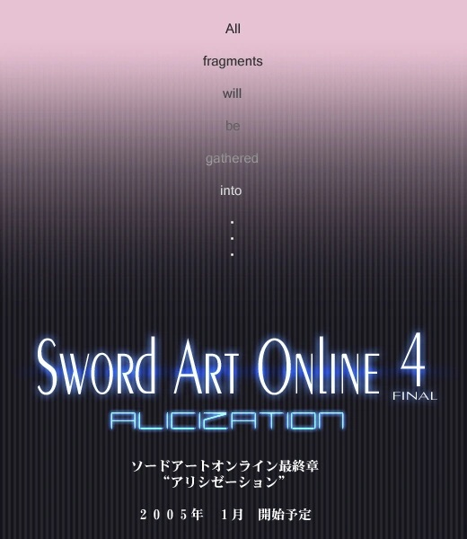

# Sword Art Online 外传4: 绝剑

&emsp;

### an additional epilogue

　　制服的右肩上突然感到了些微的气息，低头一看，上面贴着一枚淡桃色的花瓣。

　　明日奈用左手的指尖小心的拈起花瓣，用手心托着。一尘不染的美丽椭圆形花瓣，仿佛像在讲述什么似的颤抖了一会，接着就被吹来的风卷起，消失在了无数同样在空中飞舞的白点之中。她把双手放回膝上，再次仰望起雾的春空。

　　四月的第一个星期六，下午三点。一周前启程的优纪的告别式刚刚结束了。会场位于保土谷丘陵地带的天主教会，那里被成排的樱花树围绕着，一齐开始散落的花也仿佛在为优纪送行——然而仪式却和「肃静」或是「寂静」这种陈旧的形容词完全不相符。因为虽然优纪的亲戚方的出席者——包括担任丧主的作为姑母的女性在内——只有四人，但以友人名义出席的十几岁、二十几岁的人足有上百。当然，几乎全部都是ALO的玩家。亲戚们大概觉得经历了超过三年的住院生活，基本不会有优纪的熟人来告别吧，接待的时候吃惊得直翻白眼。

　　即使在仪式结束之后，大家也都在教会广大的前庭中三三五五的聚在一起，沉浸在关于《绝剑》的回忆之中。但是明日奈不知为何并不想加入他们，悄悄地溜出来，找到礼拜堂背面的长椅，独自望着天空。

　　优纪已经不在这个世界上了这件事——通过肩膀上的探测器发出欢声笑语、在森之家对着亚丝娜的料理露出满脸笑容的优纪，已经启程去往了遥远的世界，再也不会回来了这件事——不管怎样都无法当做现实理解。泪水总算流干，但在人潮之中、咖啡店的角落、或是阿尔普海姆的风中，总会突然觉得听到了优纪的声音，心脏扑通扑通地狂跳。

　　这段时间，她常常思考生命究竟是什么。

　　所有的生命都只是遗传物质的搬运装置，为了增加、延续自己的复制情报而存在，这种说法几十年前曾在街头巷尾流传。这个观点若是成立的话，在漫长的时间里让优纪痛苦的HIV，人类免疫缺陷病毒就是纯粹的生命本身吧。但是病毒们只顾一个劲的重复着增殖、复制，终于夺去了作为宿主的优纪的生命，同时自己也死绝了。

　　想想看，人类也是在数千年中重复着同样的事情。为了优先自己的利益夺去许多别人的生命，为了保障自己国家的安全要求许多其他国家牺牲。现在仰望天空的话，从相模湾的巨型海上浮动基地起飞，不知去往何方的战斗机编队正在春霞的彼方拖着白色的云。人类也会有一天像病毒一样破坏自己生存着的世界吗？还是说，与其他智慧种族的生存竞争中败北，遭到驱逐呢……？

　　优纪最后留下的话直到现在也回响在耳边。什么也无法创造、无法给予——确实，优纪没有留下自己的DNA，就离开了这个世界。

　　但是，明日奈这样想着，轻轻地触摸制服的丝带。在自己的心底，通过短短一瞬的接触，优纪深深刻下的东西确实存在着。毫不畏惧巨大的困难勇往直前的《绝剑》的英勇之姿、以及她的灵魂本身都在确实地呼吸着。这对今天聚集到这个地方的上百位年轻人们也是同样的吧。即使时间一点点的冲刷着记忆，回忆化为了结晶，也绝对会有东西留下的。

　　那么，生命就不仅仅是四种碱基传递的遗传信息，还具有运送无形记忆、精神与灵魂的功能。若在遥远未来出现一种媒体，不是模因【meme】这种含糊概念，而能纯粹记录精神本身，那或许正是防止人类这种不完全的生命自灭的唯一关键——

　　在那一天到来之前，我要用我的方法把优纪心的姿态传递下去。如果有一天有了孩子，一定会反复说给他听。在现实和虚拟世界的狭缝间，奇迹般耀眼辉煌的一位小小的女孩子的故事。

　　她在心中对自己低语，随后睁开不知不觉闭上的眼睛。

　　这时，一个从前庭转过建筑物的墙角向这边走近的人影映入眼帘。明日奈慌忙用指尖拭去眼角渗出的泪水。

　　是位女性。虽然有一瞬间感到好像在那里见过，但对脸没有记忆。个子略高，在简单的连衣裙外披着披肩。齐肩的直发是深黑色，胸前细细的银链子是唯一的饰品。年龄大约在二十出头的样子。

　　女性径直向明日奈走来，在她面前站住脚步，低头行礼。明日奈也慌忙站起来，低下了头。抬起头时，女性那几乎透明的白皙肌肤耀眼地映入眼帘。但是，血色淡薄的那种白，让明日奈不禁想起自己刚从漫长睡眠中醒来时的模样。再仔细一看，从披肩中露出的脖子和手腕都细得仿佛一碰就会断掉

　　女性无言地盯着明日奈的脸看了一会，枣形的漂亮眼睛变得柔和，嘴角浮起淡淡的微笑。

　　「是明日奈小姐吧。您和那边完全一样，我一下就认出来了。」

　　听到那沉静、圆润的声音的瞬间，明日奈也知道了对方是谁。

　　「啊……难道……」

　　「是的。我是《沉睡骑士》的希安。本名是安熙燕【An Shi-En】。初次见面……好久不见。」

> rkl：这个名字（在拼法上）并不是实际存在的韩国人名，因此川原在文库本中进行了修改。

　　「哪、哪里哪里，初次见面！我是结城明日奈。一周没见了呢。」

　　交换着有些矛盾的招呼，明日奈和安熙燕一起扑哧一声笑了出来。伸出左手请她坐在长椅上，自己也坐在了旁边。

　　这么一来，明日奈总算注意到了一件事。《沉睡骑士》的成员全都是和难治性疾病战斗之身，而且病况还到了需要terminal care——也就是终末期治疗的阶段不是吗？像这样一个人走到屋外没关系吗……？

　　安熙燕敏感地察觉到了明日奈的忧虑，轻轻点了一下头张开了口。

　　「没关系，这个四月总算可以得到外出许可了。另外哥哥也一起来了，不过他在外面等着。」

　　「……那，那个……身体方面，已经……？」

　　「是。……我得的病是急性淋巴白血病【acute lymphoblastic leukemia】……发病已经是三年前的事情了。曾经用化学疗法缓解……啊，缓解是说把身体内的白血病细胞暂时消除——但是去年复发了……。复发之后被告知有效的治疗方法只有骨髓移植……但是家人中没有任何人的白血球型适合……骨髓银行里也找不到愿意捐献的人。已经，从很久以前开始就整理好心情，想着要在剩下的时间里努力活着了，但是……」

　　希安停了一瞬，把视线转向头顶的樱花。旋风卷起无数花瓣，像雪一样吹散。

　　「——复发后，无法进行骨髓移植的场合下，只能靠被称为挽救疗法的多种药物组合来争取缓解。新药、试验药也积极的使用，副作用严重……实在太过辛苦，多少次都想着，已经够了。反正也没有希望，不如切换为让剩下的时间安然度过的治疗，也对医生说过许多次……」

　　明日奈注意到了，在樱吹雪中摇晃的安熙燕的头发，是假发。

　　「但是……每次见到优纪时，就觉得不能消沉。优纪明明和同样的痛苦一直战斗了十五年，比她大许多的我，才三年，有什么好抱怨的。这样说给自己听。——但是，从二月份开始药量一点点的减少了……医生虽说数值在变好，但我认为是那个时刻越来越近了。从抢救性疗法切换为了QoL优先疗法。那当然很恐怖……但同时也松了一口气。因为听说了优纪的状态……觉得和优纪一起的话，去到哪里都可以。不管去到哪里，都可以保护我……。很奇怪吧，这么依赖着比自己小很多的孩子……」

　　「不……我明白。」

　　明日奈简短的插话，点了点头。安熙燕也微笑着点头，继续道。

　　「——然而……一周前，和优纪告别的第二天。医生来到了我的病房……说，完全缓解，也就是白血病细胞完全消失了，已经可以出院了。我当时想着，这是在说什么呢。难道是所谓的……为了和家人一起呆一会儿的暂时回家吗，这样之类的考虑了许多……依旧混乱着，结果过了两天，真的出院了。难道说，病治好了吗，直到昨天才开始这么想。好像是实验药的一种产生了戏剧性的效果，不过……」

　　话停了一瞬，安熙燕的表情好像又哭又笑似的扭曲了。

　　「不知怎的，还完全没有实感。即使本应失去的时间突然回来了，也只是不知所措。而且……优纪……」

　　声音微微颤抖，注意到她眼角渗出了小小泪珠，明日奈的胸口也被堵住了。

　　「明明优纪在等着，却只有我留在这里，可以吗……。明明和优纪、兰【Ran】小姐、克洛维斯【Clovis】、梅丽达【Merida】……约好了要一直在一起，我……我……」

　　接下来的话再也说不出来了。安熙燕低着头，颤抖着肩膀。

　　兰小姐应该就是优纪那位曾任初代公会会长的姐姐吧。后面的两个人也都是已经去世了的《沉睡骑士》的成员吧。在这种世上最险恶的逆境中结成的羁绊，某种意义上来说可能比家人或恋人之间的还要强。明日奈想着「自己到底有资格说什么呢」但还是不能不张开口。

　　伸出左手，包住了放在长椅上的安熙燕的右手。虽然皮包骨头的细细手指，但确实向明日奈的掌心传来了温暖。

　　「我……最近想了。生命是运送、传递心的东西。我在很长时间里，既害怕向别人传达心情，也害怕去了解别人的心情。但是优纪教给了我，这样是不行的。如果不自己主动去接触的话，是什么也无法创造的。我想把从优纪那里得到的强大再传给各种各样的人。把优纪的心，尽可能送到更远的地方。然后……总有一天再和优纪相遇的时候，能把许多的心作为回礼就好了，我是这么想的。」

　　结结巴巴的，明日奈总算把这些都说了出来。虽然觉得想说的连一半都没有放进话语里，但安熙燕低着头慢慢地、深深地点了头，把另一只手也盖在了明日奈的左手上。

　　安熙燕抬起头，她美丽的漆黑瞳孔深处依然湿润，但嘴角确实浮起了微笑。

　　「谢谢你……明日奈小姐。」

　　小声说着，安熙燕突然张开双臂，抱住了明日奈。明日奈也紧紧抱住了她纤细的身体。在耳边，话语继续着。

　　「我们非常感谢明日奈小姐。在她的姐姐——兰小姐去世后，优纪一直代替姐姐鼓励我们，努力支撑大家。而我们也依赖着她……痛苦的时候、快要撑不住的时候，大家都从优纪那里分得力量。可是，虽然现在说这些已经太晚……我其实一直担心优纪。她的心，又该由谁来支撑呢……。优纪总是笑眯眯的，从不露出难受的表情，可那小小的后背背负了太多东西，我总怕有一天会把她的心压断……。就在这时，你出现了。和明日奈小姐在一起时，优纪看起来非常快乐、自然，像一只想起如何飞翔的小鸟。就那样越飞越高，飞到我们伸手够不到的地方去了……」

　　安熙燕的话在这里停了一会儿。明日奈的心中也映出了变成小鸟，在遥远的异世界的空中飞舞的优纪的身影。

　　稍稍拉开身体，安熙燕害羞似的笑了笑。用指尖拭去了泪珠。吸了一口气，用清晰的声音开始说。

　　「——其实不只是我。淳也……虽然得的是难治的癌症，但最近开始使用的药很有效，肿瘤正在变小。我们两个还说，这简直像优纪在说『现在来这边还太早』呢。看来《沉睡骑士》要再次聚齐，还得等很久。」

　　「……是啊。下次可要让我也当正式成员啊。」

　　明日奈和安熙燕互相看着对方的脸，呵呵的对笑了。一起再次仰望带着淡桃色的霞光的天空。轻柔的风从背后吹过，带动了头发，温柔地包裹着两人的肩，想象着振翅高飞的优纪的身影，明日奈慢慢闭上了眼睛。

　　就这样不知过了多少分钟。走近的两个新的脚步声打破了静谧的沉默。把脸转回前方，发现穿着和明日奈同样颜色制服的少年——桐之谷和人，和黑色礼服打扮的仓桥医生走了过来。

　　明日奈和安熙燕同时站起来，点头行礼。同样低下头后，和人看着明日奈说。

　　「原来在这里啊。打扰你们了吗？」

　　「不，没关系。但是……啊？桐人君和仓桥医生认识？」

　　「啊啊……不过是最近才认识的。关于那个通信探测器的事情交换过邮件。」

　　是的，仓桥医生接过话头。

　　「我对那个镜头相当感兴趣呢。讨论了一下那个能不能在医疗用NERDLES技术中活用。」

　　「是这样啊。……那个，这么说来……」

　　明日奈突然想起一件事，向医生问道。

　　「Medicuboid的测试那边，要怎么办呢？要找别人继续吗……？」

　　听到这话，医生放松了表情，大大地点了点头。

　　「啊，不，作为测试得到的数据已经充分过头了。今后要朝向实际的商品化，接下来要做的是和制造商协商。说不定过不了多久，安小姐和其他的人都能使用上Medicuboid了哟……」

　　话的后半是冲着安熙燕说的，但说到这里，仓桥医生突然瞪圆了眼睛慌忙继续道。

　　「不，真是失礼。竟然忘记了应该在一开始就说的事情。——安小姐，衷心祝贺您出院。木绵季君也……不知道会多开心呢……」

　　紧紧握着医生伸出的手，安熙燕大大的点头。接着，和在游戏里已经成了知己的和人握了手。

　　「非常感谢。虽然我好像用不到Medicuboid了……但是，一想到优纪留下的数据能帮助许许多多的和疾病战斗着的人们……我就特别的高兴。」

　　安熙燕这么一说，医生也不停地点头。

　　「真的是这样。——我想作为测试那个机器的第一个人，木绵季君的名字会一直留下来。和初期设计的提供者并列……给她颁个什么厉害的大奖也不为过……」

　　「多半，即使得了那种东西优纪也不会高兴哟。大概会说『又不能拿来当饭吃』。」

　　希安的话让大家都笑了。笑声平息后，明日奈忽然觉得仓桥医生话里有一部分还留在耳边，便重复道：

　　「那个……医生，刚才您说……初期设计的提供者？设计那个的不是医疗机器制造商吗？」

　　「啊啊……这个啊，确实呢。」

　　医生好像潜入记忆的海底似的眯起了眼镜后的眼睛。

　　「当然，开发出试验机本身的是制造商，但机器的核心部分，超高密度信号元件的基础设计是外部提供的。记得好像还是女性……应该是海外大学的研究者。是日本人吧……那个，名字是……」

　　那之后医生说出的姓名，明日奈完全没有听说过，安熙燕好像也一样，但看向桐人的时候，看到他浮起的表情明日奈倒吸了一口气。

　　和人脸色苍白，简直像看到了什么不可思议的事情似的，视线也飘忽不定。嘴唇小小的抽搐了两三次。

　　「怎……怎么了，桐人君？！」

　　明日奈慌忙问道，但和人继续沉默了一会儿。然后，从唇间漏出颤抖的声音。

　　「我……知道，那个人。」

　　「哎……？」

　　「也见过面……那个人是……」

　　和人看了一眼明日奈的眼睛。他黑色的瞳孔仿佛突破了时间空间的壁垒，看进了某个异世界似的。

　　「那个人是负责照顾潜行中的……希斯克利夫身体的人。听说她和他……在同一个研究室，一起研究NERDLES技术……也就是说，Medicuboid基础设计的真正提供者是……」

　　「…………」

　　明日奈也说不出话来。安熙燕和仓桥医生都带着惊讶的表情歪着头，但她什么也无法回答。只能发呆地看着眼前飘过的樱花。

　　突然，明日奈感到了「流」。

　　这个名为现实的世界，说它只是一个相也不为过——。这些世界像无数的花瓣那样聚集而构成的更上位的构造存在着，然后现在，将所有世界包裹、让其翻腾、流动的巨大力量，正慢慢显出身形——

　　明日奈用双手紧紧抱住自己的身体。一阵强风吹过，周围漂浮着的花瓣，全部被带到遥远的空中。

&emsp;

&emsp;

[Previous](saoex4-05.md) [Main](../index.md)
